= Curso de Bootstrap 5
Luis Ramón Álvarez
:lang: es
:doctype: article
:toc: left
:toclevels: 2
:toc-title: Índice
:sectnums:
:sectanchors:
:data-uri:
:webfonts!:
:imagesdir: .
:figure-caption: Figura
:table-caption: Tabla
:example-caption: Ejemplo
:note-caption: Nota
:tip-caption: Consejo
:important-caption: Importante
:warning-caption: Aviso
:caution-caption: Precaución
:last-update-label: Última actualización
:version-label: Versión
:bs-version: 5.3.8
:bs-cdn: https://cdn.jsdelivr.net/npm/bootstrap@{bs-version}/dist

Apuntes del curso práctico de Bootstrap 5.3: maquetación responsive, componentes y personalización del framework.

== Introducción y entorno

Qué es Bootstrap, qué cambia respecto a la versión 4, la unidad `rem` y cómo preparar una plantilla base.

=== ¿Qué es Bootstrap?

Bootstrap es un *framework de front-end* de código abierto, creado en Twitter en 2011, que reúne CSS y JavaScript listos para usar.
Permite maquetar interfaces *responsive* y coherentes aplicando clases en el HTML, sin escribir apenas CSS propio.

Rejilla:: Sistema de 12 columnas basado en flexbox con seis breakpoints, pensado mobile-first.
Utilidades:: Clases de una sola responsabilidad: espaciado, color, flex, bordes, sombras, visibilidad…
Componentes:: Navbar, cards, modales, formularios, carrusel… con estilos y comportamiento incluidos.
Personalización:: Variables CSS `--bs-*` y código fuente en Sass para adaptarlo a cualquier marca.

=== Qué cambia respecto a Bootstrap 4

[cols="1h,2,3",options="header"]
|===
|Aspecto |Bootstrap 4 |Bootstrap 5.3

|jQuery
|Obligatorio para los componentes JS
|*Eliminado*: JavaScript nativo

|Breakpoints
|5 (xs, sm, md, lg, xl)
|6: se añade `xxl` (≥ 1400 px)

|Utilidades
|Conjunto fijo
|Ampliadas y extensibles con la API de utilidades

|Personalización
|Solo con Sass
|Variables CSS `--bs-*` además de Sass

|Modos de color
|No
|Claro y oscuro con `data-bs-theme`

|RTL
|No
|Soporte para idiomas de derecha a izquierda

|Atributos data
|`data-toggle`
|`data-bs-toggle` (prefijo `bs`)

|Internet Explorer
|IE 10 y 11
|Sin soporte
|===

=== La unidad `rem`

*rem* (_root em_) es una unidad relativa al tamaño de letra del elemento *raíz*, es decir, de `<html>`:

----
1rem = el font-size de <html>
----

Es *CSS puro*, no tiene nada que ver con Bootstrap, pero Bootstrap la usa en casi todo, así que conviene entenderla antes de empezar.
Los navegadores usan *16 px* por defecto, así que normalmente:

[cols="1m,1",options="header"]
|===
|rem |px (base 16)
|0.25rem |4 px
|0.5rem |8 px
|1rem |16 px
|1.5rem |24 px
|3rem |48 px
|===

IMPORTANT: *Accesibilidad.* Si cambia el `font-size` de `<html>`, cambia todo lo que esté medido en rem.
Eso ocurre, por ejemplo, cuando alguien aumenta el tamaño de letra en la configuración del navegador porque ve mal: con rem el diseño crece entero, en proporción y sin descuadrarse; con px se queda igual.

==== rem frente a px

Con la base de 16 px, `10rem` = 10 × 16 = *160 px*, y `1.5rem` = 24 px, pero solo mientras la base sea 16 px.
En la demo, los botones simulan la preferencia del navegador cambiando el `font-size` de `<html>`:

[source,javascript]
----
document.documentElement.style.fontSize = '20px'
----

.Con la base de 16 px, las dos barras y los dos textos miden lo mismo
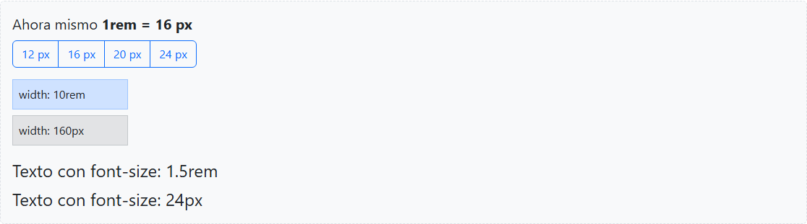

.Con la base de 24 px, lo que está en rem crece y lo que está en px se queda igual
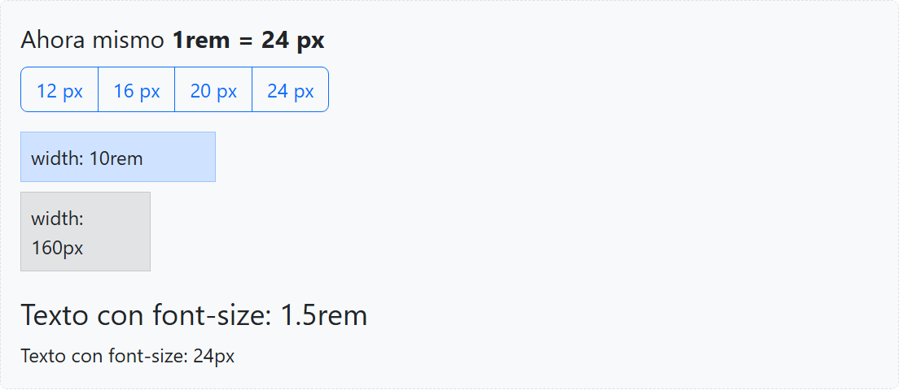

==== rem frente a em

`em` es relativo al tamaño de letra del elemento *padre*, así que al anidar *se acumula*: `1.2em` dentro de `1.2em` dentro de `1.2em` = 1.2 × 1.2 × 1.2 = *1.728* veces la base.
`rem` siempre mira a `<html>`: aunque lo anidemos, `1.2rem` es siempre 1.2 veces la base. Por eso rem es más predecible.

.Tres niveles anidados con `1.2em` y con `1.2rem`
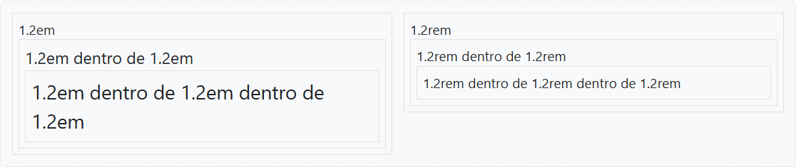

==== Bootstrap usa rem

Los márgenes y rellenos (`m-*`, `p-*`), los gutters y los tamaños de letra de Bootstrap están en rem.
Su escala de espaciado: `1` → 0.25rem (4 px), `2` → 0.5rem (8 px), `3` → 1rem (16 px), `4` → 1.5rem (24 px), `5` → 3rem (48 px).
Al cambiar la base, estas cajas cambian su relleno en proporción al texto: el diseño crece entero, sin descuadrarse.

.De `p-1` a `p-5`
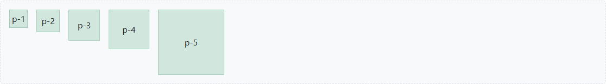

WARNING: *Excepción:* los *breakpoints* (576, 768, 992… px) y los *anchos de los contenedores* (540, 720, 960… px) están en *px*, no en rem.

=== Instalación

==== Opción A: CDN

La más rápida: no requiere instalar nada. Ideal para prototipos y para empezar.

En el `<head>`:

[source,html,subs="attributes+"]
----
<link href="{bs-cdn}/css/bootstrap.min.css" rel="stylesheet">
----

El JavaScript (incluye Popper):

[source,html,subs="attributes+"]
----

----

==== Opción B: npm

Para proyectos reales: control de versiones, Sass y compilación propia.

[source,bash]
----
npm init -y
npm install bootstrap@5.3
----

Los ficheros quedan en `node_modules/bootstrap/`:

* `dist/css/bootstrap.min.css`: CSS compilado.
* `dist/js/bootstrap.bundle.min.js`: JavaScript con Popper.
* `scss/`: código fuente Sass.

==== Opción C: copia local descargada

Se descargan el CSS y el JS compilados desde https://getbootstrap.com/docs/5.3/getting-started/download/[getbootstrap.com], se copian en una carpeta del proyecto (en el curso, `recursos/bootstrap/`) y se enlazan con rutas relativas.
Funciona sin conexión y no depende de un servidor externo, pero las actualizaciones son manuales.

[source,html]
----
<link href="recursos/bootstrap/css/bootstrap.min.css" rel="stylesheet">

----

NOTE: `bootstrap.bundle.min.js` incluye *Popper*, necesario para dropdowns, tooltips y popovers.
`bootstrap.min.js` no lo incluye y habría que cargarlo aparte.

=== Reboot: el punto de partida

Cada navegador trae sus propios estilos por defecto, y no son iguales entre sí.
*Reboot* es la primera parte de `bootstrap.css`: corrige esas diferencias y fija una base común para las etiquetas HTML, *sin necesidad de poner ninguna clase*.
Parte de `normalize.css` y le añade decisiones propias.

Por eso, nada más enlazar `bootstrap.css`, la página cambia de aspecto aunque no tenga ni una clase.

[cols="1m,3",options="header"]
|===
|Elemento |Lo que hace Reboot
|* |`box-sizing: border-box`: el ancho incluye relleno y borde
|html |No le pone `font-size`: `1rem` sigue siendo lo que configura el usuario (ver «La unidad rem»)
|body |`margin: 0`; fuente del sistema; `font-size: 1rem`; `line-height: 1.5`; color y fondo desde `--bs-body-color` y `--bs-body-bg`
|h1 … h6 |`margin-top: 0`, `margin-bottom: .5rem`, `font-weight: 500`, `line-height: 1.2`
|p |`margin-top: 0`, `margin-bottom: 1rem`
|ul, ol |`padding-left: 2rem`, `margin-bottom: 1rem`
|a |Color desde `--bs-link-color`, subrayado
|===

La idea: *los márgenes van solo hacia abajo*.
Así los bloques se apilan de forma predecible y no se suman márgenes de arriba y de abajo.

.Un encabezado, un párrafo y una lista sin ninguna clase
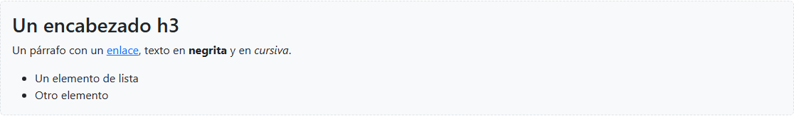

NOTE: La fuente es la del sistema operativo (`system-ui`: Segoe UI en Windows, San Francisco en macOS…).
Carga rápido porque no se descarga nada, y cada usuario ve la letra a la que está acostumbrado.

==== `box-sizing: border-box`

En CSS, por defecto (`content-box`), `width` es solo el contenido: el relleno y el borde se suman.
Con `border-box`, `width` es la caja entera.
Reboot lo pone en todos los elementos, y es lo que permite que una columna de la rejilla mida su porcentaje exacto aunque lleve relleno.

.Dos cajas con `width: 300px; padding: 20px; border: 10px`
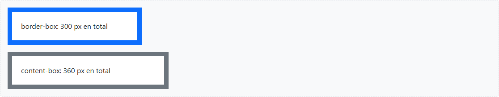

TIP: Para ver lo que hace Reboot, comentamos el `<link>` de Bootstrap y recargamos (en `02_B_Reboot.html` lo hace un botón).
Vuelven la fuente con remates (_serif_), el margen del `body` y los márgenes de arriba de títulos y párrafos.

=== Estructura de una plantilla base

[source,html,subs="attributes+"]
----
<!doctype html> <!--1-->
<html lang="es" data-bs-theme="light"> <!--2-->
<head>
  <meta charset="utf-8"> <!--3-->
  <meta name="viewport" content="width=device-width, initial-scale=1"> <!--4-->
  <title>Mi primera página con Bootstrap</title>
  <link href="{bs-cdn}/css/bootstrap.min.css" rel="stylesheet"> <!--5-->
   <!--6-->
</head>
<body>
  

    <h1>¡Hola, Bootstrap!</h1>
  

</body>
</html>
----
<1> Activa el modo estándar del navegador. Sin él, Bootstrap se ve mal.
<2> `lang`: idioma del documento, importante para accesibilidad. `data-bs-theme`: modo de color de toda la página.
<3> Codificación de caracteres. Debe ir la primera para que tildes y eñes se lean bien.
<4> Meta viewport: imprescindible para que el diseño responsive funcione en móviles.
<5> CSS en el `<head>`: evita que la página se pinte sin estilos.
<6> JavaScript en el `<head>` con `defer`: se descarga en paralelo sin bloquear el pintado y se ejecuta con el DOM completo.

==== ¿Script en el `<head>` o al final del `<body>`?

Un `

----

=== El elemento `<meta>`

`<meta>` es el elemento de *metadatos*: información sobre el documento que no se muestra en la página y que leen el navegador, los buscadores o las redes sociales.

* Va siempre dentro del `<head>`.
* Es un *elemento vacío* (_void element_): no tiene contenido ni etiqueta de cierre.
* Cada `<meta>` es una pareja nombre-valor expresada con atributos.

[cols="1m,2,3m",options="header"]
|===
|Atributo |Para qué |Ejemplo

|charset
|Codificación del documento
|<meta charset="utf-8">

|name + content
|Metadato con nombre
|<meta name="viewport" content="...">

|http-equiv + content
|Simula una cabecera HTTP
|<meta http-equiv="refresh" content="5">

|property + content
|Open Graph (redes sociales)
|<meta property="og:title" content="...">
|===

Otros `<meta name="...">` habituales: `description`, `author`, `robots` y `theme-color`.

=== La meta viewport

El *viewport* es el área visible donde el navegador pinta la página.

Cuando aparecieron los smartphones, casi todas las webs estaban pensadas para escritorio.
Para que no se vieran rotas, los navegadores móviles simulan un viewport de unos *980 px*: pintan la página a ese tamaño y luego la reducen para que quepa en la pantalla.
Todo se ve diminuto y los breakpoints de Bootstrap *creen que están en un escritorio*: 980 px es `md`, así que se activa `md` en lugar de `xs`.

[source,html]
----
<meta name="viewport" content="width=device-width, initial-scale=1">
----

`width=device-width`:: El ancho de la página es el del dispositivo en *píxeles CSS*, no físicos. Un iPhone de 1170 píxeles físicos con densidad ×3 mide 390 px CSS.
`initial-scale=1`:: Zoom inicial al 100 %.

IMPORTANT: La meta *no hace la página responsive*: solo hace que el navegador diga la verdad sobre su ancho, para que las media queries de Bootstrap puedan funcionar.

.La misma página en un iPhone emulado
[cols="1a,1a",options="header",frame=none,grid=none]
|===
|Sin meta viewport: 980 px, breakpoint `md` |Con meta viewport: 390 px, breakpoint `xs`

|image::01_viewport_sin_meta.png[Página reducida a 980 px de ancho]
|image::01_viewport_con_meta.png[Página adaptada a 390 px de ancho]
|===

Sin la meta, el diseño de escritorio se reduce hasta hacerse ilegible. Con ella, la página usa el ancho real y se activa el diseño móvil.

TIP: Para probarlo en las herramientas de desarrollo (F12 → modo dispositivo), el emulador debe estar como dispositivo *móvil*.
En Chrome y Edge, en modo «Responsive» con tipo «Desktop» no se aplica la reducción: la página se maqueta a 980 px pero aparece a tamaño normal con scroll horizontal.
Basta con elegir un modelo concreto (por ejemplo, «iPhone 12 Pro»).

=== Modos de color con `data-bs-theme`

Desde la versión 5.3, el atributo `data-bs-theme` fija el modo de color: `light` (por defecto) o `dark`.
Bootstrap redefine sus variables CSS (`--bs-body-bg`, `--bs-body-color`, `--bs-border-color`…) para ese modo, y todos los componentes que las usan cambian de color a la vez, *sin tocar ninguna clase*.
Si quitamos el atributo, la página es clara: `light` es el valor por defecto.

En `<html>`:: Afecta a toda la página.
En un elemento concreto:: Solo cambia esa zona.

[source,html]
----
<html lang="es" data-bs-theme="dark">
...

…

----

También funciona al revés: con la página en oscuro, `data-bs-theme="light"` en un elemento deja esa zona clara.

==== Cambiar el modo con JavaScript

Basta con modificar el atributo del elemento `<html>`.
`document` es la raíz del árbol DOM, pero no es una etiqueta HTML; `document.documentElement` sí: es la etiqueta `<html>`.

[source,javascript]
----
document.documentElement.setAttribute('data-bs-theme', 'dark')
document.documentElement.removeAttribute('data-bs-theme')
----

.La misma sección en modo claro y en modo oscuro
image::01_tema_claro.png[Sección en modo claro]

image::01_tema_oscuro.png[Sección en modo oscuro]

La card del centro tiene su propio `data-bs-theme="dark"`, por eso es oscura en los dos casos.
La de la derecha tiene `data-bs-theme="light"` y sigue clara aunque la página esté en oscuro.

==== Cómo funciona por dentro

Es CSS normal: *variables CSS* declaradas en `:root`, leídas con `var()`, y *selectores de atributo* que aplican unas u otras según el valor del atributo.
Lo vemos primero con un atributo inventado, `modo`, como en `04_Data_bs_theme.html`:

[source,css]
----
:root {
  --color-modo1: lightGreen;
  --color-modo2: darkGreen;
  --estilo-texto-modo1: uppercase;
  --estilo-texto-modo2: capitalize;
}
[modo=modo1] {
  color: var(--color-modo1);
  text-transform: var(--estilo-texto-modo1);
}
[modo=modo2] {
  color: var(--color-modo2);
  text-transform: var(--estilo-texto-modo2);
}
----

[source,html]
----
<b>modo 1</b>
<b>modo 2</b>

  <b>modo 1</b>

<b>modo</b>
----

.Los cuatro `` con el atributo `modo`
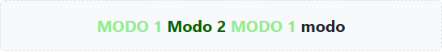

El `` interior del tercer ejemplo no tiene atributo, pero *hereda* el color y el `text-transform` de su padre; el último no tiene ningún antepasado con `modo` y se queda con los estilos normales.
Bootstrap hace lo mismo con `data-bs-theme` (simplificado):

[source,css]
----
:root, [data-bs-theme=light] {
  --bs-body-bg: #fff;
  --bs-body-color: #212529;
  --bs-border-color: #dee2e6;
}
[data-bs-theme=dark] {
  --bs-body-bg: #212529;
  --bs-body-color: #dee2e6;
  --bs-border-color: #495057;
}
body {
  background-color: var(--bs-body-bg);
  color: var(--bs-body-color);
}
----

Como las variables CSS se heredan, un `data-bs-theme` en un elemento concreto redefine las variables para él y sus descendientes: por eso funciona tanto en `<html>` como en una sola card.

=== Práctica: la primera plantilla

. Crear una carpeta de proyecto y abrirla en VS Code.
. Crear un fichero `index.html` con la plantilla base.
. Abrirlo en el navegador y comprobar en F12 → Red que se cargan el CSS y el JS de Bootstrap.
. Comentar el `<link>` del CSS, recargar y comparar: lo que cambia es Reboot.
. Añadir un párrafo con la clase `lead` y un botón con `class="btn btn-primary"`.
. Cambiar `data-bs-theme` a `dark` y observar qué cambia.
. _Opcional:_ instalar Bootstrap con npm, o descargar la copia local, y enlazar esos ficheros en lugar del CDN.

== Contenedores y breakpoints

Dónde empieza y acaba el contenido, en qué anchos cambia el diseño y por qué se piensa primero en el móvil.

=== ¿Qué es un contenedor?

El contenedor es el *elemento de maquetación más básico* de Bootstrap: una caja que envuelve el contenido, lo *centra* horizontalmente, le da un *ancho máximo* según el tamaño de pantalla y le añade un *relleno lateral* para que el texto no toque los bordes.

[source,html]
----
<body>
  

    <!-- todo el contenido aquí -->
  

</body>
----

Centrado:: `margin-left: auto; margin-right: auto`.
Ancho máximo:: `max-width` distinto en cada breakpoint.
Relleno lateral:: `0.75rem` por lado (la mitad del gutter de 1.5rem).
Imprescindible para la rejilla:: Las `.row` tienen márgenes negativos que el relleno del contenedor compensa.

NOTE: Los contenedores se pueden anidar, pero casi nunca hace falta.
Lo habitual es uno por sección (cabecera, contenido, pie) o uno solo para toda la página.

=== Los seis breakpoints

Un *breakpoint* (punto de ruptura) es un ancho de viewport a partir del cual el diseño puede cambiar.
Bootstrap 5 define seis, y cada uno tiene un *infijo* que aparece en el nombre de las clases (`col-**md**-6`, `d-**lg**-none`, `container-**xl**`…).

[cols="2h,1,1,2,2",options="header"]
|===
|Breakpoint |Infijo |Desde |Dispositivo típico |Ancho de `.container`

|Extra small |_ninguno_ |0 px |Móvil vertical |100 %
|Small |`sm` |576 px |Móvil horizontal |540 px
|Medium |`md` |768 px |Tablet |720 px
|Large |`lg` |992 px |Portátil |960 px
|Extra large |`xl` |1200 px |Escritorio |1140 px
|Extra extra large |`xxl` |1400 px |Pantalla grande |1320 px
|===

WARNING: *xs no tiene infijo.* No existe `col-xs-6` (sí existía en Bootstrap 3). Una clase sin infijo, como `col-6`, se aplica desde 0 px.

NOTE: *xxl es nuevo en Bootstrap 5.* Bootstrap 4 solo llegaba hasta xl (1200 px).

Los breakpoints se definen en Sass (mapa `$grid-breakpoints`), así que se pueden cambiar al compilar Bootstrap.
Desde la 5.3 también están expuestos como variables CSS (`--bs-breakpoint-md`, etc.), aunque solo como información: las variables CSS no funcionan dentro de una media query.

==== Indicador del breakpoint activo solo con CSS

En `05_Containers.html` el breakpoint activo se muestra sin JavaScript: seis badges, y cada uno solo se ve en su tramo de anchos gracias a las clases de visibilidad responsive (se ven a fondo en el capítulo de flexbox y utilidades).
Cada badge parte oculto con `d-none`, aparece en su breakpoint con `d-{bp}-inline` y vuelve a ocultarse en el siguiente con `d-{bp+1}-none`.
El de xs es al revés: visible de partida (`d-inline`) y oculto desde sm.

[source,html]
----
xs (&lt; 576 px)
sm (≥ 576 px)
md (≥ 768 px)
lg (≥ 992 px)
xl (≥ 1200 px)
xxl (≥ 1400 px)
----

.xs: ventana de 400 px
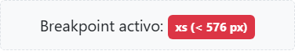

.md: ventana de 800 px
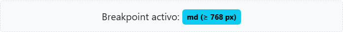

.xl: ventana de 1250 px
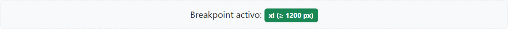

=== Tipos de contenedor

`.container`:: Ancho fijo que salta en cada breakpoint. Al 100 % solo en móvil (xs). El más habitual.
`.container-fluid`:: Siempre al 100 % del ancho. Para paneles, dashboards o bandas a ancho completo.
`.container-{breakpoint}`:: Al 100 % *hasta* ese breakpoint; a partir de él se comporta como `.container`.

.Ancho de cada contenedor según el breakpoint (px)
[cols="2m,1,1,1,1,1,1",options="header"]
|===
|Clase |xs (< 576) |sm (≥ 576) |md (≥ 768) |lg (≥ 992) |xl (≥ 1200) |xxl (≥ 1400)

|.container |*100 %* |540 |720 |960 |1140 |1320
|.container-sm |*100 %* |540 |720 |960 |1140 |1320
|.container-md |*100 %* |*100 %* |720 |960 |1140 |1320
|.container-lg |*100 %* |*100 %* |*100 %* |960 |1140 |1320
|.container-xl |*100 %* |*100 %* |*100 %* |*100 %* |1140 |1320
|.container-xxl |*100 %* |*100 %* |*100 %* |*100 %* |*100 %* |1320
|.container-fluid |*100 %* |*100 %* |*100 %* |*100 %* |*100 %* |*100 %*
|===

Los anchos fijos son `max-width` en píxeles. `.container` y `.container-sm` se comportan igual.

==== Ejemplo resuelto: ventana de 862 px

El breakpoint es el ancho de la *ventana*; el contenedor es algo más estrecho para que siempre quede margen a los lados.

. Con la ventana a *862 px* estamos en `md` (≥ 768 y < 992).
. `.container` mide *720 px*, así que quedan (862 − 720) / 2 = *71 px* a cada lado.
. El ancho incluye el relleno (`box-sizing: border-box`): el contenido útil es 720 − 2 × 12 = *696 px*.

.Ventana de 862 px: margen en gris, contenedor en azul y relleno en amarillo
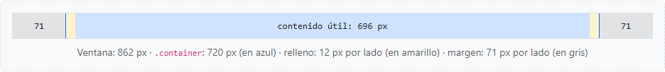

=== Los contenedores en cada breakpoint

En las capturas, cada banda punteada ocupa todo el ancho de la ventana y la zona coloreada es el contenedor.
Se ve en qué breakpoint deja cada uno de estar al 100 %.

.xs: ventana de 400 px
image::02_contenedores_xs.png[Contenedores a 400 px]

.sm: ventana de 600 px
image::02_contenedores_sm.png[Contenedores a 600 px]

.md: ventana de 800 px
image::02_contenedores_md.png[Contenedores a 800 px]

.lg: ventana de 1000 px
image::02_contenedores_lg.png[Contenedores a 1000 px]

.xl: ventana de 1250 px
image::02_contenedores_xl.png[Contenedores a 1250 px]

.xxl: ventana de 1450 px
image::02_contenedores_xxl.png[Contenedores a 1450 px]

=== El enfoque mobile-first

Bootstrap se diseña *primero para el móvil* y luego se va ampliando para pantallas mayores.
Técnicamente significa que sus media queries usan `min-width`: una clase con infijo se aplica *desde ese breakpoint hacia arriba*, nunca hacia abajo.

Lo que hace Bootstrap por dentro (simplificado):

[source,css]
----
/* Sin infijo: desde 0 px (móvil) */
.text-center { text-align: center; }

/* md: desde 768 px hacia arriba */
@media (min-width: 768px) {
  .text-md-start { text-align: left; }
}
----

Cómo se usa en el HTML:

[source,html]
----

  Centrado en móvil, a la izquierda desde tablet

  Ancho completo → mitad → tercio

----

==== Cómo se lee una lista de clases responsive

. La clase *sin infijo* es el estilo base: el del móvil.
. Cada clase con infijo *sobrescribe* la anterior a partir de su breakpoint.
. Si un breakpoint no tiene clase, *hereda* la del breakpoint inferior más cercano.

El mismo párrafo con `text-center text-md-start text-xl-end` en tres anchos de ventana:

.xs (400 px): centrado
image::02_mobile_first_xs.png[Texto centrado]

.md (800 px): a la izquierda
image::02_mobile_first_md.png[Texto alineado a la izquierda]

.xl (1250 px): a la derecha
image::02_mobile_first_xl.png[Texto alineado a la derecha]

TIP: *Por qué mobile-first:* el móvil es la pantalla más limitada y hoy la más usada.
Partir de lo sencillo y añadir complejidad es más fácil que recortar un diseño de escritorio.

NOTE: *¿Y hacia abajo?* En Sass existe `media-breakpoint-down(md)`, que genera `max-width: 767.98px`.
Los `.98` evitan que dos media queries coincidan en el mismo píxel.

=== Práctica: contenedores y breakpoints

. Crear una página con tres bloques: cabecera con `.container-fluid`, contenido con `.container` y pie con `.container-lg`, cada uno con un color de fondo distinto.
. Redimensionar la ventana y anotar en qué anchos cambia cada bloque.
. Añadir un título con `text-center text-lg-start` y comprobar en qué breakpoint cambia la alineación.
. Mostrar un mensaje solo en móvil con `d-md-none` y otro solo desde tablet con `d-none d-md-block`.

== Flexbox y utilidades

Las utilidades son clases de Bootstrap que aplican *una sola propiedad CSS*.
Este capítulo cubre las de espaciado, que separan unos elementos de otros, y las de flexbox, que los colocan, reparten el espacio y los alinean.
Después vienen las de tamaños, bordes, sombras y visibilidad responsive, que siguen la misma idea: una clase, una propiedad CSS.

=== Cómo se forma el nombre

El nombre tiene tres partes, siempre en este orden: *qué*, *dónde* y *cuánto*.

----
{qué}{dónde}-{cuánto}        p  y  - 2   →   py-2
----

[cols="1m,3",options="header"]
|===
|Qué |Significado
|p |`padding`: relleno, espacio por *dentro* del borde
|m |`margin`: margen, espacio por *fuera* del borde
|===

[cols="1m,2,2,3m",options="header"]
|===
|Dónde |Viene de |Significa |CSS equivalente (con `p`)
|t |**t**op |arriba |padding-top
|b |**b**ottom |abajo |padding-bottom
|s |**s**tart |donde empieza el texto (izquierda en español) |padding-left
|e |**e**nd |donde acaba el texto (derecha en español) |padding-right
|x |eje X |izquierda y derecha |padding-left + padding-right
|y |eje Y |arriba y abajo |padding-top + padding-bottom
|_(nada)_ | |los cuatro lados |padding
|===

`x` e `y` son los ejes de una gráfica: `x` el horizontal, `y` el vertical.

[cols="1m,2m,1",options="header"]
|===
|Cuánto |Valor |Con base de 16 px
|0 |0 |0
|1 |0.25rem |4 px
|2 |0.5rem |8 px
|3 |1rem |16 px
|4 |1.5rem |24 px
|5 |3rem |48 px
|auto |auto |solo para `margin`
|===

Todos los valores van en `rem`: si cambia el tamaño de letra base del navegador, el espaciado crece en proporción al texto.

Algunos ejemplos y su CSS equivalente:

[cols="1m,3m",options="header"]
|===
|Bootstrap |CSS normal
|p-3 |padding: 1rem;
|py-2 |padding-top: 0.5rem; padding-bottom: 0.5rem;
|px-5 |padding-left: 3rem; padding-right: 3rem;
|mt-5 |margin-top: 3rem;
|mb-3 |margin-bottom: 1rem;
|mx-auto |margin-left: auto; margin-right: auto;
|ms-auto |margin-left: auto;
|===

NOTE: Bootstrap declara estas utilidades con `!important`, para que ganen siempre a cualquier otra regla.
Los equivalentes de la tabla lo omiten.

WARNING: En Bootstrap 4 los lados eran `l` (_left_) y `r` (_right_): `pl-3`, `ml-auto`, `mr-2`.
En Bootstrap 5 ya no existen; ahora son `ps-3`, `ms-auto`, `me-2`.
Los ejemplos de Internet con `ml-auto` o `pr-3` son de Bootstrap 4.

En las capturas siguientes, la caja exterior es gris y el gris que asoma alrededor es el espaciado.
La caja de contenido va en verde si el espaciado lo pone una clase de Bootstrap y en azul si lo pone CSS normal.

=== La escala

Del 0 al 5. No es lineal: los saltos crecen (4, 8, 16, 24 y 48 px).

.De `p-0` a `p-5`
image::03_espaciado_escala.png[Escala de relleno de p-0 a p-5]

=== Los lados

La letra del medio dice dónde se aplica. `x` e `y` ahorran escribir dos propiedades.

.`py-2`, `px-5`, `pt-4` y `ps-5`, cada una con su equivalente en CSS
image::03_espaciado_lados.png[Relleno en cada lado]

=== Margin

El margen es espacio por *fuera* del borde.
Para verlo, la caja de contenido va dentro de una caja gris: el gris que asoma alrededor es el margen.

.`m-3` y `mx-5`
image::03_espaciado_margin.png[Márgenes]

=== Margin auto

Con un ancho fijo, el margen automático reparte el espacio sobrante:

* Sin `auto`: la caja se queda a la izquierda y el espacio sobrante queda a su derecha.
* `margin-right: auto`: todo el margen a la derecha, así que la caja queda *igual*, a la izquierda.
* `mx-auto`: el mismo margen a los dos lados, así que la caja queda *centrada*.
* `ms-auto`: todo el margen a la izquierda, así que la caja se va a la *derecha*.

Es la forma clásica de centrar un bloque.
Sin ancho no hace nada visible: un `div` ya ocupa todo el ancho y no sobra espacio que repartir.

.Sin `auto`, `margin-right: auto`, `mx-auto` y `ms-auto` en una caja de 150 px
image::03_espaciado_margin_auto.png[Margin auto]

=== Start y end: por qué no se llaman left y right

`s` y `e` no significan izquierda y derecha, sino *donde empieza* y *donde acaba* el texto.
En español empieza a la izquierda, pero en árabe, hebreo, persa o urdu se escribe de derecha a izquierda y empieza a la derecha.

==== El atributo `dir`

El sentido de escritura se indica en el HTML con el atributo `dir`, normalmente una sola vez en `<html>`:

[source,html]
----
<html lang="ar" dir="rtl">
----

El navegador ordena por sí solo las letras árabes o hebreas dentro de una palabra, pero sin `dir="rtl"` la maquetación sigue siendo de izquierda a derecha:

* el texto queda alineado a la izquierda;
* los elementos de una línea se colocan de izquierda a derecha;
* `start` y `end` siguen significando izquierda y derecha.

`dir` se hereda, así que también puede ponerse en un único elemento.
Con `dir="auto"` el navegador decide según el primer carácter del texto, lo que resulta útil para contenido que escribe el usuario.

==== Propiedades lógicas de CSS

CSS tiene propiedades *lógicas* que dicen «al principio» o «al final» en lugar de «a la izquierda» o «a la derecha».
El navegador las traduce a un lado concreto según el `dir` del elemento:

[cols="2m,2m,2m",options="header"]
|===
|Propiedad lógica |Con `dir="ltr"` |Con `dir="rtl"`
|margin-inline-start |margin-left |margin-right
|margin-inline-end |margin-right |margin-left
|padding-inline-start |padding-left |padding-right
|padding-inline-end |padding-right |padding-left
|===

==== Ejemplo: un botón con una lupa

Un botón con una lupa delante del texto. Queremos separación *entre* la lupa y el texto, así que le ponemos a la lupa un margen al final.
En árabe la lupa aparece siempre a la derecha, porque ahí empieza el texto.
Lo que hay que mirar es el *hueco*: si queda entre la lupa y el texto, está bien; si la lupa se pega al texto, el margen se ha ido al lado de fuera.

[source,html]
----
<button dir="rtl">🔍بحث</button>
----

(بحث significa «buscar» en árabe.)

.La misma lupa en español y en árabe con `margin-inline-end`, `margin-right` y `me-3`
image::03_espaciado_start_end.png[Botones con lupa en español y en árabe]

* `margin-inline-end`: hueco correcto en los dos idiomas.
* `margin-right`: en árabe la lupa se pega al texto.
* `me-3`: con `bootstrap.min.css` se comporta igual que `margin-right`.
* Texto árabe primero, lupa después, `margin-right` y sin `dir`: un apaño, lo que *no* hay que hacer.

WARNING: La última fila «parece» correcta, pero es una chapuza: cambiamos el orden del HTML para imitar el resultado.
El texto sigue alineado a la izquierda y el diseño deja de servir en cuanto el idioma cambia.
La solución es `dir="rtl"` más propiedades lógicas o la hoja RTL de Bootstrap.

==== Las dos hojas de estilos de Bootstrap

`me-3` no se adapta sola porque Bootstrap no usa propiedades lógicas en sus utilidades. Trae *dos hojas de estilos*:

[cols="2m,3m",options="header"]
|===
|Fichero |Regla
|bootstrap.min.css |.me-3 { margin-right: 1rem !important; }
|bootstrap.rtl.min.css |.me-3 { margin-left: 1rem !important; }
|===

Los nombres de las clases son los mismos en las dos.
Para una web en árabe se carga la versión rtl y se pone `<html dir="rtl">`: el HTML no cambia, solo la hoja de estilos.
Por eso las clases se llaman _start_ y _end_ y no _left_ y _right_.

IMPORTANT: Una web de derecha a izquierda con Bootstrap necesita las dos cosas:
`dir="rtl"` en `<html>`, para que el navegador coloque el texto y los elementos, y `bootstrap.rtl.min.css`, para que las clases de espaciado vayan al lado correcto.

=== Espaciado responsive

Igual que en los contenedores, se puede añadir un breakpoint en medio del nombre:

----
{qué}{dónde}-{breakpoint}-{cuánto}     p-md-5
----

Es mobile-first: `p-2 p-md-5` aplica `p-2` en móvil y, a partir de md (768 px), `p-5`.
En CSS normal no basta con un `style=""`: hace falta una media query.

[source,css]
----
.relleno-responsive {
  padding: 0.5rem;
}

@media (min-width: 768px) {
  .relleno-responsive {
    padding: 3rem;
  }
}
----

.xs: `p-2`
image::03_espaciado_responsive_xs.png[Espaciado responsive en xs]

.md: `p-5`
image::03_espaciado_responsive_md.png[Espaciado responsive en md]

=== Flexbox: contenedor, ejes y dirección

Flexbox es CSS puro: coloca elementos en fila o en columna, reparte el espacio entre ellos y los alinea.
Bootstrap solo le pone clases.
La propia rejilla está hecha con flexbox: `.row` es un contenedor flex.

Siempre hay *dos niveles*:

* *Contenedor flex*: el elemento con `d-flex` (`display: flex`).
* *Elementos flex*: sus hijos directos, que pasan a colocarse en fila.

Y *dos ejes*:

* *Eje principal*: la dirección en la que se colocan los elementos (en fila, el horizontal). Lo controla `justify-content`.
* *Eje cruzado*: el perpendicular (en fila, el vertical). Lo controla `align-items`.

Si la dirección cambia a columna, los ejes se intercambian.

[cols="2m,2m,3",options="header"]
|===
|Bootstrap |CSS |Efecto
|d-flex |display: flex |Los hijos se colocan uno al lado del otro
|d-inline-flex |display: inline-flex |Igual, pero el contenedor solo ocupa lo que su contenido
|flex-row |flex-direction: row |En fila (por defecto)
|flex-column |flex-direction: column |En columna: los ejes se intercambian
|flex-row-reverse |flex-direction: row-reverse |Fila con el orden visual invertido
|flex-column-reverse |flex-direction: column-reverse |Columna con el orden visual invertido
|===

.Sin `d-flex`, con `d-flex` y con `flex-row-reverse`
image::03_flex_contenedor.png[Contenedor flex]

==== `flex-column` frente al flujo normal

Sin flex, los `div` ya se apilan porque son de bloque, pero los `span` son elementos en línea y se quedan uno al lado del otro.
Con `flex-column` todos los hijos pasan a ser elementos flex y se apilan, sean del tipo que sean.

.Dos `div` y tres `span` sin `d-flex` y con `d-flex flex-column`
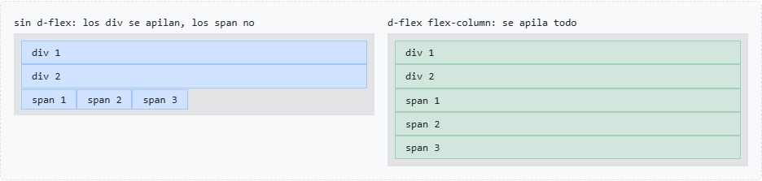

=== Reparto en el eje principal: `justify-content-*`

Decide qué se hace con el espacio que sobra en la fila.

[cols="2m,2m,3",options="header"]
|===
|Bootstrap |CSS |Efecto
|justify-content-start |justify-content: flex-start |Todo al principio (por defecto)
|justify-content-end |justify-content: flex-end |Todo al final
|justify-content-center |justify-content: center |Todo en el centro
|justify-content-between |justify-content: space-between |Primero y último pegados a los bordes, el resto repartido
|justify-content-around |justify-content: space-around |El mismo espacio alrededor de cada uno (en los bordes, la mitad)
|justify-content-evenly |justify-content: space-evenly |Todos los huecos iguales, también los de los bordes
|===

.Los seis valores de `justify-content`
image::03_flex_justify.png[justify-content]

=== Alineación en el eje cruzado: `align-items-*`

En fila, el eje cruzado es el vertical: para que se note, el contenedor necesita más altura que sus elementos.
Bootstrap no tiene clases para una altura concreta, así que en los ejemplos el contenedor lleva un `style="height: 7rem"`.

[cols="2m,2m,3",options="header"]
|===
|Bootstrap |CSS |Efecto
|align-items-stretch |align-items: stretch |Estirados a toda la altura (por defecto)
|align-items-start |align-items: flex-start |Arriba
|align-items-center |align-items: center |Centrados en vertical
|align-items-end |align-items: flex-end |Abajo
|align-items-baseline |align-items: baseline |Alineados por la línea base del texto
|===

.Los valores de `align-items` y el centrado en las dos direcciones
image::03_flex_align.png[align-items]

TIP: `justify-content-center align-items-center` centra un elemento en las dos direcciones.
Es la forma más sencilla de centrar algo en CSS.

=== Hueco y salto de línea: `gap-*` y `flex-wrap`

`gap-*` separa los elementos entre sí, pero no de los bordes del contenedor.
Usa la escala del espaciado (`gap-3` = `gap: 1rem`) y es mejor que poner margen a cada elemento: no deja hueco sobrante al final.
También existen `row-gap-*` y `column-gap-*` para separar en una sola dirección.

Por defecto (`flex-nowrap`) todos los elementos se quedan en la misma línea aunque no quepan: se encogen o se salen del contenedor.
Con `flex-wrap` (`flex-wrap: wrap`) los que no caben bajan a la línea siguiente.
`.row` lleva `flex-wrap`: por eso las columnas que no caben bajan de línea.

.`gap-3` y `flex-wrap`
image::03_flex_gap_wrap.png[gap y flex-wrap]

==== Sin wrap, lo que no cabe se sale

Siete elementos de 150 px con `flex-shrink-0` para que no se encojan: sin `flex-wrap`, cuando no caben (en cualquier ancho por debajo de xxl) se salen del contenedor y provocan scroll horizontal.
En la captura, la caja de la demo hace scroll para no desbordar la página; en una página real, el que hace scroll es toda la página.

.`d-flex gap-2` con siete elementos de 150 px y `flex-shrink-0`
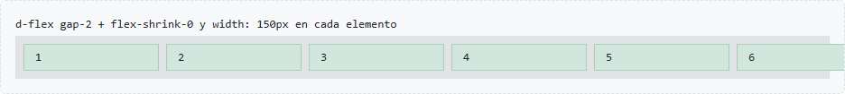

=== Clases para un elemento

Las clases anteriores van en el contenedor; estas van en un elemento concreto.

[cols="2m,2m,3",options="header"]
|===
|Bootstrap |CSS |Efecto
|flex-grow-0 |flex-grow: 0 |No crece (valor por defecto)
|flex-grow-1 |flex-grow: 1 |El elemento se queda con el espacio sobrante
|flex-shrink-0 |flex-shrink: 0 |El elemento no se encoge aunque falte sitio
|ms-auto |margin-left: auto |Empuja el elemento y los siguientes hasta el final
|me-auto |margin-right: auto |Empuja hasta el final a los que le *siguen*
|align-self-* |align-self |Alinea solo ese elemento en el eje cruzado
|order-* |order |Cambia su posición visual
|===

.`flex-grow-1`, `align-self-end`, `ms-auto` y `me-auto`
image::03_flex_elementos.png[Clases para un elemento]

NOTE: `ms-auto` dentro de un contenedor flex es el truco típico de las barras de navegación: logo a la izquierda y enlaces a la derecha, sin `justify-content`.
`me-auto` hace lo contrario: el margen va a la derecha del elemento y empuja hasta el final a los que le siguen.
`me-auto` en el 2 y `ms-auto` en el 3 dan el mismo resultado: el 1 y el 2 a un lado, el 3 y el 4 al otro.

==== Los valores de `flex-grow`

El número es la parte del espacio *sobrante* que se lleva cada elemento: primero cada uno ocupa lo que pide su contenido y lo que sobra se reparte según los números.

* `0` es el valor por defecto: el elemento no crece.
* Si crecen dos con `1`, se reparten el sobrante a partes iguales.
* Bootstrap solo trae `flex-grow-0` y `flex-grow-1`; para otras proporciones hace falta CSS propio. Con 1 y 2 el sobrante se divide en tres partes: una para el 2 y dos para el 3.

----
Contenedor de 600 px, cada caja pide 100 px, sobran 300 px:
  0, 0, 0 → |[ 1 ][ 2 ][ 3 ]                              |
  0, 1, 1 → |[ 1 ][      2 (+150)     ][      3 (+150)    ]|
  0, 1, 2 → |[ 1 ][   2 (+100)   ][         3 (+200)      ]|
----

.`flex-grow-0` en todos, `flex-grow-1` en dos y `flex-grow: 1` / `flex-grow: 2` con CSS propio
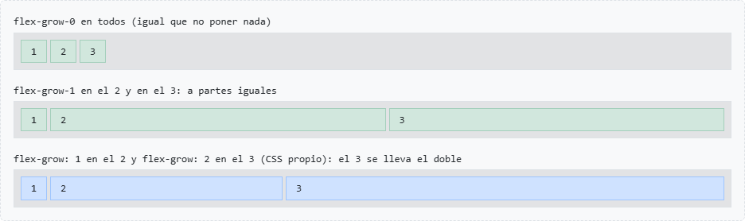

=== Flexbox responsive

Casi todas las clases admiten breakpoint: `d-md-flex`, `flex-md-row`, `justify-content-lg-between`…
Caso típico: en columna en móvil y en fila a partir de md.

[source,html]
----

…

----

[source,css]
----
.fila-responsive {
  display: flex;
  flex-direction: column;
}

@media (min-width: 768px) {
  .fila-responsive {
    flex-direction: row;
  }
}
----

.xs: en columna
image::03_flex_responsive_xs.png[Flexbox responsive en xs]

.md: en fila
image::03_flex_responsive_md.png[Flexbox responsive en md]

=== Tamaños: `w-*`, `h-*`, `mw-100` y `vh-100`

Más utilidades de una sola propiedad, como las de espaciado. Ninguna depende de la rejilla: se pueden poner en cualquier elemento.
Los porcentajes son del *padre*, no de la pantalla.

[cols="2m,2m,3",options="header"]
|===
|Bootstrap |CSS |Nota
|w-25 / w-50 / w-75 / w-100 |width: 25% … 100% |Solo estos valores; otro ancho (300 px, 20rem…) necesita CSS propio
|w-auto |width: auto |
|h-25 … h-100, h-auto |height: 25% … |No hace nada si el padre no tiene una altura definida
|mw-100 |max-width: 100% |Puede medir menos que el padre, nunca más
|mh-100 |max-height: 100% |
|vh-100 |height: 100vh |Exactamente el alto de la pantalla
|min-vh-100 |min-height: 100vh |Como mínimo la pantalla; si el contenido es más largo, crece
|vw-100 |width: 100vw |
|===

==== Ancho y alto

`h-50` es el 50 % del alto del padre: si el padre mide «lo que mida su contenido», el porcentaje no se puede calcular y la clase no hace nada.
Por eso en el ejemplo el padre lleva `height: 8rem`.

.`w-*` y `h-*`, con su equivalente en CSS en azul
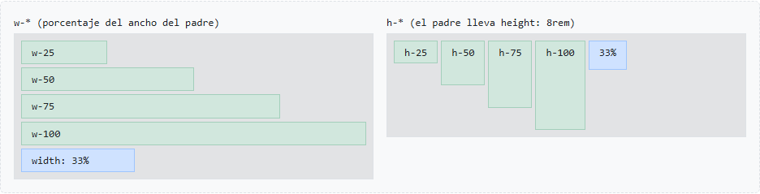

==== Que no se salga: `mw-100`

El caso típico son las *imágenes*: una imagen de 800 px en un móvil de 400 px se sale de la pantalla.
Lo simulamos con una caja de 1500 px, más ancha que cualquier contenedor: las dos primeras se ajustan y la que no lleva límite se sale.

.Una caja de 1500 px con `mw-100`, con `max-width: 100%` y sin límite
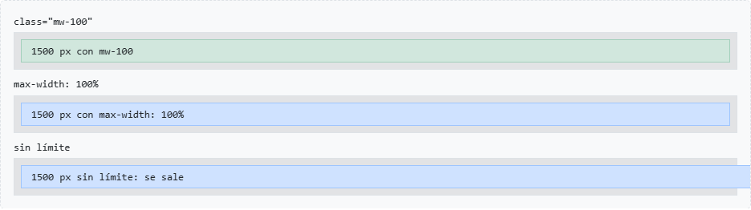

==== Respecto a la pantalla: `min-vh-100`

`vh` y `vw` son unidades de CSS: `1vh` es el 1 % del alto del viewport y `1vw`, el 1 % del ancho.
`min-vh-100` es lo habitual para una portada que ocupa toda la pantalla al entrar; con `d-flex justify-content-center align-items-center` centramos su contenido.

[source,html]
----

La mitad del padre

<header class="min-vh-100 d-flex justify-content-center align-items-center">
  <h1>Portada</h1>
</header>
----

=== Bordes y esquinas: `border-*` y `rounded-*`

Las clases de borde dicen *dónde*, de qué *color* y con qué *grosor*.
Los lados se llaman igual que en el espaciado: `start` y `end` en lugar de `left` y `right`.

[cols="2m,3",options="header"]
|===
|Bootstrap |CSS
|border |`border: 1px solid` (gris de Bootstrap) en los cuatro lados
|border-top / -end / -bottom / -start |Borde solo en ese lado
|border-0 |`border: 0`: quita todos
|border-top-0 / -end-0… |Quita solo ese lado
|border-primary, border-success… y border-success-subtle… |`border-color` del tema (también las versiones suaves)
|border-1 … border-5 |`border-width` de 1 a 5 px
|===

Se combinan: `border border-danger border-3`.

.Dónde, color y grosor
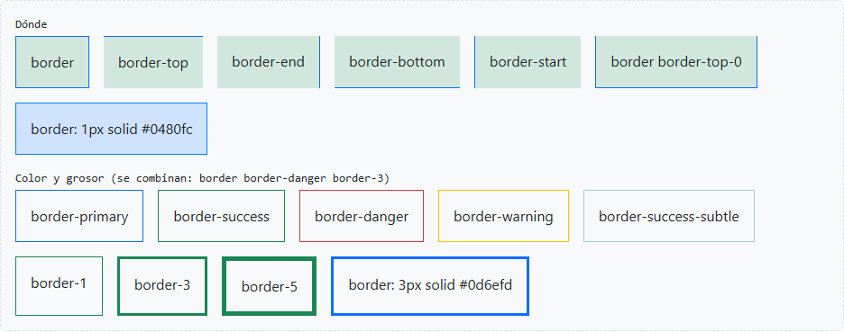

==== Esquinas redondeadas

[cols="2m,3",options="header"]
|===
|Bootstrap |CSS `border-radius`
|rounded |`0.375rem` (6 px)
|rounded-0 · -1 · -2 · -3 · -4 · -5 |`0` · `0.25rem` · `0.375rem` · `0.5rem` · `1rem` · `2rem`
|rounded-circle |`50%`: un círculo si la caja es cuadrada
|rounded-pill |`50rem`: extremos totalmente redondos (píldora)
|rounded-top / -end / -bottom / -start |Solo las esquinas de ese lado
|===

El redondeo funciona aunque no haya borde: redondea también el fondo.

.De `rounded-0` a `rounded-5`, `rounded-circle`, `rounded-pill` y `rounded-top-4`
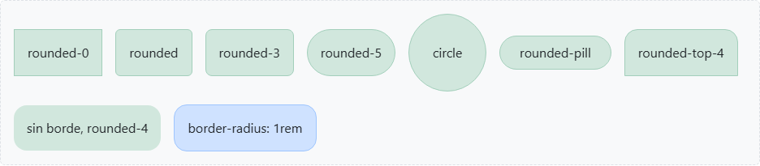

[source,html]
----

…

----

=== Sombras: `shadow-*`

La sombra da sensación de altura: cuanto mayor, más «flota» el elemento.
Los números de `box-shadow` son el desplazamiento horizontal, el desplazamiento vertical, el difuminado y el color (negro con poca opacidad).

[cols="1m,3m",options="header"]
|===
|Bootstrap |CSS box-shadow
|shadow-none |none
|shadow-sm |0 0.125rem 0.25rem rgba(0, 0, 0, 0.075)
|shadow |0 0.5rem 1rem rgba(0, 0, 0, 0.15)
|shadow-lg |0 1rem 3rem rgba(0, 0, 0, 0.175)
|===

.`shadow-none`, `shadow-sm`, `shadow`, `shadow-lg` y el equivalente en CSS de `shadow`
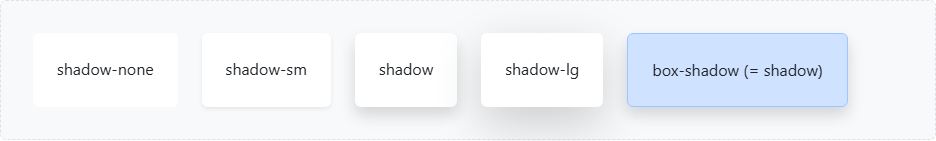

NOTE: En modo oscuro las sombras apenas se ven: una sombra negra sobre un fondo oscuro no destaca.

==== Todo junto

Una tarjeta hecha solo con utilidades: borde, esquinas, sombra, relleno y centrado, sin una línea de CSS propio salvo el ancho máximo.
Es casi lo que hace el componente _card_, que veremos más adelante.

[source,html]
----

  <h3 class="h5">Una tarjeta</h3>
  
Hecha solo con utilidades.

----

.Una tarjeta solo con utilidades
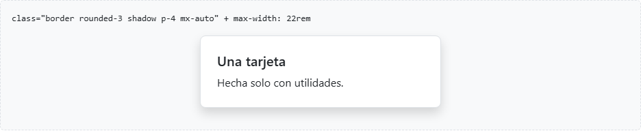

=== Visibilidad responsive: `d-*`

Para mostrar u ocultar elementos según el ancho de pantalla se usan las utilidades de `display` (la `d` viene de _display_).
Siguen el patrón de siempre, mobile-first:

----
d-{valor}                → en todos los anchos
d-{breakpoint}-{valor}   → a partir de ese breakpoint
----

[cols="2m,3",options="header"]
|===
|Bootstrap |CSS
|d-none |`display: none`: el elemento desaparece por completo
|d-block / d-inline / d-inline-block |`display: block` / `inline` / `inline-block`
|d-flex / d-inline-flex / d-grid |`display: flex` / `inline-flex` / `grid`
|d-md-none, d-lg-block… |Lo mismo dentro de `@media (min-width: …)`
|===

IMPORTANT: No hay clases «ocultar en móvil» ni «mostrar en escritorio».
Siempre se combinan dos: una para el punto de partida y otra para el cambio.
Se leen de izquierda a derecha: `d-none d-md-block` es «oculto; a partir de md, visible».

==== El indicador de breakpoint

Seis etiquetas, una por breakpoint. Cada una está oculta y solo se muestra en su tramo; por ejemplo, la de md lleva `d-none d-md-inline d-lg-none`:

* `d-none`: oculta por defecto.
* `d-md-inline`: visible a partir de md.
* `d-lg-none`: otra vez oculta a partir de lg.

En cada ancho solo queda visible una, sin JavaScript. Es la misma técnica del indicador del capítulo de contenedores.

[source,html]
----
xs
sm
md
lg
xl
xxl
----

.El indicador en xs, md y xl
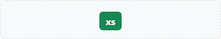

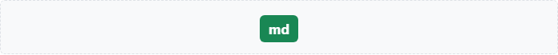

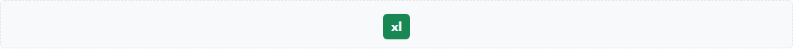

==== Las combinaciones habituales

[cols="3,2m",options="header"]
|===
|Queremos |Clases
|Oculto en todos los anchos |d-none
|Visible solo desde md (escritorio) |d-none d-md-block
|Visible solo por debajo de md (móvil) |d-md-none
|Visible solo en md |d-none d-md-block d-lg-none
|===

Cada clase actúa desde su breakpoint hacia la derecha, y la siguiente la sustituye:

.`d-none d-md-block`
----
xs        sm        md        lg        xl       xxl
0 px     576 px    768 px    992 px   1200 px  1400 px
|---------|---------|---------|---------|---------|--------|
d-none ─────────────►
                    d-md-block ────────────────────────────►
oculta   oculta    VISIBLE   VISIBLE   VISIBLE   VISIBLE
----

.`d-md-none`
----
xs        sm        md        lg        xl       xxl
0 px     576 px    768 px    992 px   1200 px  1400 px
|---------|---------|---------|---------|---------|--------|
block (el div ya es de bloque)
────────────────────►
                    d-md-none ─────────────────────────────►
VISIBLE   VISIBLE   oculta    oculta    oculta    oculta
----

.`d-none d-md-block d-lg-none`
----
xs        sm        md        lg        xl       xxl
0 px     576 px    768 px    992 px   1200 px  1400 px
|---------|---------|---------|---------|---------|--------|
d-none ─────────────►
                    d-md-block ►
                              d-lg-none ───────────────────►
oculta    oculta    VISIBLE   oculta    oculta    oculta
----

El equivalente de `d-none d-md-block` con CSS propio necesita una media query:

[source,css]
----
.solo-desde-md {
  display: none;
}

@media (min-width: 768px) {
  .solo-desde-md {
    display: block;
  }
}
----

.`.solo-desde-md`
----
xs        sm        md        lg        xl       xxl
0 px     576 px    768 px    992 px   1200 px  1400 px
|---------|---------|---------|---------|---------|--------|
display: none ──────►
                    @media (min-width: 768px) display: block ►
oculta    oculta    VISIBLE   VISIBLE   VISIBLE   VISIBLE
----

En las capturas, cada caja verde lleva las clases de su etiqueta; cuando está oculta, en su lugar aparece un hueco punteado (que lleva las clases contrarias).

.xs (400 px)
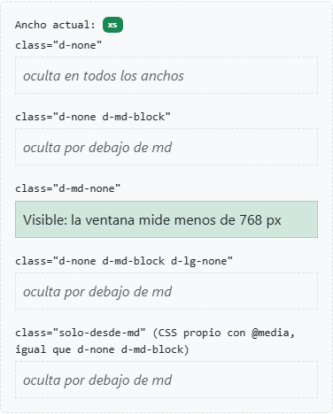

.md (800 px)
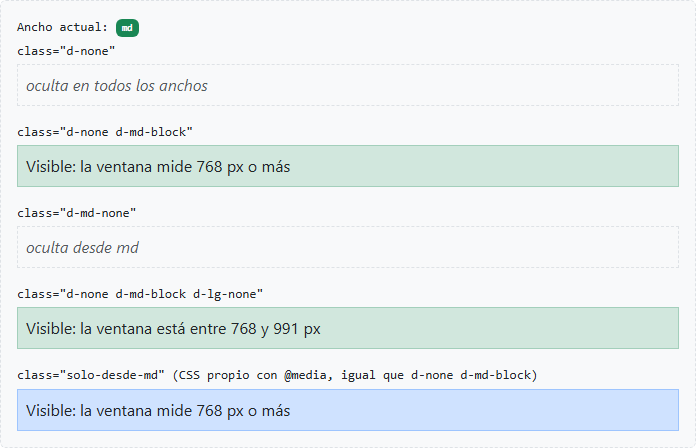

.lg (1000 px)
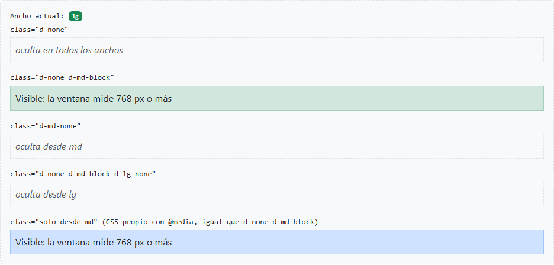

==== Menú de escritorio y de móvil

Dos versiones del mismo contenido, cada una en su tramo: en escritorio los enlaces en fila (`d-none d-md-flex`, que muestra como flex desde md) y en móvil un botón (`d-md-none`) que en un caso real abriría el menú.

[source,html]
----

  <strong>Mi web</strong>
  

    <a href="#">Inicio</a> <a href="#">Productos</a> <a href="#">Contacto</a>
  

  <button type="button" class="btn btn-outline-secondary btn-sm d-md-none ms-auto">☰ Menú</button>

----

.xs: botón de menú
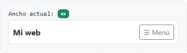

.md: enlaces en fila
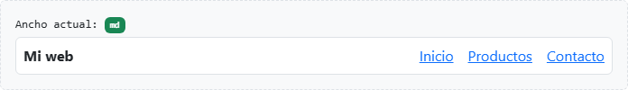

==== `d-none` frente a `invisible`

[cols="1m,2m,3",options="header"]
|===
|Bootstrap |CSS |¿Conserva el hueco?
|d-none |display: none |No: los demás se mueven para ocuparlo
|invisible |visibility: hidden |Sí: no se ve, pero sigue ocupando su sitio
|===

`invisible` no tiene versiones responsive: no existe `invisible-md`.

.`d-none`, `invisible` y `visibility: hidden` en el elemento 2
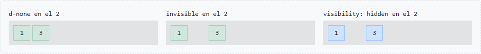

==== Solo para lectores de pantalla: `visually-hidden`

`d-none` oculta el elemento para todo el mundo, también para los lectores de pantalla que usan las personas ciegas.
`visually-hidden` lo oculta solo a la vista: el lector lo sigue leyendo.
Caso típico: un botón que solo muestra un icono necesita un texto que diga qué hace. Se verá más a fondo en accesibilidad.

[source,html]
----
<button type="button" class="btn btn-outline-secondary">
  🔍Buscar
</button>
----

.Solo se ve la lupa; el lector de pantalla lee «Buscar»
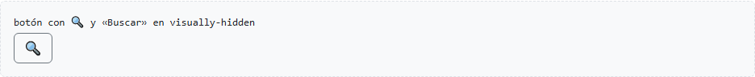

==== Al imprimir: `d-print-*`

Las mismas clases con `print` en lugar de un breakpoint se aplican solo al imprimir:

* `d-print-none`: no sale en papel (menús, botones, publicidad…).
* `d-none d-print-block`: solo sale en papel.

[source,html]
----
<nav class="d-print-none">…</nav>

Impreso desde www.mi-web.es

----

.La misma demo en pantalla y al imprimir
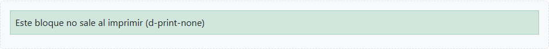

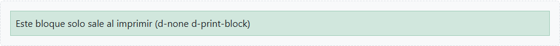

TIP: Se comprueba con Ctrl+P y la vista previa de impresión.

=== Práctica: flexbox y utilidades

. Crear una caja con un título y un párrafo, y darle relleno con `p-*` hasta que el texto respire.
. Separar varias cajas seguidas con `mb-*` en lugar de ` `.
. Centrar una caja de 300 px de ancho con `mx-auto`.
. Hacer que el relleno sea pequeño en móvil y grande desde lg.
. Maquetar una barra con un logo a la izquierda y tres enlaces a la derecha usando `d-flex` y `ms-auto`.
. Rehacerla con `justify-content-between` y comparar.
. Centrar un texto en una caja de 300 px de alto en las dos direcciones.
. Hacer que la barra pase a columna en móvil con `flex-column flex-md-row`.
. Convertir una de las cajas en una tarjeta con `border`, `rounded-3` y `shadow`.
. Hacer una portada a pantalla completa con `min-vh-100` y el texto centrado.
. En la barra, mostrar los enlaces solo desde md y un botón «Menú» solo por debajo de md.
. Escribir el CSS normal equivalente de cada clase usada.

== Sistema de rejilla

Filas y columnas sobre flexbox: doce columnas que se reparten, se recolocan y se adaptan a cada breakpoint.

En las capturas de este capítulo, las cajas de color son el contenido de cada columna, y el hueco entre ellas es el _gutter_.

=== Filas y columnas

La rejilla de Bootstrap divide el ancho disponible en *12 columnas* y está construida con *flexbox*.
Siempre tiene la misma estructura de tres niveles:

[source,html]
----

      <!-- 1. contenedor -->
  
          <!-- 2. fila -->
    
…
 <!-- 3. columnas -->
    
…

  

----

`.row`:: Contenedor flex (`display: flex; flex-wrap: wrap`). Agrupa columnas en horizontal.
`.col-*`:: Hijos directos de la fila. Solo ellos pueden ser hijos de `.row`.
El contenido:: Va siempre _dentro_ de las columnas, nunca directamente en la fila.

==== Cómo se forma el hueco entre columnas

Cada columna tiene un relleno lateral de la mitad del gutter: 0.75rem por lado, 1.5rem entre dos columnas.
La fila tiene un margen negativo del mismo tamaño para que la primera y la última columna queden alineadas con el borde del contenedor.

.Tres columnas `.col` con el gutter por defecto
image::04_filas.png[Tres columnas iguales]

IMPORTANT: Una `.row` debe ir dentro de un contenedor (o de otra columna): si no, su margen negativo provoca scroll horizontal.

==== Las 12 columnas

Doce columnas `.col-1`: cada una ocupa 1/12 del ancho de la fila. Todo el sistema se basa en repartir estas 12 partes.

.Doce `.col-1`
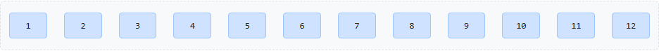

==== ¿Por qué el contenido va en un elemento interior?

Con el fondo en la propia `.col`, el relleno queda *dentro* del color y no vemos el hueco: parece una sola franja.
Con el fondo en un `div` dentro de cada `.col`, el relleno queda *fuera* del color y el hueco aparece.
Por eso el contenido (y su fondo) va siempre en un elemento dentro de la columna.

.Fondo en la `.col` y fondo en un `div` interior
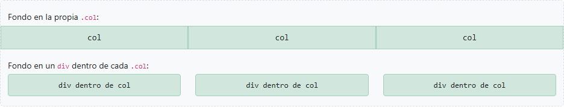

==== El margen negativo de la fila, a la vista

Si pintamos el fondo en la `.row`, vemos que sobresale 0.75rem del contenedor por cada lado.
Así compensa el relleno de la primera y la última columna, y su contenido queda alineado con el texto que va directamente en el contenedor.

.Una `.row` con fondo amarillo bajo un párrafo que va directamente en el contenedor
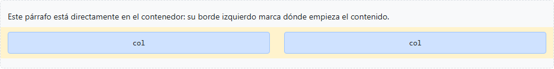

=== Columnas automáticas

`.col` sin número:: Todas las columnas se reparten el espacio *a partes iguales*, sean cuantas sean.
`.col-auto`:: La columna mide *lo que mida su contenido*. Las `.col` restantes se reparten lo que sobra.

.Dos y cinco columnas `.col`
image::04_auto_iguales.png[Columnas iguales]

[source,html]
----

  
…
  <!-- ancho del contenido -->
  
…
       <!-- el resto del espacio -->
  
…

----

.`.col-auto` a los lados y `.col` en el centro
image::04_auto_col_auto.png[Columnas col-auto]

=== Columnas de ancho fijo

`.col-{n}` ocupa *n de las 12 columnas*. El ancho es un porcentaje: `col-4` = 4/12 = 33,33 %.
Se pueden mezclar con `.col`, que se reparten lo que quede.

.`col-4 + col-8`, `col-3 + col-6 + col-3` y `col-6 + col + col`
image::04_fijas.png[Columnas de ancho fijo]

*Si la suma pasa de 12*, las columnas que no caben bajan a una nueva línea (`flex-wrap: wrap`):

.`col-9 + col-4`: 13 columnas, la segunda baja
image::04_fijas_desborde.png[Columnas que bajan de línea]

TIP: Para forzar un salto de línea sin cerrar la fila: `

` entre dos columnas.

=== Clases responsive

`.col-{breakpoint}-{n}` aplica el ancho *desde ese breakpoint hacia arriba* (mobile-first).
Por debajo, si no hay otra clase, la columna ocupa el 100 % y las columnas se *apilan*.

[source,html]
----

  
…

  
…

  
…

  
…

----

[cols="2m,1,1,1",options="header"]
|===
|Clases |xs / sm |md / lg |xl / xxl
|col-12 col-md-6 col-xl-3 |1 por fila |2 por fila |4 por fila
|===

.xs (400 px): apiladas
image::04_responsive_xs.png[Columnas apiladas]

.md (800 px): dos por fila
image::04_responsive_md.png[Dos columnas por fila]

.xl (1250 px): cuatro por fila
image::04_responsive_xl.png[Cuatro columnas por fila]

`.col-{breakpoint}` sin número: columnas iguales desde ese breakpoint y apiladas por debajo.

.`.col-md` en xs (apiladas) y en md (en fila)
image::04_responsive_col_md_xs.png[col-md en xs]

image::04_responsive_col_md_md.png[col-md en md]

WARNING: *Error típico:* pensar que `col-md-6` es «media columna solo en tablet».
Es media columna *desde* tablet: también en portátil y escritorio.

=== Offset: desplazar columnas

`.offset-{n}` y `.offset-{breakpoint}-{n}` añaden un margen izquierdo de *n columnas*.
Útil para centrar o dejar huecos sin columnas vacías.

.`col-4 offset-4`, `col-6 offset-3` (centrada) y `col-md-6 offset-md-3`
image::04_offset.png[Columnas con offset]

Alternativa con márgenes automáticos de flexbox: `ms-auto` empuja la columna hacia la derecha.

.`col-3` y `col-3 ms-auto`
image::04_offset_ms_auto.png[Columna con ms-auto]

=== Order: cambiar el orden visual

Las columnas se muestran en el orden del HTML.
Con `.order-{0..5}`, `.order-first` y `.order-last` (y sus versiones responsive) cambiamos el orden *visual* sin tocar el HTML.
Las columnas sin clase `order-*` cuentan como `order-0`.

[source,html]
----

  
1º en el HTML

  
2º en el HTML

  
3º en el HTML

----

.xs: la segunda columna sube la primera
image::04_order_xs.png[Orden en móvil]

.md: la segunda columna pasa a ser la última
image::04_order_md.png[Orden desde md]

Caso típico: en móvil, el contenido principal antes que la barra lateral.

==== Caso real: contenido primero y menú a la izquierda

En el HTML el contenido va antes que el menú lateral: es lo importante y así se apila primero en móvil.
Desde md, el menú pasa a la izquierda con `order-md-first`.

[source,html]
----

  
Contenido

  
Menú
  <!-- a la izquierda desde md -->

----

.xs: el contenido arriba
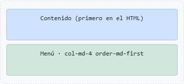

.md: el menú a la izquierda
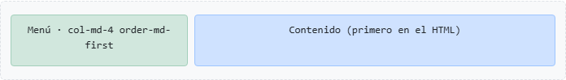

CAUTION: *Accesibilidad:* `order` solo cambia lo que se ve.
Lectores de pantalla y navegación con tabulador siguen el orden del HTML, así que el HTML debe tener ya un orden lógico.

=== Gutters: el espacio entre columnas

El gutter por defecto es de *1.5rem* (24 px) en horizontal y 0 en vertical.
Se cambia *en la fila* con una escala de 0 a 5:

[cols="1m,2",options="header"]
|===
|Clase |Afecta a
|g-{n} |Horizontal y vertical
|gx-{n} |Solo horizontal (entre columnas)
|gy-{n} |Solo vertical (entre líneas)
|g-md-{n}… |Versiones responsive
|===

[cols="1,2",options="header"]
|===
|n |Valor
|0 |0
|1 / 2 / 3 |0.25rem / 0.5rem / 1rem
|4 |1.5rem (el de por defecto en horizontal)
|5 |3rem
|===

Por dentro, `g-*`, `gx-*` y `gy-*` solo cambian dos variables CSS de la fila, `--bs-gutter-x` y `--bs-gutter-y`.
El relleno de las columnas y el margen negativo de la fila se calculan a partir de ellas, así que todo se ajusta a la vez:

[source,css]
----
.row {
  --bs-gutter-x: 1.5rem;
  --bs-gutter-y: 0;
  margin-right: calc(-.5 * var(--bs-gutter-x));
  …
}
.row > * {
  padding-right: calc(var(--bs-gutter-x) * .5);
  margin-top: var(--bs-gutter-y);
  …
}
.g-5 {
  --bs-gutter-x: 3rem;
  --bs-gutter-y: 3rem;
}
----

.`g-0`: sin hueco
image::04_gutters_g0.png[Gutter 0]

.`g-5`: hueco grande en las dos direcciones
image::04_gutters_g5.png[Gutter 5]

.`gx-1 gy-4`: poco hueco horizontal, mucho vertical
image::04_gutters_gx1_gy4.png[Gutter horizontal 1 y vertical 4]

NOTE: Sin `gy-*`, al apilarse en móvil las columnas quedan pegadas una encima de otra.
`g-*` o `gy-*` es la forma correcta de separarlas, mejor que añadir márgenes a cada columna.

=== `row-cols-*`: columnas por fila

En lugar de dar ancho a cada columna, `.row-cols-{n}` en la *fila* indica *cuántas columnas caben por línea*.
Las columnas solo llevan `.col`. Ideal para listas de elementos iguales: cards, productos, galerías.

[source,html]
----

  
…
  <!-- 1 por fila en xs, 2 desde sm, 4 desde lg -->
  …

----

.xs: una por fila
image::04_row_cols_xs.png[row-cols en xs]

.sm: dos por fila
image::04_row_cols_sm.png[row-cols en sm]

.lg: cuatro por fila
image::04_row_cols_lg.png[row-cols en lg]

Admite de `row-cols-1` a `row-cols-6` y `row-cols-auto` (cada columna con el ancho de su contenido).

=== Anidado

Dentro de una columna podemos poner una *nueva `.row`*, que vuelve a tener 12 columnas *relativas al ancho de esa columna*, no al de la página.
No hace falta otro contenedor: el margen negativo de la fila interior anula el relleno de la columna padre, igual que la fila exterior compensa el del contenedor.

[source,html]
----

  

    
            <!-- nueva fila: 12 columnas dentro de las 8 -->
      
…

      
…

    

  

  
…

----

.Dos `col-6` anidadas dentro de una `col-md-8`
image::04_anidado.png[Rejilla anidada]

=== Práctica: tres layouts

==== Layout 1: blog con contenido y barra lateral

Contenido de 8 columnas y lateral de 4 desde lg; apilados en móvil con el contenido primero.

[source,html]
----

  
Cabecera

  
Artículo

  
Lateral

  
Pie

----

.Layout de blog en xs y en lg
image::04_layout_blog_xs.png[Blog en móvil]

image::04_layout_blog_lg.png[Blog en escritorio]

==== Layout 2: catálogo de productos

Un producto por fila en móvil, 2 desde sm, 3 desde md y 4 desde xl, con `row-cols-*` y `g-*`.

[source,html]
----

  
Producto 1

  …

----

.Catálogo en sm y en xl
image::04_layout_catalogo_sm.png[Catálogo en sm]

image::04_layout_catalogo_xl.png[Catálogo en xl]

==== Layout 3: panel con menú, contenido y avisos

Tres columnas desde lg (2 + 7 + 3). En móvil el contenido va primero con `order`; el contenido tiene una rejilla anidada con tarjetas de datos.

[source,html]
----

  
Menú

  

    Contenido
    

      
Dato 1

      
Dato 2

      
Dato 3

    

  

  
Avisos

----

.Panel en xs y en lg
image::04_layout_panel_xs.png[Panel en móvil]

image::04_layout_panel_lg.png[Panel en escritorio]

==== Ejercicio

. Maquetar los tres layouts en páginas separadas, con cajas de color en lugar de contenido real.
. Comprobar cada uno en xs, md y xl con el modo dispositivo de F12.
. En el layout 1, hacer que el lateral pase a la izquierda desde lg sin cambiar el HTML.
. En el layout 2, quitar `g-3` y observar qué ocurre al apilarse en móvil.
. En el layout 3, centrar el bloque de datos en una columna de 6 con `offset` en lugar de tres datos.

NOTE: El enunciado y la solución de este ejercicio están en link:../ejercicios/07_rejilla_tres_layouts_enunciado.html[07_rejilla_tres_layouts_enunciado.html] y link:../ejercicios/07_rejilla_tres_layouts_solucion.html[07_rejilla_tres_layouts_solucion.html].

== Tipografía y color

Los encabezados, las utilidades de texto, la paleta de colores del tema, las imágenes responsive y los iconos.

=== Encabezados

`h1` a `h6` tienen tamaños fijados por Bootstrap.
Las clases `.h1` a `.h6` dan el *mismo aspecto* a cualquier elemento: separan el *significado* (qué nivel de título es) del *tamaño* (cómo se ve).

[cols="1m,1",options="header"]
|===
|Etiqueta / clase |Tamaño
|h1 / .h1 |2.5rem · 40 px
|h2 / .h2 |2rem · 32 px
|h3 / .h3 |1.75rem · 28 px
|h4 / .h4 |1.5rem · 24 px
|h5 / .h5 |1.25rem · 20 px
|h6 / .h6 |1rem · 16 px
|===

.Las clases `.h1` a `.h6`
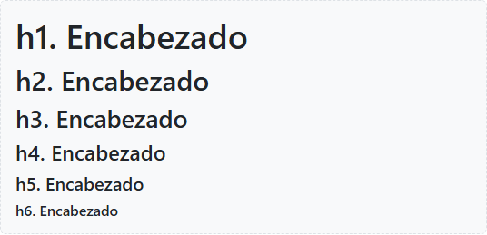

[source,html]
----
<h2 class="h4">Un título de segundo nivel que se ve pequeño</h2>

Un párrafo con aspecto de h1

<h3>Catálogo <small class="text-body-secondary">otoño 2026</small></h3>
----

`.h4` no es solo un tamaño: copia todo el estilo de encabezado (`font-size: 1.5rem`, `font-weight: 500` y `line-height: 1.2`). `fs-4` solo da el tamaño.
En CSS propio, `.h4` equivale a:

[source,css]
----
.titulo-mediano {
  font-size: 1.5rem;
  font-weight: 500;
  line-height: 1.2;
}
----

NOTE: `h1` a `h4` son *responsive*: en pantallas pequeñas se reducen solos (Bootstrap lo llama RFS, _responsive font sizes_).
Los 40 px del `h1` son a partir de 1200 px.

WARNING: No hay que elegir el nivel del encabezado por su tamaño.
Los niveles no se saltan (de `h2` a `h4`), porque los lectores de pantalla los usan como índice.
El tamaño se ajusta con `.h*` o `fs-*`.

=== Titulares grandes: `display-*`

Para portadas y cabeceras destacadas: más grandes que un `h1` y con letra más fina (`font-weight: 300`).
También se reducen en pantallas pequeñas.

[cols="1,1,1,1,1,1,1",options="header"]
|===
|Clase |`display-1` |`display-2` |`display-3` |`display-4` |`display-5` |`display-6`
|Tamaño |5rem |4.5rem |4rem |3.5rem |3rem |2.5rem
|===

.De `display-1` a `display-6`
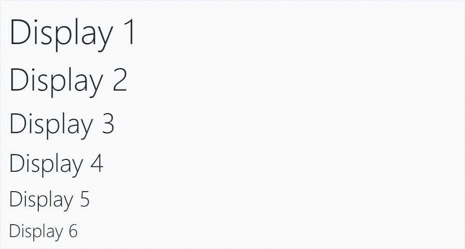

=== Párrafos y utilidades de texto

`lead` destaca un párrafo de entrada (1.25rem, letra fina).

.Un párrafo con `lead` y uno normal
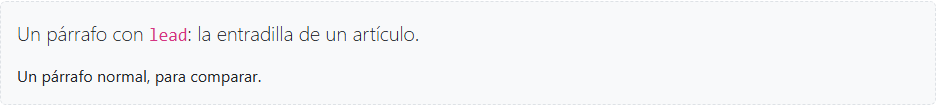

Las utilidades de texto, como las de espaciado, aplican *una sola propiedad CSS* cada una:

[cols="2,2,3",options="header"]
|===
|Bootstrap |CSS |Efecto
|`fs-1` … `fs-6` |`font-size` |Los tamaños de `h1` a `h6`, sin el resto del estilo de encabezado
|`fw-light`, `fw-normal`, `fw-semibold`, `fw-bold` |`font-weight` |Grosor: 300, 400, 600, 700
|`fst-italic`, `fst-normal` |`font-style` |Cursiva o normal (`fst-normal` quita la cursiva a lo que la trae de serie, como `<em>`)
|`text-decoration-underline`, `-line-through`, `-none` |`text-decoration` |Subrayado, tachado o nada (quitar el subrayado de un enlace)
|`text-uppercase`, `text-lowercase`, `text-capitalize` |`text-transform` |Mayúsculas, minúsculas, primera letra en mayúscula. Solo cambia cómo se ve: en el HTML el texto sigue como se escribió
|`text-start`, `text-center`, `text-end` |`text-align` |Alineación; con breakpoint: `text-md-start`
|`lh-1`, `lh-sm`, `lh-base`, `lh-lg` |`line-height` |Interlineado: 1, 1.25, 1.5, 2
|`text-nowrap` |`white-space: nowrap` |Sin saltos de línea: el texto no baja y puede salirse de su caja
|`text-truncate` |`overflow` + `text-overflow: ellipsis` + `nowrap` |Corta con «…» lo que no cabe en una línea (necesita un ancho)
|`small` / `<small>` |`font-size: .875em` |Texto más pequeño, relativo al del padre
|`mark` / `<mark>` |fondo amarillo |Texto resaltado
|===

.Tamaño, grosor, `fst-normal`, decoración, `text-nowrap` y otras utilidades
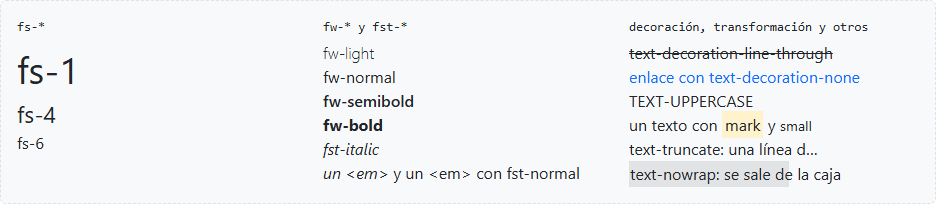

=== Listas

Dos clases para las listas: `list-unstyled` quita viñetas y sangría (solo del primer nivel), y `list-inline` + `list-inline-item` pone los elementos en línea.
Los menús y los pies de página suelen ser listas así.
Una lista anidada dentro de una `list-unstyled` conserva su viñeta.

[source,html]
----
<ul class="list-inline">
  <li class="list-inline-item">Inicio</li>
  <li class="list-inline-item">Productos</li>
</ul>
----

.Sin clase, `list-unstyled` y `list-inline`
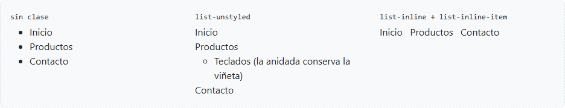

=== Citas

`.blockquote` agranda la cita (1.25rem).
La autoría va en un `<figcaption class="blockquote-footer">`, que añade el guion delante.
Todo dentro de un `<figure>`, que es lo que une la cita con su fuente.

[source,html]
----
<figure>
  <blockquote class="blockquote">
    
El texto de la cita.

  </blockquote>
  <figcaption class="blockquote-footer">
    Autora en <cite title="Título de la obra">Título de la obra</cite>
  </figcaption>
</figure>
----

.Una cita y la misma alineada a la derecha con `text-end`
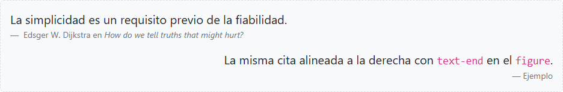

=== Los colores del tema

Bootstrap tiene ocho colores con *nombre de función*, no de color: `primary` no significa «azul», sino «el color principal de la marca».
Si la marca es verde, se cambia `primary` y todo se adapta.

[cols="1m,3",options="header"]
|===
|Nombre |Uso habitual
|primary |Acción principal, color de marca
|secondary |Acciones secundarias, elementos neutros
|success |Éxito, confirmación
|danger |Error, acción peligrosa (borrar)
|warning |Aviso
|info |Información
|light / dark |Fondos claros u oscuros
|===

Cada color se aplica al texto con `text-{color}` y al fondo con `bg-{color}`.
Por dentro usan variables CSS, como todo lo que vimos en `data-bs-theme`: `text-primary` es `color: rgba(var(--bs-primary-rgb), 1)`.
`text-light` casi no se ve sobre fondo claro: necesita un fondo oscuro.

.`text-*` y `bg-*`
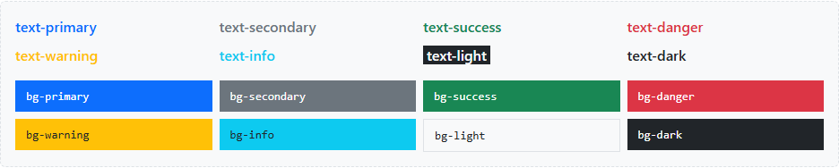

Además están los colores *del cuerpo de la página*, que son los que cambian con el modo oscuro:

[cols="2,3",options="header"]
|===
|Clase |Para qué
|`text-body`, `bg-body` |El color de texto y de fondo de la página
|`text-body-emphasis` |Más contraste que el texto normal (negro en claro, blanco en oscuro)
|`text-body-secondary`, `text-body-tertiary` |Texto atenuado: fechas, notas, ayudas
|`bg-body-secondary`, `bg-body-tertiary` |Fondos ligeramente distintos al de la página
|===

WARNING: `text-muted` sigue funcionando, pero está obsoleta desde la 5.3: se usa `text-body-secondary`.

TIP: Opacidad: `bg-opacity-10`, `-25`, `-50`, `-75` y `-100`, y `text-opacity-*`, junto a una clase de color, por ejemplo `bg-success bg-opacity-25`.

=== Variantes `*-subtle` y `*-emphasis`

Bootstrap 5.3 añade dos variantes de cada color, pensadas para usarse juntas y para *adaptarse al modo oscuro*:

[cols="1m,2",options="header"]
|===
|Clase |Qué es
|bg-{color}-subtle |Fondo suave (claro en modo claro, oscuro en modo oscuro)
|border-{color}-subtle |Borde suave a juego
|text-{color}-emphasis |Texto intenso, legible sobre el fondo suave
|===

[source,html]
----

…

----

.La misma combinación en modo claro y con `data-bs-theme="dark"`
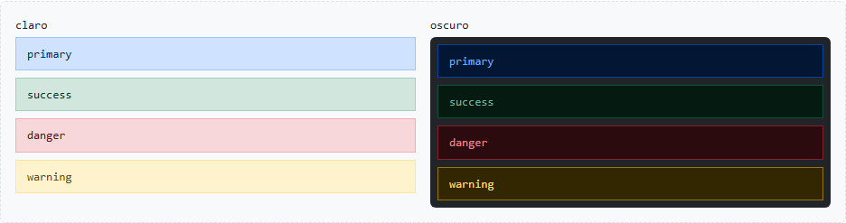

IMPORTANT: Los colores normales (`bg-primary`, `bg-success`…) *no cambian* en modo oscuro.
Si una página va a tener los dos modos, conviene usar las variantes `-subtle` y `-emphasis` y los colores `body`.
`text-bg-*` tampoco cambia, y menos aún un color fijo como `style="color: #198754"`: es el mismo verde que `text-success`, pero no lo controla el tema.

=== Fondo y texto a la vez: `text-bg-*`

Con `bg-warning` el texto sigue siendo el de la página, y hay que elegir a mano `text-dark` o `text-white`.
`text-bg-{color}` pone el fondo *y* un color de texto que contrasta con él.

.`text-bg-*`
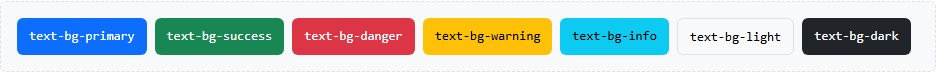

En `warning`, `info` y `light` el texto sale oscuro; en el resto, blanco.
Es la clase habitual en las etiquetas: ``.

=== Imágenes responsive

Una imagen se muestra a su tamaño real aunque no quepa.
`img-fluid` aplica `max-width: 100%` y `height: auto`: nunca es más ancha que su contenedor y no se deforma.
`max-width: 100%` solo limita: una imagen más pequeña que su contenedor *no crece*.

[source,html]
----

----

.Una imagen de 800 px sin clase (se sale de su caja) y con `img-fluid`
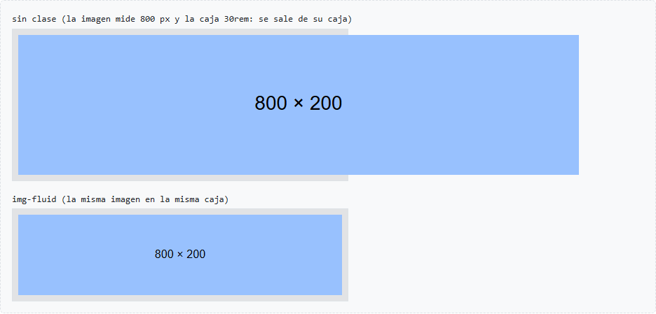

[cols="2,3",options="header"]
|===
|Clase |Efecto
|`img-thumbnail` |Marco con borde redondeado y relleno (también es responsive)
|`rounded`, `rounded-circle` |Esquinas redondeadas o círculo (las mismas de los bordes)
|`figure`, `figure-img`, `figure-caption` |Imagen con pie de foto
|===

.`img-thumbnail`, `rounded-circle` y `figure`
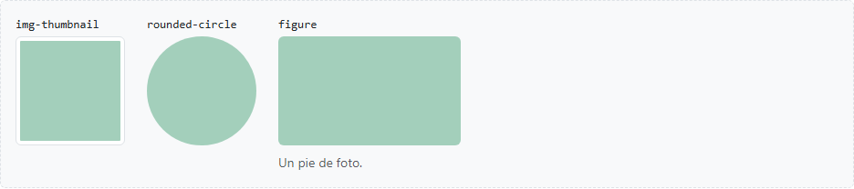

Para la imagen con pie de foto, `<figure>` y `<figcaption>` son etiquetas semánticas: unen la imagen con su descripción.
Las clases solo les dan estilo:

[source,html]
----
<figure class="figure">                                       <!-- el bloque: display: inline-block -->
    <!-- con margen inferior -->
  <figcaption class="figure-caption">Un pie de foto.</figcaption>  <!-- más pequeño y atenuado -->
</figure>
----

WARNING: El atributo `alt` es obligatorio: describe la imagen para quien no la ve.
Es lo que lee el lector de pantalla y lo que aparece si la imagen no carga.
Si es puramente decorativa, `alt=""` (vacío, pero presente): así el lector de pantalla se la salta.

=== Bootstrap Icons

Una biblioteca de iconos del mismo equipo, *aparte de Bootstrap*: hay que cargarla por separado.
Tiene unos 2000 iconos.
La forma más cómoda es como fuente: una hoja de estilos y una etiqueta `<i>` por icono.

[source,html]
----
<link href="https://cdn.jsdelivr.net/npm/bootstrap-icons@1.11.3/font/bootstrap-icons.min.css" rel="stylesheet">

<i class="bi bi-heart-fill"></i>
----

`bi` activa la fuente de iconos y `bi-{nombre}` elige el icono (los nombres están en https://icons.getbootstrap.com/[icons.getbootstrap.com]).
Como es texto, el *tamaño* se cambia con `fs-*` (o `display-*`) y el *color* con `text-*`.
Usamos `<i>` por costumbre; vale cualquier etiqueta en línea, como ``.

[source,html]
----
<i class="bi bi-star-fill fs-2 text-warning"></i>
<i class="bi bi-star-fill display-4 text-warning"></i>

<button type="button" class="btn btn-primary">
  <i class="bi bi-cart3" aria-hidden="true"></i> Añadir al carrito
</button>

<button type="button" class="btn btn-outline-secondary">
  <i class="bi bi-search" aria-hidden="true"></i>Buscar
</button>

<button type="button" class="btn btn-outline-danger" aria-label="Borrar">
  <i class="bi bi-trash" aria-hidden="true"></i>
</button>
----

.Iconos sueltos, con tamaño y color, y dentro de botones
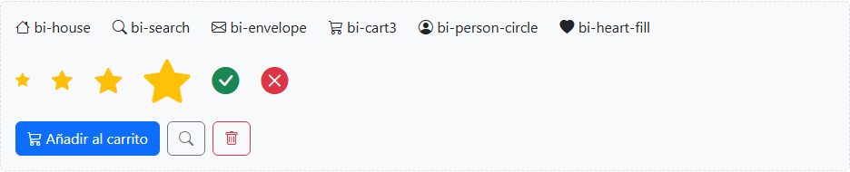

IMPORTANT: Un icono decorativo junto a un texto lleva `aria-hidden="true"`, para que el lector de pantalla no lo lea.
Un botón que solo tiene un icono necesita un texto alternativo: `visually-hidden` o `aria-label`.

== Tablas

La clase `.table` y sus variantes (rayas, hover, bordes, tamaño y color), tablas que no rompen la página en el móvil y alineación de las celdas.
Ejemplos de clase: `09_A_Tablas_variantes.html` y `09_B_Tablas_responsive_alineacion.html`.

=== La clase `.table`

Las tablas son para *datos tabulares* (filas y columnas con sentido), nunca para maquetar: para eso está la rejilla.
En Bootstrap una `<table>` no cambia hasta que le ponemos la clase `.table`; las variantes se suman con más clases.

.Una tabla sin clase (solo Reboot) y la misma con `.table`
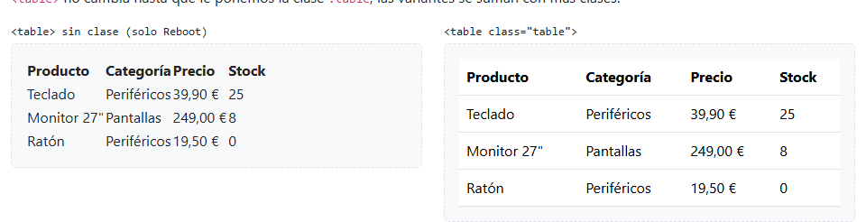

[cols="2,3",options="header"]
|===
|Regla de `.table` |Para qué
|`width: 100%` |Ocupa todo el ancho de su contenedor
|`padding: .5rem` en las celdas |Aire alrededor de cada dato
|`border-bottom` en las celdas |Una línea bajo cada fila
|`margin-bottom: 1rem` |Separación con lo que viene después
|`vertical-align: top` |El contenido de las celdas, arriba (ver <<_alineación_de_las_celdas>>)
|===

Sin clase solo actúa Reboot: `border-collapse: collapse` (los bordes de las celdas se funden en uno) y el `caption` debajo de la tabla.

NOTE: Los colores de `.table` salen de variables CSS (`--bs-table-bg`, `--bs-table-striped-bg`…) que dependen del modo de color: las tablas se adaptan solas al modo oscuro.

.Tablas con `table-striped` y `table-hover` en modo oscuro

=== La estructura de una tabla

[cols="1m,3",options="header"]
|===
|Etiqueta |Contenido
|<caption> |Título de la tabla (Reboot lo pone debajo, pequeño y atenuado)
|<thead> |Fila o filas de cabecera
|<tbody> |Los datos
|<tfoot> |Totales o resumen
|<th scope="col"> |Cabecera de una columna
|<th scope="row"> |Cabecera de una fila
|===

[source,html]
----
<table class="table">
  <caption>Catálogo de productos (precios con IVA)</caption>
  <thead>
    <tr>
      <th scope="col">Producto</th>
      <th scope="col">Categoría</th>
      <th scope="col">Precio</th>
      <th scope="col">Stock</th>
    </tr>
  </thead>
  <tbody>
    <tr>
      <th scope="row">Teclado</th>
      <td>Periféricos</td>
      <td>39,90 €</td>
      <td>25</td>
    </tr>
    …
  </tbody>
  <tfoot>
    <tr>
      <th scope="row">Total</th>
      <td></td>
      <td></td>
      <td>33</td>
    </tr>
  </tfoot>
</table>
----

.`caption`, `thead`, `tbody` y `tfoot`

IMPORTANT: `scope` le dice al lector de pantalla a qué datos se refiere cada cabecera: al llegar a «8» lee «Monitor 27", Stock, 8».
Además, algunas variantes (`table-striped`, `table-group-divider`) solo actúan dentro de `<tbody>`: conviene escribir siempre la estructura completa.

=== Filas a rayas y hover

[cols="2,1,3",options="header"]
|===
|Clase |Dónde |Efecto
|`table-striped` |table |Fondo suave en las filas impares del `tbody`
|`table-striped-columns` |table |Lo mismo, en las columnas
|`table-hover` |table |Oscurece la fila bajo el ratón (útil si la fila es clicable)
|`table-active` |tr o td |La marca como seleccionada, con el tono del hover
|===

.`table-striped table-hover` y `table-striped-columns` con `table-active` en una fila y en una celda

Con CSS propio, las rayas serían un selector `:nth-child` con un gris fijo, que no cambia con el modo oscuro:

[source,css]
----
tbody tr:nth-child(odd) td { background-color: #f2f2f2; }
----

=== Bordes y tabla compacta

`table-bordered` pone borde en los cuatro lados de cada celda; `table-borderless` quita todas las líneas.
El color del borde se cambia con las utilidades de siempre (`border-primary`…).
`table-sm` reduce el relleno de las celdas a la mitad (de `.5rem` a `.25rem`): para tablas con muchas filas o dentro de una tarjeta.

.`table-bordered`, con `border-primary`, `table-borderless` y `table-sm`

=== Colores: `table-{color}`

Los ocho colores del tema en versión suave: `table-primary`, `table-secondary`, `table-success`, `table-danger`, `table-warning`, `table-info`, `table-light` y `table-dark`.
Se ponen en la *tabla*, en un *tr* o en un *td*.
Un color en el `thead` (`table-light` o `table-dark`) separa la cabecera de los datos.

[source,html]
----
<tr class="table-danger">…</tr>          <!-- toda la fila -->
<td class="table-danger">0</td>          <!-- una celda -->
<thead class="table-dark">…</thead>      <!-- la cabecera -->
<table class="table table-dark table-striped">…</table>  <!-- la tabla entera -->
----

.Filas de cada color, una celda en `table-danger`, cabecera `table-dark` y tabla `table-dark table-striped`

NOTE: `table-success` no es `bg-success`: además del fondo ajusta el color del texto, de los bordes y de las rayas y el hover para que combinen.
En una tabla usamos siempre `table-*`.
El color debe dar significado (sin stock en rojo, stock bajo en amarillo), no decorar.

=== Separar grupos de filas: `table-group-divider`

En un `tbody` o `tfoot`, pone encima una línea del doble de grosor con el color del texto.
Separa la cabecera de los datos, o los datos de los totales.

[source,html]
----
<tbody class="table-group-divider">…</tbody>
<tfoot class="table-group-divider">…</tfoot>
----

.`table-group-divider` en el `tbody` y en el `tfoot`

=== Tablas responsive

Una tabla no se puede partir como una rejilla, y *no se encoge por debajo del ancho de su contenido*.
Con muchas columnas, en el móvil se sale del contenedor y aparece scroll horizontal en *toda la página*.
La solución es envolverla en un `div` con `table-responsive`: el scroll queda dentro de ese div.

[source,html]
----

        <!-- overflow-x: auto -->
  <table class="table">…</table>

----

.La misma tabla en una caja de 360 px: sin envolver se sale; dentro de `table-responsive` aparece el scroll en la caja

La clase va en el *div que envuelve*, no en la tabla, y a la tabla no le hace nada: no la encoge ni reparte las columnas.
Por dentro es solo `overflow-x: auto`: si la tabla cabe, no aparece ningún scroll.
Por eso, en una pantalla ancha, una tabla con `table-responsive` y otra sin él se ven iguales; en los ejemplos de clase las metemos en una caja de `max-width: 400px` para que se vea la diferencia a cualquier ancho.

==== Solo hasta un breakpoint: `table-responsive-{bp}`

`table-responsive-sm`, `-md`, `-lg`, `-xl` y `-xxl` aplican el scroll solo *por debajo* de ese breakpoint.
Desde él, la tabla se comporta como una normal.

----
table-responsive-md
|      xs      |      sm      |      md      |      lg      |
0             576            768            992           ...px
[  overflow-x: auto (scroll)  ][        sin scroll           ]
----

TIP: Casi siempre basta con `table-responsive` a secas.
La variante con breakpoint sirve cuando el overflow molesta en pantallas grandes, por ejemplo porque recorta un menú desplegable que hay dentro de la tabla.

=== Alineación de las celdas

==== Horizontal: las utilidades de texto

`text-end` para los números (las unidades quedan en columna), `text-center` para cantidades cortas o estados, y `text-nowrap` para que un precio o una fecha no se partan.
Se ponen en cada celda *y también en el `th`* de la cabecera, para que el título quede sobre los datos.

[source,html]
----
<th scope="col" class="text-end">Precio</th>
…
<td class="text-end text-nowrap">1.249,00 €</td>
----

.Todo a la izquierda y con el precio a la derecha y el stock centrado

==== Vertical: `align-top`, `align-middle`, `align-bottom`

`.table` tiene `vertical-align: top`: si una celda tiene más líneas, las demás se quedan arriba (el `thead` lleva `vertical-align: bottom`, para que los títulos se apoyen sobre los datos).
Las utilidades `align-*` lo cambian en la tabla, en un `tr` o en un `td`.

.Por defecto y con `align-middle` en la tabla y `align-bottom` en la última celda

WARNING: No confundir `align-middle` (la propiedad `vertical-align`, para celdas y elementos en línea) con `align-items-center` (flexbox).

==== El título arriba: `caption-top`

Reboot coloca el `<caption>` debajo de la tabla (`caption-side: bottom`); `caption-top`, en la tabla, lo sube.

.`caption-top`

=== Práctica

Tabla de inventario para el catálogo de la práctica de la sesión: al menos seis productos y siete columnas (referencia, producto, categoría, proveedor, precio, stock y estado).

* Estructura completa: `caption`, `thead` con `th scope="col"`, `tbody` y un `tfoot` con el stock total.
* Filas a rayas y hover; cabecera con `table-dark` o `table-light`.
* Productos sin stock con `table-danger` y con stock bajo (menos de 5) con `table-warning`.
* Precio alineado a la derecha y sin partir; stock centrado; todo centrado en vertical.
* Un `table-group-divider` antes del `tfoot`.
* Envuelta en `table-responsive`: al estrechar la ventana, el scroll queda dentro de la tabla y no en la página.
* Comprobar el resultado en modo oscuro.

.Un resultado posible, en pantalla ancha y en el móvil (con scroll dentro de la tabla)

== Formularios

Campos de texto, listas, checks, switches y rangos; grupos de entrada y etiquetas flotantes; la rejilla en los formularios y la validación nativa con el aspecto de Bootstrap.
Ejemplos de clase: `10_A_Formularios_controles.html`, `10_B_Formularios_checks_rangos.html`, `10_C_Formularios_input_group_floating.html`, `10_D_Formularios_rejilla.html` y `10_E_Formularios_validacion.html`.

=== Campos de texto: `form-control`

Bootstrap no cambia cómo funciona un formulario: sigue siendo HTML (`<form>`, `<input>`, `<select>`, `<textarea>`, `<label>`…).
Solo les da estilo con clases.
Sin clase, cada navegador dibuja el campo a su manera y es un elemento en línea: la etiqueta y la caja quedan en la misma línea, con el ancho que decide el navegador.

[cols="1,1,3",options="header"]
|===
|Clase |Va en |Qué hace
|`form-control` |`input`, `textarea` |`display: block` y `width: 100%`; relleno, borde y esquinas iguales en todos los navegadores; borde azul y halo (`box-shadow`) al tener el foco
|`form-label` |`label` |Solo un `margin-bottom: .5rem`
|`form-text` |un `div` debajo del campo |Texto de ayuda pequeño y atenuado
|`form-select` |`select` |Lista desplegable con flecha propia (ver <<_listas_form_select>>)
|===

.Un campo sin clases: la etiqueta y la caja en la misma línea

.El mismo campo con `form-label` y `form-control`

==== La etiqueta, el campo y la ayuda

[source,html]
----

  <label for="email" class="form-label">Correo electrónico</label>
  <input type="email" class="form-control" id="email"
         placeholder="nombre@ejemplo.com" aria-describedby="email-ayuda">
  
No compartiremos el correo con nadie.

----

.Etiqueta, campo y texto de ayuda

El `for` del `label` coincide con el `id` del campo.
Así, al hacer clic en la etiqueta el cursor entra en el campo, y el lector de pantalla lee la etiqueta al llegar al campo.
Con `aria-describedby` en el input, apuntando al `id` de la ayuda, el lector de pantalla también la lee.

IMPORTANT: El `placeholder` *no sustituye a la etiqueta*: desaparece al escribir y tiene poco contraste.
Lo usamos solo como ejemplo del formato esperado.

=== Tipos de input y `textarea`

`form-control` sirve para todos los `input` de texto.
El `type` lo pone HTML, no Bootstrap, y cambia el teclado del móvil y lo que valida el navegador.

[cols="1m,3",options="header"]
|===
|type |Qué aporta
|email |Teclado con @; el navegador comprueba que parezca un correo
|tel |Teclado numérico de teléfono
|number |Flechas para subir y bajar (`min`, `max`)
|date |El calendario del navegador
|search |Una X para borrar
|file |El selector de ficheros, con el aspecto de los demás campos
|color |El selector de color; con `form-control-color`, para que no se estire a todo el ancho
|===

El `textarea` también lleva `form-control`; `rows` fija la altura inicial.

[source,html]
----
<input type="color" class="form-control form-control-color" id="color" value="#198754">
<textarea class="form-control" id="mensaje" rows="3"></textarea>
----

.Los tipos de input con `form-control` y un `textarea`

=== Tamaños y estados

`form-control-lg` y `form-control-sm` cambian la altura, el relleno y el tamaño de letra.
En las listas, lo mismo con `form-select-lg` y `form-select-sm`.

.`form-control-lg`, `form-control` y `form-control-sm`

Deshabilitar o bloquear un campo son atributos de HTML; Bootstrap solo les da aspecto.

[cols="2,3,1",options="header"]
|===
|Atributo o clase |Aspecto |¿Se envía?
|`disabled` |Gris, no se puede tocar |No
|`readonly` |No se puede cambiar, pero sí seleccionar |Sí
|`readonly` + `form-control-plaintext` |Sin caja: el valor parece texto normal, pero sigue alineado con los demás campos |Sí
|`<fieldset disabled>` |Deshabilita de golpe todos los campos y botones de dentro |No
|===

[source,html]
----
<input type="text" class="form-control-plaintext" id="correo" value="cliente@ejemplo.com" readonly>

<fieldset disabled>
  <legend class="fs-6 fw-semibold">fieldset disabled</legend>
  <input type="text" class="form-control" …>
  <button type="submit" class="btn btn-primary">También el botón</button>
</fieldset>
----

.`disabled`, `readonly`, `form-control-plaintext` y `fieldset disabled`

=== Listas: `form-select`

En un `<select>` va `form-select` en lugar de `form-control`: quita la flecha del navegador y dibuja la suya.
Con `multiple` o `size` se convierte en una lista con varias filas visibles (Ctrl + clic para elegir varias).
Una primera opción con `selected disabled` hace de «Elige una opción».

[source,html]
----
<label for="categoria" class="form-label">Categoría</label>
<select class="form-select" id="categoria">
  <option selected disabled>Elige una categoría</option>
  <option value="perifericos">Periféricos</option>
  <option value="pantallas">Pantallas</option>
  <option value="audio">Audio</option>
</select>
----

.Un `select` sin clase, con `form-select` y con `multiple`

=== Checkbox y radio

Las casillas las dibuja Bootstrap enteras: el aspecto del navegador se sustituye por el suyo, igual en todos los navegadores y con el color `primary`.
Siempre son tres piezas:

[source,html]
----

                                    <!-- deja sitio a la izquierda -->
  <input class="form-check-input" type="checkbox" id="acepto">
  <label class="form-check-label" for="acepto">Acepto las condiciones</label>

----

Al hacer clic en el texto se marca la casilla: es más fácil acertar, sobre todo en el móvil.

[cols="1,3",options="header"]
|===
|Tipo o clase |Comportamiento
|`type="checkbox"` |Cada casilla es independiente: se marcan varias
|`type="radio"` |Solo una del grupo; el grupo lo forma el mismo `name`
|`checked` / `disabled` |Marcada por defecto / deshabilitada
|`form-check-inline` |Las opciones una al lado de otra
|`form-check-reverse` |La casilla a la derecha del texto
|===

`fieldset` + `legend` agrupan las opciones y dan título al grupo: el lector de pantalla lee el `legend` antes de cada opción.

[source,html]
----
<fieldset>
  <legend class="fs-6 fw-semibold">Envío</legend>
  

    <input class="form-check-input" type="radio" name="envio" id="envio-normal" checked>
    <label class="form-check-label" for="envio-normal">Normal (3-5 días)</label>
  

  

    <input class="form-check-input" type="radio" name="envio" id="envio-urgente">
    <label class="form-check-label" for="envio-urgente">Urgente (24 h)</label>
  

</fieldset>
----

.Checkbox, radio, `form-check-inline` y `form-check-reverse`

=== Interruptores y checks con aspecto de botón

==== `form-switch`

Un checkbox normal con `form-switch` en el contenedor se dibuja como un interruptor.
Sigue siendo un checkbox (marcado o no); `role="switch"` le dice al lector de pantalla que lo anuncie como interruptor (activado / desactivado).
Se usa para opciones que se aplican al momento: notificaciones, modo oscuro…

[source,html]
----

  <input class="form-check-input" type="checkbox" role="switch" id="notificaciones" checked>
  <label class="form-check-label" for="notificaciones">Notificaciones por correo</label>

----

==== `btn-check`

El input se oculta (`btn-check`) y el `label` lleva las clases de botón: al marcarlo, el botón aparece pulsado.
Funciona con checkbox y con radio.
Aquí el `label` va *después* del input y sin `div.form-check`.

[source,html]
----
<input type="checkbox" class="btn-check" id="filtro-oferta" autocomplete="off">
<label class="btn btn-outline-primary" for="filtro-oferta">En oferta</label>

  <input type="radio" class="btn-check" name="vista" id="vista-tarjetas" autocomplete="off" checked>
  <label class="btn btn-outline-secondary" for="vista-tarjetas">Tarjetas</label>
  <input type="radio" class="btn-check" name="vista" id="vista-lista" autocomplete="off">
  <label class="btn btn-outline-secondary" for="vista-lista">Lista</label>

----

.Interruptores y checks con aspecto de botón (checkbox sueltos y radios en un `btn-group`)

TIP: `autocomplete="off"` evita que Firefox recuerde el estado marcado al recargar la página y el botón aparezca pulsado sin que lo hayamos elegido.

=== Deslizadores: `form-range`

Un `<input type="range">` con `form-range` ocupa todo el ancho y se dibuja igual en todos los navegadores.

[cols="1m,3",options="header"]
|===
|Atributo |Para qué
|min, max |Los extremos (por defecto 0 y 100)
|step |De cuánto en cuánto avanza (por defecto 1)
|value |La posición inicial
|===

El deslizador no muestra su valor: lo escribimos al lado con JavaScript, en el evento `input`, que salta en cada movimiento.

[source,html]
----
<label for="volumen" class="form-label">Volumen: 50</label>
<input type="range" class="form-range" id="volumen" min="0" max="100" step="5" value="50">
----

[source,javascript]
----
window.onload = () => {
  document.getElementById('volumen').oninput = () => {
    document.getElementById('valor-volumen').textContent = document.getElementById('volumen').value
  }
}
----

.`form-range` con el valor escrito en la etiqueta

NOTE: El evento `change` solo salta al soltar el deslizador; `input` salta mientras se arrastra, y por eso el número se actualiza a la vez.

=== Grupos de entrada: `input-group`

Un `div.input-group` pega al campo textos, iconos o botones, como una sola pieza.
Es un contenedor flex: el campo crece y lo demás se queda a su tamaño, y Bootstrap quita las esquinas redondeadas entre las piezas para que parezcan una.

[source,html]
----
<label for="movil" class="form-label">Teléfono</label>

  +34
  <input type="tel" class="form-control" id="movil" placeholder="600 123 456">

<label for="precio" class="form-label">Precio</label>

  <input type="number" class="form-control" id="precio" step="0.01">
  €

----

[cols="1,3",options="header"]
|===
|Pieza |Cómo
|Texto delante o detrás |`span.input-group-text`: unidades (€, kg), prefijos (@, +34, https://) y sufijos (.com); caben varios seguidos
|Icono |Un icono de Bootstrap Icons dentro del `input-group-text`, con `aria-hidden="true"` (la etiqueta ya dice qué es el campo)
|Botón |Directamente en el grupo, sin `input-group-text`: `<button class="btn btn-primary">`
|Lista |Un `form-select` también forma parte del grupo; con `flex-grow-0 w-auto` no se estira
|Check |Un checkbox o radio dentro de un `div.input-group-text`, con `mt-0` para quitarle el margen superior de `form-check-input`
|Tamaño |`input-group-lg` o `input-group-sm` en el `div` del grupo: cambia todas las piezas a la vez
|===

[source,html]
----

  <input type="search" class="form-control" id="buscar" placeholder="Nombre del producto">
  <button class="btn btn-primary" type="button">
    <i class="bi bi-search" aria-hidden="true"></i> Buscar
  </button>

  

    <input class="form-check-input mt-0" type="checkbox" aria-label="Incluir mensaje de regalo">
  

  <input type="text" class="form-control" id="regalo" placeholder="¡Feliz cumpleaños!">

----

.Prefijos, unidades, iconos, botones, una lista y un check dentro del grupo

NOTE: El texto del `input-group-text` no se escribe ni se envía con el formulario: solo indica el formato.
Si el servidor necesita el «+34», tiene que añadirlo él (o ir en un `select` dentro del grupo, que sí se envía).

=== Etiquetas flotantes: `form-floating`

La etiqueta empieza dentro del campo, como si fuera un placeholder, y al entrar o escribir sube y se hace pequeña.
Ahorra espacio y la etiqueta no se pierde.

[source,html]
----

  <input type="email" class="form-control" id="email" placeholder="nombre@ejemplo.com">
  <label for="email">Correo electrónico</label>

----

IMPORTANT: Tres reglas:
el `input` va *antes* del `label` (al revés que en un formulario normal);
el `input` necesita un `placeholder`, aunque no se vea, porque Bootstrap usa `:placeholder-shown` para saber si el campo está vacío;
y el `label` no lleva `form-label`, porque lo coloca `form-floating`.

[cols="1,3",options="header"]
|===
|Caso |Comportamiento
|Campo con `value` |La etiqueta ya está arriba
|`textarea` |`rows` no funciona: la altura se fija con `style="height: 7rem"`
|`select` |La etiqueta siempre está arriba: un `select` nunca está vacío
|Sin `placeholder` |`:placeholder-shown` nunca se cumple: Bootstrap cree que el campo tiene contenido y la etiqueta se queda siempre arriba, pequeña
|Dentro de un `input-group` |El `div.form-floating` ocupa el sitio del campo dentro del grupo
|===

[source,html]
----

  <i class="bi bi-person" aria-hidden="true"></i>
  

    <input type="text" class="form-control" id="usuario" placeholder="Usuario">
    <label for="usuario">Usuario</label>
  

----

.Etiquetas flotantes: vacío, con `value`, `textarea`, `select`, sin `placeholder` y dentro de un `input-group`

=== La rejilla en los formularios

Bootstrap no tiene un sistema propio para colocar campos: usamos la rejilla de siempre (`row`, `col`, `g-*`) y las utilidades de espaciado.

[cols="1,3",options="header"]
|===
|Disposición |Cómo
|Un campo debajo de otro |Cada etiqueta + campo en un `div.mb-3` (`form-control` ya ocupa todo el ancho)
|Varios por fila |`form.row.g-3` y columnas `col-md-6`, `col-12`…: en el móvil se apilan
|Horizontal (etiqueta a la izquierda) |Cada campo en un `row mb-3`; etiqueta `col-sm-3 col-form-label` y campo en `col-sm-9`
|En línea |`row g-2 align-items-center` con columnas `col-auto`; etiquetas con `visually-hidden`
|Campo que crece y botón a su tamaño |`col` + `col-auto`
|===

==== Varios campos por fila: `row g-3` y `col-md-*`

[source,html]
----
<form class="row g-3">
  

    <label for="nombre" class="form-label">Nombre</label>
    <input type="text" class="form-control" id="nombre">
  

  
…Apellidos…

  
…Dirección…

  
…Ciudad…

  
…Provincia…

  
…C. P.…

  

    <button type="submit" class="btn btn-primary">Guardar dirección</button>
  

</form>
----

`col-md-6`: dos por fila desde `md`; en el móvil, uno debajo de otro.
`col-12`: la fila entera en todos los tamaños.
`g-3` separa los campos en horizontal y en vertical: sin él, al apilarse en el móvil quedarían pegados.

.Formulario en rejilla en el móvil y en pantalla ancha

==== Formulario horizontal: `col-form-label`

Cada campo es una fila (`row mb-3`): la etiqueta en una columna (`col-sm-3`, un cuarto) y el campo en otra (`col-sm-9`, tres cuartos).
La etiqueta lleva `col-form-label` en lugar de `form-label`: le da el mismo relleno vertical que al campo, para que el texto quede a la altura del texto del campo.
Por debajo de `sm` la etiqueta vuelve a quedar encima.
Lo que no tiene etiqueta (un check, el botón) se alinea con los campos con `offset-sm-3`.

[source,html]
----

  <label for="email" class="col-sm-3 col-form-label">Correo electrónico</label>
  

    <input type="email" class="form-control" id="email">
  

  

    <button type="submit" class="btn btn-primary">Entrar</button>
  

----

.Formulario horizontal: en la primera fila `form-label` (la etiqueta queda pegada arriba) y en las demás `col-form-label` (a la altura del texto del campo)

.El mismo formulario en el móvil: las etiquetas encima

==== Formulario en línea: `col-auto`

Todo en una sola línea: un buscador, una suscripción al boletín…
`row g-2 align-items-center` hace una fila con hueco pequeño y todo centrado en vertical, y `col-auto` hace que cada columna mida lo que su contenido.
La etiqueta no se ve (`visually-hidden`), pero el lector de pantalla la lee.

Con `col` y `col-auto` juntas, `col` reparte el espacio sobrante y `col-auto` se ajusta al contenido: el campo de búsqueda crece y el botón se queda a su tamaño.

[source,html]
----
<form class="row g-2 align-items-center">
  

    <label for="suscripcion" class="visually-hidden">Correo electrónico</label>
    <input type="email" class="form-control" id="suscripcion" placeholder="nombre@ejemplo.com">
  

  

    <button type="submit" class="btn btn-primary">Suscribirme</button>
  

</form>

<form class="row g-2">
  

    <label for="buscar" class="visually-hidden">Buscar</label>
    <input type="search" class="form-control" id="buscar" placeholder="Buscar productos">
  

  

    <button type="submit" class="btn btn-primary">Buscar</button>
  

</form>
----

.Formularios en línea en el móvil y en pantalla ancha (si no caben, las columnas `col-auto` bajan a la línea siguiente)

=== Validación

Quien valida es el *navegador*, con los atributos de HTML5:

[cols="1m,3",options="header"]
|===
|Atributo |Regla
|required |Obligatorio
|type="email" |Tiene que parecer un correo
|minlength, maxlength |Longitud mínima y máxima del texto
|min, max |En números y fechas
|pattern |Una expresión regular: `pattern="[0-9]{5}"`, cinco cifras
|===

Bootstrap no valida nada: solo pinta en verde o rojo lo que el navegador ya ha decidido, y muestra nuestros mensajes en lugar de los del navegador.

==== Sin Bootstrap: la validación del navegador

Al pulsar «Enviar» con un campo mal, el navegador no envía el formulario y muestra un globo con su propio mensaje en el primer campo que falla.
El aspecto y el texto del globo los decide cada navegador (con `title` se añade una pista al mensaje de `pattern`).

[source,html]
----
<form>
  <input type="email" id="email" required>
  <input type="text" id="cp" pattern="[0-9]{5}" title="Cinco cifras">
  <button type="submit">Enviar</button>
</form>
----

==== Con Bootstrap: `novalidate` y `was-validated`

[cols="2,3",options="header"]
|===
|Pieza |Para qué
|`novalidate` en el `form` |El navegador sigue validando, pero no muestra sus globos ni bloquea el envío: lo controlamos nosotros
|`was-validated` en el `form` (con JavaScript, al enviar) |Bootstrap pinta cada campo según la pseudoclase del navegador: `:valid` borde verde y un check, `:invalid` borde rojo y una exclamación
|`invalid-feedback` / `valid-feedback` |Mensajes que solo se ven si el campo es inválido / válido
|`has-validation` en el `input-group` |Las esquinas redondeadas quedan bien aunque el mensaje vaya dentro del grupo
|===

[source,html]
----
<form id="form-alta" class="row g-3" novalidate>
  

    <label for="nombre" class="form-label">Nombre</label>
    <input type="text" class="form-control" id="nombre" required minlength="2">
    
Correcto.

    
El nombre es obligatorio (mínimo 2 letras).

  

  

    <label for="usuario" class="form-label">Usuario</label>
    

      @
      <input type="text" class="form-control" id="usuario" required pattern="[a-z0-9_]{3,15}">
      
Entre 3 y 15 caracteres: minúsculas, números y _.

    

  

  

    <label for="provincia" class="form-label">Provincia</label>
    <select class="form-select" id="provincia" required>
      <option selected disabled value="">Elige...</option>
      <option>Madrid</option>
    </select>
    
Elige una provincia.

  

  

    

      <input class="form-check-input" type="checkbox" id="condiciones" required>
      <label class="form-check-label" for="condiciones">Acepto las condiciones</label>
      
Hay que aceptar las condiciones.

    

  

  

    <button type="submit" class="btn btn-primary">Crear cuenta</button>
  

  

    
Todo correcto: el formulario se enviaría.

  

</form>
----

[source,javascript]
----
window.onload = () => {
  const formAlta = document.getElementById('form-alta')

  formAlta.onsubmit = (evento) => {
    evento.preventDefault()
    formAlta.classList.add('was-validated')
    if (formAlta.checkValidity()) {
      document.getElementById('aviso-enviado').classList.remove('d-none')
    }
  }
}
----

`preventDefault()` evita que la página se recargue (en el ejemplo no hay servidor) y `checkValidity()` devuelve `true` si todos los campos son válidos.

IMPORTANT: Los mensajes tienen que ir *después del campo y como hermanos* (mismo padre): Bootstrap los muestra con el selector `:invalid ~ .invalid-feedback`.
Por eso, en un `input-group` el mensaje va dentro del grupo, y en un check, dentro del `div.form-check`, detrás del `label`.

NOTE: En un `select` obligatorio, la primera opción lleva `value=""`: una opción con valor vacío no cumple `required`.

.Antes de enviar: aunque los campos obligatorios vacíos ya son `:invalid`, no se pinta nada

.Al enviar con datos incompletos: en verde lo válido y en rojo lo inválido, con su mensaje

.Con todo correcto: todos los campos en verde y el aviso de envío

===== ¿Por qué esperar a `was-validated`?

Porque `:invalid` se cumple desde que carga la página: un campo `required` vacío ya es inválido.
Si Bootstrap pintara los campos sin esperar, el formulario aparecería todo en rojo antes de que el usuario escriba nada.

==== Marcar un campo a mano: `is-invalid` e `is-valid`

Hay errores que el navegador no puede saber: «ese correo ya está registrado».
Los decide el servidor, y al devolver la página marcamos el campo con `is-invalid` (o `is-valid`).
No dependen de `was-validated` ni de `novalidate`: se ven siempre, y el `invalid-feedback` aparece porque el campo tiene `is-invalid`.

[source,html]
----
<input type="email" class="form-control is-invalid" id="email" value="cliente@ejemplo.com">

Ya hay una cuenta con este correo.

<input type="text" class="form-control is-valid" id="usuario" value="luis_r">

Nombre de usuario disponible.

----

.`is-invalid` e `is-valid` puestos a mano

==== Mensajes como globo: `invalid-tooltip` y `valid-tooltip`

En lugar de un texto debajo, un globo de color que flota sobre lo que haya debajo.
Se posiciona con `position: absolute`, así que el contenedor del campo necesita `position-relative`.
Como tapa lo que tiene debajo, conviene dejarle sitio (en el ejemplo, `pt-4` en la fila del botón).

[source,html]
----

  <label for="nombre" class="form-label">Nombre</label>
  <input type="text" class="form-control" id="nombre" required>
  
El nombre es obligatorio.

----

.Mensajes en globo tras enviar: el nombre vacío y la ciudad rellena

WARNING: La validación del navegador es una ayuda para el usuario, no una seguridad: desde las herramientas de desarrollo se puede quitar un `required` y enviar cualquier cosa.
El servidor tiene que volver a validarlo todo.

=== Práctica

Página de contacto para la tienda de la práctica de la sesión:

* Nombre y apellidos en la misma fila desde `md`; correo y teléfono (con prefijo en un `input-group`) en otra.
* Asunto con `form-select` y mensaje con `textarea`.
* Preferencia de respuesta con radios en línea (correo / teléfono) y un switch para el boletín.
* Casilla obligatoria de aceptación de la política de privacidad.
* Validación con `novalidate`, `was-validated` y un mensaje `invalid-feedback` en cada campo obligatorio.
* Al ser válido, mostrar un `alert-success` en lugar de enviar.
* Variante: los campos de texto con `form-floating`.

.Un resultado posible, en pantalla ancha y en el móvil

== Componentes de contenido

Botones y grupos, cards, alerts, badges, list groups, breadcrumbs, paginación, barras de progreso y spinners: todo lo que se pinta solo con HTML y clases.
Ejemplos de clase: `11_A_Botones.html`, `11_B_Cards.html`, `11_C_Alerts_badges_list_group.html` y `11_D_Navegacion_progreso.html`.

=== Botones

`btn` da la forma (relleno, borde, esquinas, cursor) y `btn-{color}` el color: siempre van juntas.
`btn-outline-{color}` deja solo el borde, para acciones secundarias.
`btn-link` tiene el aspecto de un enlace con el tamaño de un botón.

[cols="1,3",options="header"]
|===
|Clase |Efecto
|`btn` |La forma del botón, sin color
|`btn-primary`, `btn-secondary`, `btn-success`, `btn-danger`, `btn-warning`, `btn-info`, `btn-light`, `btn-dark` |Fondo y borde del color del tema
|`btn-outline-{color}` |Solo el borde y el texto; se rellena al pasar el ratón
|`btn-link` |Aspecto de enlace
|`btn-lg`, `btn-sm` |Más grande o más pequeño
|===

[source,html]
----
<button type="button" class="btn btn-primary">Guardar</button>
<button type="button" class="btn btn-outline-secondary">Cancelar</button>
<button type="button" class="btn btn-primary btn-lg">Grande</button>
<button type="button" class="btn btn-primary" disabled>Deshabilitado</button>
<button type="button" class="btn btn-success">
  <i class="bi bi-cart-plus" aria-hidden="true"></i> Con icono
</button>
<button type="button" class="btn btn-outline-secondary" aria-label="Editar">
  <i class="bi bi-pencil" aria-hidden="true"></i>
</button>
----

.Un botón sin clase, los colores, los `btn-outline-*`, tamaños, deshabilitado y con iconos

==== La etiqueta: `button`, `a` o `input`

Las clases `btn` sirven en las tres etiquetas; se elige por lo que hace el botón, no por su aspecto.

[cols="2m,3",options="header"]
|===
|Etiqueta |Cuándo
|<button type="button"> |Una acción en la página (guardar, abrir, borrar)
|<a href="…" role="button"> |Ir a otra página, con aspecto de botón
|<input type="submit"> |Enviar un formulario (no admite iconos dentro)
|===

WARNING: Dentro de un `<form>`, un `<button>` sin `type` es `type="submit"`: envía el formulario.
Por eso los botones que no envían llevan siempre `type="button"`.

Un `<a>` no tiene atributo `disabled`: se le pone la clase `disabled` (quita los clics con `pointer-events: none`), `aria-disabled="true"` y se le quita el `href`.

[source,html]
----
<a class="btn btn-primary disabled" role="button" aria-disabled="true">Ver catálogo</a>
----

==== A todo el ancho: `d-grid`

`btn-block` de Bootstrap 4 ya no existe.
Un contenedor `d-grid gap-2` estira cada botón a todo el ancho; con `d-md-block`, desde `md` vuelven a su tamaño.

[source,html]
----

  <button type="button" class="btn btn-primary">Comprar ahora</button>
  <button type="button" class="btn btn-outline-secondary">Seguir comprando</button>

----

.`d-grid gap-2`: los botones a todo el ancho

.`d-grid gap-2 d-md-block`, en el móvil y desde `md`

=== Grupos de botones y `btn-close`

`btn-group` pega los botones en una sola pieza (como `input-group` con los campos), con `role="group"` y un `aria-label`.

[cols="1,3",options="header"]
|===
|Clase |Efecto
|`btn-group` |Los botones, pegados en fila
|`btn-group-vertical` |Pegados en columna
|`btn-group-sm`, `btn-group-lg` |Cambian el tamaño de todos los botones del grupo
|`btn-toolbar` |Varios grupos en fila (con `role="toolbar"`)
|===

[source,html]
----

  <button type="button" class="btn btn-outline-primary">Izquierda</button>
  <button type="button" class="btn btn-outline-primary">Centro</button>
  <button type="button" class="btn btn-outline-primary">Derecha</button>

  
…

  
…

<button type="button" class="btn-close" aria-label="Cerrar"></button>
----

.`btn-group`, `btn-group-vertical`, `btn-toolbar` y `btn-close` sobre fondo claro y oscuro

`btn-close` es la X de alertas, modales y toasts: sin texto, así que necesita `aria-label`.

NOTE: Para fondos oscuros, `btn-close-white` está obsoleta desde la 5.3: se usa `data-bs-theme="dark"` en el botón o en un elemento que lo contenga.

=== Cards

Una caja con borde y esquinas que agrupa contenido relacionado.
Es un contenedor flex en columna con piezas opcionales:

[cols="2,3",options="header"]
|===
|Clase |Pieza
|`card` |La caja (sin ancho propio: ocupa el de su contenedor)
|`card-img-top` |Imagen arriba, con las esquinas superiores redondeadas
|`card-header` / `card-footer` |Cabecera y pie con fondo gris y una línea
|`card-body` |El contenido, con relleno (`flex: 1 1 auto`: crece)
|`card-title`, `card-subtitle`, `card-text`, `card-link` |Título, subtítulo, párrafo y enlaces del cuerpo
|`list-group-flush` |Una lista dentro de la card, sin bordes exteriores (ver <<_list_groups>>)
|===

[source,html]
----

  
  

    <h5 class="card-title">Teclado mecánico</h5>
    
Interruptores marrones.

    <a href="#" class="btn btn-primary">Comprar</a>
  

----

.Una card con título, subtítulo y enlaces; otra con imagen y botón; y otra con cabecera, lista y pie

==== Colores y card horizontal

`text-bg-{color}` colorea fondo y texto; `border-{color}` solo el borde.
Para una card horizontal, una `row g-0` dentro: imagen en `col-md-4` con `rounded-start` y cuerpo en `col-md-8`.

[source,html]
----

…

  
Aviso

  
…

  

    

      
    

    

      
…

    

  

----

.`text-bg-success`, `border-danger` y una card horizontal

=== Rejillas de cards y `card-group`

En un catálogo, cada card va en una columna: `row row-cols-1 row-cols-sm-2 row-cols-lg-4 g-4`.
Con `h-100` en cada card, todas miden lo que la más alta de su fila; y como `card-body` crece, los `card-footer` quedan alineados abajo.

[source,html]
----

  

    

      
…

      
39,90 €

    

  

  …

----

.Rejilla de cards con `h-100`, en `sm` (dos por fila) y en `lg` (cuatro por fila)

.Lo mismo sin `h-100`: los pies no se alinean

TIP: La columna (`col`) ya mide lo que la más alta de la fila, porque la fila es flex; lo que no se estira es la card que va dentro.
`h-100` hace que la card ocupe toda la altura de su columna.

`card-group` pega las cards sin hueco, en una sola fila y con la misma altura (por debajo de `sm` se apilan).

[source,html]
----

  
…

  
…

  
…

----

.`card-group`

=== Alerts

`alert alert-{color}`: fondo suave, borde y texto del mismo color (se adaptan al modo oscuro).
`role="alert"` hace que el lector de pantalla lo lea en cuanto aparece; en un aviso fijo desde el principio no hace falta.
`alert-heading` da título y `alert-link` un enlace con el color de la alerta.

[source,html]
----

  <h4 class="alert-heading">¡Pedido confirmado!</h4>
  
Hemos recibido el pago y preparamos el envío.

  

  
Seguimiento en <a href="#" class="alert-link">Mis pedidos</a>.

  <i class="bi bi-exclamation-triangle-fill fs-4 me-2" aria-hidden="true"></i>
  
Quedan solo 2 unidades.

----

==== Alerts que se cierran: `alert-dismissible`

[source,html]
----

  Usamos cookies para recordar el carrito.
  <button type="button" class="btn-close" data-bs-dismiss="alert" aria-label="Cerrar"></button>

----

`alert-dismissible` deja sitio a la derecha para la X.
`data-bs-dismiss="alert"` hace que el JavaScript de Bootstrap quite la alerta al pulsar la X, sin escribir código (se ve en la sesión 3).
`fade show` la desvanece en lugar de quitarla de golpe.

.Colores, con icono, con título y enlace, y que se cierra

=== Badges

`badge text-bg-{color}`: etiqueta pequeña en negrita.
Su tamaño es relativo al del padre (`.75em`): dentro de un `h3` es más grande que dentro de un párrafo.
`rounded-pill` la redondea del todo.

[source,html]
----
<h3>Monitor 27" Nuevo</h3>

<button type="button" class="btn btn-primary">
  Carrito 3 productos
</button>

<button type="button" class="btn btn-outline-secondary position-relative">
  <i class="bi bi-bell" aria-hidden="true"></i> Avisos
  
    12 avisos sin leer
  
</button>
----

Como contador en una esquina: el botón con `position-relative` y el badge con `position-absolute top-0 start-100 translate-middle` (su centro, en la esquina superior derecha del botón).

.Badges en un título, en un párrafo y como contadores

IMPORTANT: Un contador suelto («3») no dice nada al lector de pantalla: se completa con un texto `visually-hidden` («3 productos»).

=== List groups

[cols="2,3",options="header"]
|===
|Clase |Efecto
|`list-group` + `list-group-item` |Lista con borde y una línea entre elementos (en `ul`/`ol`, o en un `div` con enlaces o botones)
|`active` / `disabled` |Seleccionado (`aria-current="true"`) / apagado (`aria-disabled="true"`)
|`list-group-item-action` |En `a` o `button`: gris al pasar el ratón y cursor de mano
|`list-group-flush` |Sin bordes exteriores: para meterla en una card
|`list-group-numbered` |Numerada (en un `ol`)
|`list-group-horizontal-{bp}` |En fila desde ese breakpoint
|`list-group-item-{color}` |Un elemento de color
|===

[source,html]
----

  <a href="#" class="list-group-item list-group-item-action active" aria-current="true">Mis pedidos</a>
  <a href="#" class="list-group-item list-group-item-action">Mis direcciones</a>
  <button type="button" class="list-group-item list-group-item-action">Cerrar sesión</button>

<ul class="list-group">
  <li class="list-group-item d-flex justify-content-between align-items-center">
    Periféricos 14
  </li>
  …
</ul>
----

Cada elemento es un bloque normal: con `d-flex justify-content-between` se pone el texto a un lado y un badge al otro.

.`active` y `disabled`, `list-group-item-action`, numerada y de colores, con badges y horizontal

=== Breadcrumbs

El camino desde la portada hasta la página actual: un `ol.breadcrumb` dentro de un `nav` con `aria-label`.
La página actual lleva `active` y `aria-current="page"`, sin enlace.
El separador lo pone el CSS (`/` por defecto) y se cambia con la variable `--bs-breadcrumb-divider`.

[source,html]
----
<nav style="--bs-breadcrumb-divider: '›'" aria-label="Migas de pan">
  <ol class="breadcrumb">
    <li class="breadcrumb-item"><a href="#">Inicio</a></li>
    <li class="breadcrumb-item"><a href="#">Periféricos</a></li>
    <li class="breadcrumb-item active" aria-current="page">Teclados</li>
  </ol>
</nav>
----

.Con el separador por defecto y con `--bs-breadcrumb-divider: '›'`

=== Paginación

`ul.pagination` en un `nav`; cada `li.page-item` con un `a.page-link`.
`active` marca la página actual y `disabled` lo que no se puede pulsar.
Es flex: se alinea con `justify-content-*`, y `pagination-lg`/`-sm` cambian el tamaño.

[source,html]
----
<nav aria-label="Páginas del catálogo">
  <ul class="pagination justify-content-center">
    <li class="page-item disabled"><a class="page-link">Anterior</a></li>
    <li class="page-item active"><a class="page-link" href="#" aria-current="page">1</a></li>
    <li class="page-item"><a class="page-link" href="#">2</a></li>
    <li class="page-item">
      <a class="page-link" href="#" aria-label="Siguiente">&raquo;</a>
    </li>
  </ul>
</nav>
----

.Paginación normal, grande y centrada con flechas, y pequeña a la derecha

NOTE: Bootstrap solo da el aspecto: qué página se ve lo decide el servidor o el JavaScript.

=== Barras de progreso

Dos divs: `progress` es el carril (con `role="progressbar"` y los `aria-value*`) y `progress-bar` la parte llena, con su ancho en `style="width: …"` (normalmente lo cambia JavaScript).

[source,html]
----

  
60 %

----

[cols="1,3",options="header"]
|===
|Clase |Efecto
|`bg-*` o `text-bg-*` en `progress-bar` |Color de la barra (`text-bg-*` ajusta también el color del texto)
|`style="height: …"` en `progress` |Grosor de la barra
|`progress-bar-striped` |Rayas
|`progress-bar-animated` |Las rayas se mueven
|`progress-stacked` |Varias barras seguidas; el ancho va en cada `progress`
|===

[source,html]
----

  

    
Fotos

  

  

    
Vídeos

  

----

.Normal, de color, fina, con rayas animadas y `progress-stacked`

=== Spinners

Indican que algo se está cargando cuando no se sabe cuánto falta (si se sabe, mejor una barra).
`spinner-border` es un aro que gira y `spinner-grow` un punto que crece.
El color sale de `text-*`; `spinner-border-sm` y `spinner-grow-sm` los reducen para meterlos en un botón.
Llevan `role="status"` y un texto `visually-hidden`; dentro de un botón que ya tiene texto, `aria-hidden="true"`.

[source,html]
----

  Cargando...

<button class="btn btn-primary" type="button" disabled>
  
  Guardando...
</button>
----

.`spinner-border`, de color, `spinner-grow`, más grande y dentro de botones

TIP: El tamaño se cambia con `width` y `height` (`style="width: 3rem; height: 3rem"`).

=== Práctica

Catálogo de productos de la tienda (la segunda mitad de la práctica guiada de la sesión):

* Breadcrumb arriba: Inicio / Catálogo / Periféricos.
* Una alerta descartable con el aviso de envío gratis.
* Rejilla de al menos seis cards (1 por fila en el móvil, 2 en `sm`, 3 en `lg`) con imagen, título, descripción, badge de estado y pie con el precio y un botón «Añadir»; todas igual de altas.
* Un producto agotado: badge `text-bg-secondary` y botón deshabilitado.
* Un menú lateral de categorías con `list-group-item-action` y badges con el número de productos (en el móvil, encima del catálogo).
* Paginación centrada debajo.
* Botón del carrito con contador.

.Un resultado posible, en pantalla ancha y en el móvil

== JavaScript de Bootstrap

El fichero JavaScript de Bootstrap y Popper, los atributos `data-bs-*` frente a la API programática, y los métodos y eventos de las instancias.
Ejemplos de clase: `12_A_JavaScript_data_atributos.html`, `12_B_JavaScript_API.html` y `12_C_JavaScript_eventos.html`.

=== Qué hace el JavaScript de Bootstrap

Casi todo Bootstrap es CSS: la rejilla, las utilidades, las cards o los formularios funcionan sin JavaScript.
El JavaScript solo hace falta para los componentes que *reaccionan* a lo que hace el usuario.
Desde la versión 5 es JavaScript normal: *no necesita jQuery*.

[cols="1m,3,1",options="header"]
|===
|Componente |Qué hace con JavaScript |¿Necesita Popper?
|Alert |Cerrar la alerta |No
|Button |Estado pulsado / no pulsado |No
|Carousel |Pasar las diapositivas |No
|Collapse |Mostrar y ocultar un bloque (acordeón, menú de la navbar) |No
|Dropdown |Abrir el menú desplegable |*Sí*
|Modal |Ventana modal |No
|Offcanvas |Panel lateral |No
|Popover |Globo con título y contenido |*Sí*
|ScrollSpy |Marcar en el menú la sección visible |No
|Tab |Pestañas |No
|Toast |Notificaciones |No
|Tooltip |Texto flotante al pasar el ratón |*Sí*
|===

Hay dos formas de usarlo: con atributos `data-bs-*` en el HTML, sin escribir JavaScript, o con la *API programática* desde nuestro código.

=== El bundle y Popper

*Popper* es una librería que calcula dónde colocar un elemento flotante respecto a otro: que no se salga de la pantalla, que se dé la vuelta si no cabe debajo…
La usan los dropdowns, los tooltips y los popovers.

[cols="2m,2,3",options="header"]
|===
|Fichero |Contiene |Cuándo
|bootstrap.bundle.min.js |Bootstrap + Popper |Lo normal: un solo fichero y funciona todo
|bootstrap.min.js |Solo Bootstrap |Si Popper ya se carga por otro lado (o no se usan dropdowns, tooltips ni popovers)
|===

[source,html]
----
<!-- Con el bundle (lo que usamos en el curso) -->

<!-- Sin el bundle: Popper primero -->

----

NOTE: El bundle crea un objeto global, `bootstrap`, con una clase por componente: `bootstrap.Collapse`, `bootstrap.Modal`, `bootstrap.Tooltip`…
Es lo que usa la API programática (ver <<_la_api_programática>>).

=== Sin escribir JavaScript: atributos `data-bs-*`

Al cargar, Bootstrap se queda escuchando los clics de toda la página.
Cuando se pulsa un elemento con `data-bs-toggle`, mira qué componente indica y sobre qué elemento actuar: `data-bs-target` o, en un enlace, el `href`.

[source,html]
----
<button class="btn btn-primary" type="button"
        data-bs-toggle="collapse" data-bs-target="#detalles"
        aria-expanded="false" aria-controls="detalles">
  Botón con data-bs-target
</button>
<a class="btn btn-outline-primary" data-bs-toggle="collapse" href="#detalles"
   role="button" aria-expanded="false" aria-controls="detalles">
  Enlace con href
</a>

  
Envío en 24 horas a la península. Devoluciones gratis durante 30 días.

----

.Un collapse abierto con `data-bs-toggle="collapse"`

[cols="1m,3",options="header"]
|===
|Atributo |Para qué
|data-bs-toggle |El componente que se activa: `collapse`, `dropdown`, `modal`, `offcanvas`, `tab`, `button`…
|data-bs-target |El elemento sobre el que actúa (selector CSS). En un enlace, vale el `href`
|data-bs-dismiss |Cierra el componente que contiene al botón: `alert`, `modal`, `offcanvas`, `toast`
|data-bs-{opción} |Una opción del componente (ver <<_opciones_data_bs_opción>>)
|===

Lo que hace Bootstrap al pulsar se ve en el inspector de elementos:

* Al bloque le pone o le quita la clase `show` (`collapse` lo oculta, `collapse show` lo muestra) y, durante la animación de la altura, la clase `collapsing`.
* Al botón le cambia `aria-expanded` entre `false` y `true`, para el lector de pantalla. `aria-controls` dice qué bloque controla el botón.

`data-bs-dismiss` no necesita `data-bs-target`: Bootstrap busca el componente en el que está el botón.

[source,html]
----

  Quedan 2 unidades del monitor.
  <button type="button" class="btn-close" data-bs-dismiss="alert" aria-label="Cerrar"></button>

----

TIP: Para un bloque que se abre y se cierra, HTML ya tiene `
` y `
`, sin JavaScript.
Es más sencillo, pero el botón tiene que ir pegado al contenido y no se puede abrir el bloque desde otro sitio de la página.

=== Opciones: `data-bs-{opción}`

Cada componente tiene opciones (en la documentación, apartado _Options_). Se pueden dar de dos formas:

* Como atributo: `data-bs-` y el nombre de la opción. Si el nombre tiene mayúsculas, se escribe con guiones: `autoClose` → `data-bs-auto-close`.
* Como objeto en el segundo parámetro del constructor de JavaScript (ver <<_la_api_programática>>).

Ejemplo con la opción `autoClose` del dropdown, que decide cuándo se cierra el menú:

[cols="1m,3",options="header"]
|===
|data-bs-auto-close |El menú se cierra…
|true (por defecto) |Al pulsar dentro o fuera del menú
|"outside" |Solo al pulsar fuera: se puede pulsar dentro sin que se cierre
|"inside" |Solo al pulsar dentro
|false |Solo al volver a pulsar el botón (o con Esc)
|===

[source,html]
----

  <button class="btn btn-secondary dropdown-toggle" type="button"
          data-bs-toggle="dropdown" data-bs-auto-close="outside" aria-expanded="false">
    data-bs-auto-close="outside"
  </button>
  <ul class="dropdown-menu">
    <li><a class="dropdown-item" href="#">Precio</a></li>
    <li><a class="dropdown-item" href="#">Novedades</a></li>
  </ul>

----

Otra opción del dropdown, `offset`: con `data-bs-offset="0,20"` el menú se separa 20 px del botón.

.Dropdown abierto con `data-bs-offset="0,20"`: Popper lo coloca 20 px por debajo del botón

NOTE: El dropdown necesita Popper: con `bootstrap.min.js` y sin Popper, da un error en la consola.
Popper coloca el menú debajo del botón y, si no cabe (con el botón al final de la ventana), lo pone encima.

IMPORTANT: Si una opción está en un atributo y también en el constructor, *gana la de JavaScript*.

=== La API programática

Una *instancia* es el componente «vivo» de un elemento del HTML: guarda su estado y tiene los métodos para manejarlo.
Se usa cuando la acción no sale de un clic en un botón: al terminar de guardar, al recibir datos del servidor, pasado un tiempo…

[cols="3m,2",options="header"]
|===
|Para conseguir la instancia |Qué hace
|new bootstrap.Collapse(elemento, opciones) |La crea
|bootstrap.Collapse.getInstance(elemento) |Devuelve la que ya exista, o `null`
|bootstrap.Collapse.getOrCreateInstance(elemento, opciones) |La que exista o una nueva: la más cómoda
|===

El elemento puede ser el nodo del DOM o un selector CSS (`'#panel'`).

[cols="2,3",options="header"]
|===
|Método |Qué hace
|`show()` / `hide()` / `toggle()` |Mostrar, ocultar, alternar (en casi todos los componentes)
|`dispose()` |Destruye la instancia y quita lo que Bootstrap había añadido al elemento
|Propios de cada componente |`close()` en Alert, `next()` y `prev()` en Carousel, `enable()` y `disable()` en Tooltip…
|===

==== Métodos: `show()`, `hide()` y `toggle()`

Tres botones sin `data-bs-toggle`: cada uno con su `id` y su `onclick`, que llama a un método de la instancia del collapse.

[source,html]
----
<button type="button" class="btn btn-primary" id="boton-mostrar">show()</button>
<button type="button" class="btn btn-primary" id="boton-ocultar">hide()</button>
<button type="button" class="btn btn-primary" id="boton-alternar">toggle()</button>

  
Un bloque manejado desde JavaScript.

----

[source,javascript]
----
window.onload = () => {
  const panel = bootstrap.Collapse.getOrCreateInstance(document.getElementById('panel'), { toggle: false })

  document.getElementById('boton-mostrar').onclick = () => {
    panel.show()
  }

  document.getElementById('boton-ocultar').onclick = () => {
    panel.hide()
  }

  document.getElementById('boton-alternar').onclick = () => {
    panel.toggle()
  }
}
----

.Tras pulsar `show()`: el bloque se abre sin `data-bs-toggle`

WARNING: `{ toggle: false }`: la opción `toggle` del collapse vale `true` por defecto, y entonces el bloque se abre o se cierra en el mismo momento de crear la instancia.
Con `false`, la instancia se crea sin tocar el bloque.

==== Actuar desde otro sitio: `close()`

La alerta tiene su X con `data-bs-dismiss`, y además un botón de fuera la cierra con el método `close()` de su instancia.

[source,html]
----
<button type="button" class="btn btn-outline-danger" id="boton-cerrar-aviso">Cerrar el aviso desde fuera</button>

  Pedido guardado.
  <button type="button" class="btn-close" data-bs-dismiss="alert" aria-label="Cerrar"></button>

----

[source,javascript]
----
document.getElementById('boton-cerrar-aviso').onclick = () => {
  const elementoAviso = document.getElementById('aviso')
  if (elementoAviso) {
    bootstrap.Alert.getOrCreateInstance(elementoAviso).close()
  }
}
----

* `getOrCreateInstance` y no `getInstance`: con `data-bs-*`, Bootstrap no crea la instancia al cargar la página, sino *la primera vez que se usa* (al pulsar la X). Hasta entonces, `getInstance` devolvería `null`.
* Una alerta cerrada desaparece del HTML: por eso se comprueba que el elemento sigue existiendo.

=== Componentes que hay que activar: tooltips y popovers

Por rendimiento, Bootstrap no busca tooltips ni popovers en la página: *no funcionan hasta que se crea su instancia* con JavaScript, uno a uno.
Las opciones pueden ir en atributos `data-bs-*` o en el segundo parámetro del constructor.

[source,html]
----
<button type="button" class="btn btn-secondary" id="tooltip-atributos"
        data-bs-title="Opciones en atributos data-bs-*" data-bs-placement="top">
  Opciones en atributos
</button>
<button type="button" class="btn btn-secondary" id="tooltip-opciones">Opciones en JavaScript</button>
<button type="button" class="btn btn-outline-secondary" id="boton-desactivar">disable()</button>
<button type="button" class="btn btn-outline-secondary" id="boton-activar">enable()</button>
----

[source,javascript]
----
window.onload = () => {
  new bootstrap.Tooltip(document.getElementById('tooltip-atributos'))

  const tooltipOpciones = new bootstrap.Tooltip(document.getElementById('tooltip-opciones'), {
    title: 'Opciones pasadas desde JavaScript',
    placement: 'bottom'
  })

  document.getElementById('boton-desactivar').onclick = () => {
    tooltipOpciones.disable()
  }

  document.getElementById('boton-activar').onclick = () => {
    tooltipOpciones.enable()
  }
}
----

`enable()` y `disable()` activan y desactivan el tooltip sin destruirlo.

.Un tooltip con `data-bs-placement="right"` al pasar el ratón

NOTE: Los tooltips y los popovers se ven a fondo en el capítulo siguiente, con el resto de componentes interactivos.

=== Eventos

Los componentes avisan de lo que les pasa lanzando eventos sobre su elemento, con el nombre `acción.bs.componente`.

[cols="2m,3,2",options="header"]
|===
|Evento |Cuándo |¿Se puede cancelar?
|show.bs.collapse |Va a empezar a abrirse (todavía no se ve nada) |Sí, con `preventDefault()`
|shown.bs.collapse |Ha terminado de abrirse (después de la animación) |No
|hide.bs.collapse |Va a empezar a cerrarse |Sí
|hidden.bs.collapse |Ha terminado de cerrarse |No
|===

El mismo patrón sirve para dropdown, modal, offcanvas, tab, toast y tooltip (`show.bs.modal`, `hidden.bs.dropdown`…).
Alert usa `close` y `closed`; carousel, `slide` y `slid`.
Cada componente tiene la lista en la documentación, apartado _Events_.

Se escuchan con `addEventListener` sobre el elemento del componente: no hay propiedad `onshow.bs.collapse`.

[source,javascript]
----
window.onload = () => {
  const registro = document.getElementById('registro')
  const bloque = document.getElementById('bloque')

  bloque.addEventListener('show.bs.collapse', () => {
    registro.textContent += 'show.bs.collapse   → empieza a abrirse\n'
  })

  bloque.addEventListener('shown.bs.collapse', () => {
    registro.textContent += 'shown.bs.collapse  → ya está abierto\n'
  })

  bloque.addEventListener('hide.bs.collapse', () => {
    registro.textContent += 'hide.bs.collapse   → empieza a cerrarse\n'
  })

  bloque.addEventListener('hidden.bs.collapse', () => {
    registro.textContent += 'hidden.bs.collapse → ya está cerrado\n'
  })
}
----

NOTE: *¿Para qué el evento de «terminado»?* Los métodos (`show()`, `hide()`…) vuelven enseguida, pero la animación sigue.
Lo que tenga que pasar cuando el componente ya se ve (poner el foco en un campo de un modal, por ejemplo) va en `shown`.

==== Cancelar: `preventDefault()`

Los eventos de «antes» (`show`, `hide`, `close`…) se pueden cancelar: con `evento.preventDefault()` el componente no se abre (o no se cierra).
Los de «después» (`shown`, `hidden`, `closed`) no: ya ha pasado.

[source,javascript]
----
document.getElementById('bloque-bloqueable').addEventListener('show.bs.collapse', (evento) => {
  if (document.getElementById('bloquear').checked) {
    evento.preventDefault()
  }
})
----

.Registro de eventos al abrir, al cerrar y al intentar abrir con la casilla «Impedir que se abra» marcada

==== Un caso real: `closed.bs.alert`

`closed.bs.alert` salta cuando la alerta ya ha desaparecido.
En una web real guardaríamos que el usuario ya ha visto el aviso (en el servidor o en `localStorage`) para no volver a enseñárselo; en el ejemplo, mostramos un mensaje.

[source,html]
----

  Usamos cookies para recordar el carrito.
  <button type="button" class="btn-close" data-bs-dismiss="alert" aria-label="Cerrar"></button>

Aviso cerrado: aquí guardaríamos que ya lo ha visto.

----

[source,javascript]
----
document.getElementById('cookies').addEventListener('closed.bs.alert', () => {
  document.getElementById('mensaje-cookies').classList.remove('d-none')
})
----

=== Práctica

Preguntas frecuentes de la tienda:

* Tres preguntas; cada una es un botón con `data-bs-toggle="collapse"` que abre su respuesta.
* Dos botones, «Abrir todas» y «Cerrar todas», que usan la API: `getOrCreateInstance(…, { toggle: false })` y `show()` / `hide()`.
* Un contador «Respuestas abiertas: N» que se actualiza con los eventos `shown.bs.collapse` y `hidden.bs.collapse`.
* Opcional: un botón de ayuda con un tooltip creado con `new bootstrap.Tooltip()`.

.Un resultado posible, tras pulsar «Abrir todas»

== Componentes interactivos

Navbar responsive con collapse, dropdowns, modales, offcanvas, tabs y pills, accordion, carousel, tooltips, popovers, toasts y scrollspy: los componentes que necesitan el JavaScript de Bootstrap.
Ejemplos de clase: `13_A_Navbar.html`, `13_B_Dropdowns.html`, `13_C_Modales.html`, `13_D_Offcanvas.html`, `13_E_Tabs_pills_accordion.html`, `13_F_Carousel.html`, `13_G_Tooltips_popovers_toasts.html` y `13_H_Scrollspy.html`.

Todos funcionan igual: se abren con `data-bs-toggle` y `data-bs-target`, se cierran con `data-bs-dismiss`, aceptan opciones `data-bs-{opción}` y lanzan eventos `acción.bs.componente`.
Casi todos los ejemplos de clase funcionan sin escribir JavaScript.

[cols="2,3",options="header"]
|===
|Componente |Cómo se activa
|Navbar, dropdown, modal, offcanvas, tabs, accordion, carousel, scrollspy |Solo con atributos `data-bs-*`
|Tooltip y popover |Hay que crear cada uno con JavaScript (`new bootstrap.Tooltip(…)`)
|Toast |Se muestra con el método `show()` de su instancia
|===

NOTE: Todos necesitan `bootstrap.bundle.min.js`; dropdowns, tooltips y popovers usan además *Popper* (incluido en el bundle) para colocarse.

=== Navbar responsive con collapse

La barra de navegación de la web: marca, enlaces y, a veces, un buscador.
Por encima de un breakpoint se ve desplegada; por debajo, el menú se recoge tras el *botón hamburguesa*, que es un `collapse` normal.

[source,html]
----
<nav class="navbar navbar-expand-lg bg-body-tertiary">
  

    <a class="navbar-brand" href="#">TecladoShop</a>
    <button class="navbar-toggler" type="button" data-bs-toggle="collapse" data-bs-target="#menu-principal"
            aria-controls="menu-principal" aria-expanded="false" aria-label="Mostrar el menú">
      
    </button>
    

      <ul class="navbar-nav me-auto mb-2 mb-lg-0">
        <li class="nav-item"><a class="nav-link active" aria-current="page" href="#">Inicio</a></li>
        <li class="nav-item"><a class="nav-link" href="#">Teclados</a></li>
        <li class="nav-item"><a class="nav-link disabled" aria-disabled="true">Ofertas</a></li>
      </ul>
      <form class="d-flex" role="search">
        <input class="form-control me-2" type="search" placeholder="Buscar" aria-label="Buscar">
        <button class="btn btn-outline-success" type="submit">Buscar</button>
      </form>
    

  

</nav>
----

[cols="2,3",options="header"]
|===
|Clase |Para qué
|`navbar` |La barra (flex); sin clase de fondo es transparente
|`navbar-expand-{bp}` |Desplegada desde ese breakpoint; por debajo, recogida
|`navbar-brand` |El nombre o el logo (texto, icono o ``)
|`navbar-toggler` + `navbar-toggler-icon` |El botón hamburguesa y sus tres rayas (un SVG del CSS)
|`collapse navbar-collapse` |Lo que se recoge: el menú y el buscador
|`navbar-nav` con `nav-item` y `nav-link` |La lista de enlaces; `active` + `aria-current="page"` en la página actual
|`navbar-text` |Un texto suelto, alineado con los enlaces
|===

`me-auto` en el `ul` empuja el buscador al final (la navbar es flex) y `mb-2 mb-lg-0` separa la lista solo con el menú recogido.

.La misma navbar en el móvil (recogida) y desde `lg` (desplegada)

.El menú abierto con el botón hamburguesa

IMPORTANT: El botón hamburguesa no tiene texto: necesita `aria-label`.
`aria-controls` dice qué bloque controla y `aria-expanded` si está abierto (Bootstrap lo cambia al pulsar).

==== Cuándo se recoge: `navbar-expand-{bp}`

[cols="1,2",options="header"]
|===
|Clase |Comportamiento
|`navbar-expand-sm` … `navbar-expand-xxl` |Recogida por debajo del breakpoint, desplegada desde él
|`navbar-expand` |Siempre desplegada (no hace falta botón)
|Sin `navbar-expand-*` |Siempre recogida
|===

Es el enfoque mobile-first de siempre: por defecto recogida y, desde el breakpoint, desplegada.

==== Un dropdown dentro de la navbar

Un `nav-item dropdown` con un `a.nav-link.dropdown-toggle` (`role="button"`, `data-bs-toggle="dropdown"`) y su `ul.dropdown-menu`.
Con el menú recogido, el dropdown se abre dentro de la lista, empujando lo de abajo; con la barra desplegada, flota.

[source,html]
----
<li class="nav-item dropdown">
  <a class="nav-link dropdown-toggle" href="#" role="button" data-bs-toggle="dropdown" aria-expanded="false">
    Productos
  </a>
  <ul class="dropdown-menu">
    <li><a class="dropdown-item" href="#">Teclados</a></li>
    <li>
</li>
    <li><a class="dropdown-item" href="#">Todo el catálogo</a></li>
  </ul>
</li>
----

==== Navbar oscura: `data-bs-theme="dark"`

Con un fondo oscuro, los enlaces tienen que ser claros: `data-bs-theme="dark"` en el `nav` (la navbar, su dropdown y su botón hamburguesa pasan al modo oscuro) y el fondo con `bg-dark` o `bg-primary`.

[source,html]
----
<nav class="navbar navbar-expand-lg bg-dark" data-bs-theme="dark">…</nav>
----

.`data-bs-theme="dark"` con `bg-dark`

WARNING: En la 5.3, `navbar-dark`, `dropdown-menu-dark`, `carousel-dark` y `btn-close-white` están obsoletas.
En su lugar, `data-bs-theme="dark"` en el componente o en un padre.

==== Al hacer scroll: `sticky-top` y `fixed-top`

[cols="1,3",options="header"]
|===
|Clase |Efecto
|`sticky-top` |En su sitio y, al bajar, pegada arriba (`position: sticky`) mientras su contenedor siga a la vista
|`fixed-top` / `fixed-bottom` |Siempre pegada arriba / abajo de la ventana (`position: fixed`). Sale del flujo: el `body` necesita un `padding-top` del alto de la barra para que no tape el contenido
|===

En una web real la navbar va al principio del `body`, fuera del `container`.

=== Dropdowns

Un botón que muestra una lista de opciones flotando encima del resto.
`data-bs-toggle="dropdown"` en el botón y el `dropdown-menu` justo detrás, dentro de un elemento con `dropdown` (o `btn-group`).
Con el menú abierto, las flechas pasan de una opción a otra y Esc lo cierra.

[source,html]
----

  <button class="btn btn-primary dropdown-toggle" type="button" data-bs-toggle="dropdown" aria-expanded="false">
    Botón
  </button>
  <ul class="dropdown-menu">
    <li><h6 class="dropdown-header">Ordenar por</h6></li>
    <li><a class="dropdown-item active" href="#" aria-current="true">Precio</a></li>
    <li><a class="dropdown-item" href="#">Novedades</a></li>
    <li><a class="dropdown-item disabled" aria-disabled="true">Más vendidos</a></li>
    <li>
</li>
    <li>125 productos</li>
  </ul>

----

.Un dropdown abierto con cabecera, opción activa, opción deshabilitada, separador y texto

[cols="2,3",options="header"]
|===
|Clase / atributo |Para qué
|`dropdown-item` |Cada opción; en un `<a>` o en un `<button>`
|`active` / `disabled` |Opción elegida (`aria-current="true"`) / no pulsable (`aria-disabled="true"`)
|`dropdown-header`, `dropdown-divider`, `dropdown-item-text` |Título de grupo, separador (`
`), texto suelto
|`btn-group` + `dropdown-toggle-split` |Botón partido: acción principal y flecha aparte (con un `visually-hidden` en la flecha)
|`dropup`, `dropend`, `dropstart`, `dropdown-center`, `dropup-center dropup` |Hacia dónde se abre; va en el elemento que envuelve botón y menú
|`dropdown-menu-end` |Alineado con el borde derecho del botón
|`dropdown-menu-lg-end` |A la derecha solo desde `lg`; necesita `data-bs-display="static"` en el botón
|`data-bs-theme="dark"` en el `dropdown-menu` |Menú oscuro
|`data-bs-auto-close="outside"` |No se cierra al pulsar dentro: imprescindible con un formulario en el menú
|===

[source,html]
----

  <button type="button" class="btn btn-success">Comprar ahora</button>
  <button type="button" class="btn btn-success dropdown-toggle dropdown-toggle-split"
          data-bs-toggle="dropdown" aria-expanded="false">
    Más opciones de compra
  </button>
  <ul class="dropdown-menu">…</ul>

----

TIP: Si el menú no cabe hacia donde se abre (al borde de la ventana), Popper le da la vuelta.
Por eso las clases responsive de alineación necesitan `data-bs-display="static"`: si no, decide Popper.

=== Modales

Una ventana encima de la página, con el fondo oscurecido (_backdrop_).
Mientras está abierta no se puede usar lo de detrás: sirve para confirmar una acción, un formulario corto o un detalle sin salir de la página.
Se abre con `data-bs-toggle="modal"` y se cierra con `data-bs-dismiss="modal"`, con Esc o pulsando en el fondo.

[source,html]
----
<button type="button" class="btn btn-danger" data-bs-toggle="modal" data-bs-target="#modal-basico">
  Vaciar el carrito
</button>

  

    

      

        <h1 class="modal-title fs-5" id="modal-basico-titulo">¿Vaciar el carrito?</h1>
        <button type="button" class="btn-close" data-bs-dismiss="modal" aria-label="Cerrar"></button>
      

      
Se quitarán los 3 productos del carrito.

      

        <button type="button" class="btn btn-secondary" data-bs-dismiss="modal">Cancelar</button>
        <button type="button" class="btn btn-danger" data-bs-dismiss="modal">Vaciar</button>
      

    

  

----

[cols="1,3",options="header"]
|===
|Pieza |Qué es
|`modal fade` |La capa que ocupa toda la ventana (`fade`: aparece con animación)
|`modal-dialog` |La caja centrada en horizontal; aquí van las clases de tamaño y posición
|`modal-content` |El fondo con borde y esquinas
|`modal-header`, `modal-body`, `modal-footer` |Título y X, contenido y botones
|===

.Un modal abierto, con el fondo oscurecido

IMPORTANT: `tabindex="-1"` para que el modal reciba el foco (y funcione Esc), `aria-labelledby` con el id del título y `aria-hidden="true"` mientras está cerrado.
Bootstrap quita `aria-hidden` al abrir y añade `aria-modal` y `role="dialog"`.

==== Opciones y tamaños

[cols="1,2,3",options="header"]
|===
|Dónde |Clase / atributo |Efecto
|`.modal` |`data-bs-backdrop="static"` |Pulsar en el fondo no lo cierra
|`.modal` |`data-bs-keyboard="false"` |Esc no lo cierra
|`.modal-dialog` |`modal-sm` / (ninguna) / `modal-lg` / `modal-xl` |300 / 500 / 800 / 1140 px de ancho máximo
|`.modal-dialog` |`modal-dialog-centered` |Centrado en vertical (por defecto sale arriba)
|`.modal-dialog` |`modal-dialog-scrollable` |El scroll va dentro de `modal-body`; cabecera y pie siempre a la vista
|`.modal-dialog` |`modal-fullscreen` |Siempre a pantalla completa
|`.modal-dialog` |`modal-fullscreen-{bp}-down` |A pantalla completa *por debajo* del breakpoint
|===

.`modal-dialog-centered modal-dialog-scrollable` con un texto largo

NOTE: `modal-fullscreen-md-down` lleva `-down` porque vale del breakpoint hacia abajo: al revés que el resto de clases responsive.

==== Un formulario en un modal y `shown.bs.modal`

El formulario va en `modal-body` y el botón de enviar en `modal-footer`, fuera del `<form>`: el atributo `form="form-resena"` de HTML lo asocia al formulario.

[source,html]
----

  <form id="form-resena">
    <label for="resena-nombre" class="form-label">Nombre</label>
    <input type="text" class="form-control" id="resena-nombre" required>
  </form>

  <button type="button" class="btn btn-secondary" data-bs-dismiss="modal">Cancelar</button>
  <button type="submit" class="btn btn-success" form="form-resena">Publicar</button>

----

`autofocus` no funciona dentro de un modal: el foco se pone en el evento `shown.bs.modal`, cuando el modal ya se ve (con `show.bs.modal` el campo todavía no se ve y `focus()` no hace nada).
Al enviar, cerramos el modal con el método `hide()` de su instancia.

[source,js]
----
window.onload = () => {
  document.getElementById('modal-resena').addEventListener('shown.bs.modal', () => {
    document.getElementById('resena-nombre').focus()
  })

  document.getElementById('form-resena').onsubmit = (evento) => {
    evento.preventDefault()
    bootstrap.Modal.getOrCreateInstance(document.getElementById('modal-resena')).hide()
    document.getElementById('resena-gracias').classList.remove('d-none')
  }
}
----

WARNING: Solo puede haber un modal abierto a la vez.
El HTML del modal conviene dejarlo «arriba» en el documento, fuera de elementos con `position` o `transform`.

=== Offcanvas

Un panel escondido fuera de la pantalla que entra deslizándose desde un borde: el carrito, los filtros del catálogo, el menú del móvil.
Se comporta como un modal (fondo, Esc, foco, sin scroll en el `body`) y tiene la misma estructura: cabecera y cuerpo.

[source,html]
----
<button class="btn btn-primary" type="button" data-bs-toggle="offcanvas" data-bs-target="#carrito" aria-controls="carrito">
  Ver el carrito
</button>

  

    <h5 class="offcanvas-title" id="carrito-titulo">Carrito</h5>
    <button type="button" class="btn-close" data-bs-dismiss="offcanvas" aria-label="Cerrar"></button>
  

  
…

----

.El carrito en un `offcanvas-end`

[cols="2,3",options="header"]
|===
|Clase / atributo |Para qué
|`offcanvas-start` / `-end` / `-top` / `-bottom` |Desde qué lado entra (obligatorio: no hay valor por defecto)
|`data-bs-scroll="true"` |La página de detrás se puede seguir moviendo
|`data-bs-backdrop="false"` |Sin fondo oscuro: lo de detrás se puede usar
|`data-bs-backdrop="static"` |Con fondo, pero pulsar en él no lo cierra
|`offcanvas-lg` (y `-sm`, `-md`, `-xl`, `-xxl`) |Panel por debajo del breakpoint; contenido normal desde él
|===

Un enlace también lo abre, con `href="#carrito"` en lugar de `data-bs-target` (y `role="button"`).

==== Offcanvas responsive: `offcanvas-lg`

Los filtros de un catálogo: en el móvil, en un panel; en pantalla ancha, siempre a la vista en una columna.

[source,html]
----
<button class="btn btn-primary d-lg-none" type="button" data-bs-toggle="offcanvas" data-bs-target="#filtros"
        aria-controls="filtros">Filtros</button>

  

    

      

        <h5 class="offcanvas-title" id="filtros-titulo">Filtros</h5>
        <button type="button" class="btn-close" data-bs-dismiss="offcanvas" data-bs-target="#filtros"
                aria-label="Cerrar"></button>
      

      
…

    

  

  
…

----

WARNING: En el offcanvas responsive la X necesita `data-bs-target` explícito.

==== Una navbar con offcanvas

El botón hamburguesa con `data-bs-toggle="offcanvas"` y un `div.offcanvas` en lugar de `div.collapse.navbar-collapse`.
Con `navbar-expand-lg`, desde `lg` el panel se convierte en el menú normal de la barra.

[source,html]
----
<nav class="navbar navbar-expand-lg bg-body-tertiary">
  

    <a class="navbar-brand" href="#">TecladoShop</a>
    <button class="navbar-toggler" type="button" data-bs-toggle="offcanvas" data-bs-target="#menu-lateral"
            aria-controls="menu-lateral" aria-label="Mostrar el menú">
      
    </button>
    

      
…

      

        <ul class="navbar-nav flex-grow-1 justify-content-end">…</ul>
      

    

  

</nav>
----

=== Navs, tabs y pills

`nav` es una lista de enlaces en fila (flex); es solo CSS.
Una clase más cambia el aspecto:

[cols="1,3",options="header"]
|===
|Clase |Efecto
|`nav-tabs` |Pestañas, como las de las carpetas de un archivador
|`nav-pills` |El activo es un botón relleno con las esquinas redondeadas
|`nav-underline` |El activo va subrayado (nuevo en la 5.3)
|`nav-fill` |Los enlaces se reparten todo el ancho, cada uno según su texto
|`nav-justified` |Todos del mismo ancho
|`flex-column`, `justify-content-*` |En columna, centrados o a la derecha (es flex)
|===

.`nav-pills` y `nav-underline`

==== Pestañas que funcionan: `data-bs-toggle="tab"`

Cada pestaña es un `button.nav-link` con `data-bs-toggle="tab"` y `data-bs-target`; los paneles van en un `tab-content` y solo se ve el `tab-pane` con `active`.

[source,html]
----
<ul class="nav nav-tabs" role="tablist">
  <li class="nav-item" role="presentation">
    <button class="nav-link active" id="desc-tab" data-bs-toggle="tab" data-bs-target="#desc" type="button"
            role="tab" aria-controls="desc" aria-selected="true">Descripción</button>
  </li>
  <li class="nav-item" role="presentation">
    <button class="nav-link" id="carac-tab" data-bs-toggle="tab" data-bs-target="#carac" type="button"
            role="tab" aria-controls="carac" aria-selected="false">Características</button>
  </li>
</ul>

  
…

  
…

----

.Tabs con sus paneles

[cols="2,3",options="header"]
|===
|Atributo |Para qué
|`role="tablist"` en el `ul` |Es una lista de pestañas
|`role="presentation"` en cada `li` |El `li` no cuenta: lo importante es el botón
|`role="tab"`, `aria-selected`, `aria-controls` |Es una pestaña, si está elegida (Bootstrap lo cambia) y qué panel muestra
|`role="tabpanel"`, `aria-labelledby`, `tabindex="0"` |Es un panel, su pestaña hace de título y se llega a él con el tabulador
|===

Con el foco en una pestaña, las flechas pasan a la siguiente.
`fade` en los paneles los hace aparecer con un fundido; el primero, `fade show active`.

==== Pills verticales: `data-bs-toggle="pill"`

Lo mismo con `nav-pills` y `data-bs-toggle="pill"`: las pills en columna (`nav flex-column nav-pills`, con `aria-orientation="vertical"`) a la izquierda y el `tab-content` a la derecha, dentro de un `d-flex`.

[source,html]
----

  

    <button class="nav-link active" data-bs-toggle="pill" data-bs-target="#pedidos" type="button"
            role="tab" aria-controls="pedidos" aria-selected="true">Pedidos</button>
    …
  

  
…

----

=== Accordion

Varios `collapse` apilados con un aspecto ya preparado.

[source,html]
----

  

    <h3 class="accordion-header">
      <button class="accordion-button" type="button" data-bs-toggle="collapse" data-bs-target="#envio"
              aria-expanded="true" aria-controls="envio">¿Cuánto tarda el envío?</button>
    </h3>
    

      
24 horas en la península.

    

  

  

    <h3 class="accordion-header">
      <button class="accordion-button collapsed" type="button" data-bs-toggle="collapse" data-bs-target="#devolver"
              aria-expanded="false" aria-controls="devolver">¿Puedo devolverlo?</button>
    </h3>
    

      
Sí, gratis durante 30 días.

    

  

----

.Un accordion con el primer bloque abierto

[cols="2,3",options="header"]
|===
|Clase / atributo |Para qué
|`accordion` > `accordion-item` |El conjunto y cada bloque
|`accordion-header` |El encabezado (`h2`, `h3`… según la página)
|`accordion-button` |El botón con la flecha; con `collapsed` si está cerrado
|`accordion-collapse collapse` (+ `show`) |Lo que se abre (con `show`, empieza abierto)
|`data-bs-parent="#id"` |Al abrir un bloque se cierran los demás; sin él, se pueden abrir varios
|`accordion-flush` |Sin bordes exteriores ni esquinas: para meterlo en una card
|===

WARNING: El bloque abierto lleva `show` en el collapse, el botón *sin* `collapsed` y `aria-expanded="true"`; los cerrados, al revés.
Si no coinciden, la flecha apunta al lado contrario.

=== Carousel

Diapositivas que pasan una tras otra: las ofertas de la portada, las fotos de un producto.
Se pasan con flechas, con indicadores o solas.

[source,html]
----

  

    <button type="button" data-bs-target="#carrusel-ofertas" data-bs-slide-to="0" class="active"
            aria-current="true" aria-label="Diapositiva 1"></button>
    <button type="button" data-bs-target="#carrusel-ofertas" data-bs-slide-to="1" aria-label="Diapositiva 2"></button>
  

  

    

      
      

        <h5>Teclados</h5>
        
20 % de descuento.

      

    

    
…

  

  <button class="carousel-control-prev" type="button" data-bs-target="#carrusel-ofertas" data-bs-slide="prev">
    
    Anterior
  </button>
  <button class="carousel-control-next" type="button" data-bs-target="#carrusel-ofertas" data-bs-slide="next">
    
    Siguiente
  </button>

----

[cols="2,3",options="header"]
|===
|Pieza |Qué es
|`carousel slide` |El carrusel (necesita un `id`); `slide`: las diapositivas se deslizan
|`carousel-inner` > `carousel-item` |La ventana y cada diapositiva; una, y solo una, con `active`
|`carousel-control-prev` / `-next` |Las flechas, con `data-bs-slide="prev"` / `"next"`
|`carousel-indicators` |Las rayitas de abajo, con `data-bs-slide-to` (desde 0)
|`carousel-caption` |Texto encima de la imagen; con `d-none d-md-block`, solo desde `md`
|`carousel-fade` |Fundido en lugar de deslizamiento (se añade a `carousel slide`)
|`data-bs-theme="dark"` |Flechas, indicadores y textos en negro, para imágenes claras
|===

.Con indicadores, textos y flechas

.`carousel-fade` con `data-bs-theme="dark"`

==== Que pase solo

[cols="2,3",options="header"]
|===
|Atributo |Efecto
|`data-bs-ride="carousel"` |Empieza a pasar solo al cargar la página
|`data-bs-ride="true"` |Empieza a pasar solo cuando se pulsa una flecha
|(sin `data-bs-ride`) |Solo pasa con las flechas o los indicadores
|`data-bs-interval="2000"` en un `carousel-item` |Esa diapositiva dura 2 segundos (por defecto, 5000 ms)
|`data-bs-pause`, `data-bs-touch`, `data-bs-wrap` |Pausa con el ratón encima, deslizar con el dedo, volver al principio (todas activas por defecto)
|===

==== Desde JavaScript

Métodos de la instancia: `prev()`, `next()`, `to(n)` (cuenta desde 0), `pause()` y `cycle()`.
Eventos: `slide.bs.carousel` cuando empieza a pasar y `slid.bs.carousel` cuando termina; el evento trae `from` y `to`.

[source,js]
----
window.onload = () => {
  const carruselOfertas = document.getElementById('carrusel-ofertas')

  carruselOfertas.addEventListener('slid.bs.carousel', (evento) => {
    document.getElementById('numero-diapositiva').textContent = evento.to + 1
  })

  document.getElementById('boton-ultima').onclick = () => {
    bootstrap.Carousel.getOrCreateInstance(carruselOfertas).to(2)
  }
}
----

IMPORTANT: Un carrusel que pasa solo es difícil de seguir y de leer: la documentación de Bootstrap recomienda no confiarle contenido importante.
Todas las imágenes deberían tener el mismo tamaño; si no, el carrusel cambia de alto.

=== Tooltips y popovers

El *tooltip* es un texto corto al pasar el ratón o el foco; el *popover*, un globo con título y contenido que se abre al pulsar.
Los dos usan Popper y *no funcionan solo con atributos*: hay que crear la instancia de cada uno con JavaScript.

[source,html]
----
<button type="button" class="btn btn-secondary" id="tooltip-arriba"
        data-bs-title="Tooltip arriba" data-bs-placement="top">top</button>

<button type="button" class="btn btn-danger" id="popover-basico"
        data-bs-title="Envío urgente" data-bs-content="Si se pide antes de las 14:00, llega mañana.">Envío urgente</button>
----

[source,js]
----
window.onload = () => {
  new bootstrap.Tooltip(document.getElementById('tooltip-arriba'))
  new bootstrap.Popover(document.getElementById('popover-basico'))
}
----

.Un popover abierto y un tooltip

[cols="2,3",options="header"]
|===
|Atributo |Para qué
|`data-bs-title`, `data-bs-content` |Texto del tooltip; título y contenido del popover
|`data-bs-placement` |`top` (por defecto en el tooltip), `right` (por defecto en el popover), `bottom`, `left`. Popper le da la vuelta si no cabe
|`data-bs-html="true"` |Permite etiquetas en el texto (Bootstrap limpia lo peligroso); solo con textos propios
|`data-bs-trigger="focus"` |Popover que se cierra al pulsar fuera; en un `<a tabindex="0" role="button">`
|===

NOTE: La documentación oficial pone `data-bs-toggle="tooltip"` en cada elemento y los crea todos con un bucle sobre ese selector.
En clase creamos cada uno por su `id`, así que no hace falta.

Un elemento `disabled` no recibe el ratón ni el foco, así que no saca tooltip: se envuelve en un `span.d-inline-block` con `tabindex="0"` y el tooltip va en el `span`.

[source,html]
----

  <button type="button" class="btn btn-primary" disabled>Añadir al carrito</button>

----

TIP: El tooltip también aparece al llegar con el tabulador, y Bootstrap pone `aria-describedby` en el elemento: el lector de pantalla lo lee como su descripción.
Para un contenido largo o con formato, mejor un modal que un popover.

=== Toasts

Notificaciones pequeñas que aparecen en una esquina y se van solas («producto añadido»).
No se muestran con atributos: se llama a `show()` cuando pasa algo.

[source,html]
----

  

    

      <strong class="me-auto">Carrito</strong>
      <small>ahora</small>
      <button type="button" class="btn-close" data-bs-dismiss="toast" aria-label="Cerrar"></button>
    

    
Teclado mecánico añadido al carrito.

  

----

[source,js]
----
window.onload = () => {
  document.getElementById('boton-carrito').onclick = () => {
    bootstrap.Toast.getOrCreateInstance(document.getElementById('toast-carrito')).show()
  }
}
----

.Tres toasts apilados en el `toast-container`: normal, de color y de error

[cols="2,3",options="header"]
|===
|Clase / atributo |Para qué
|`toast-container position-fixed bottom-0 end-0 p-3` |Abajo a la derecha de la ventana; apila varios toasts con hueco
|`toast-header`, `toast-body` |Título (con `me-auto`), hora y X; el mensaje
|`role="alert" aria-live="assertive"` |Mensaje importante: interrumpe al lector de pantalla
|`role="status" aria-live="polite"` |Mensaje normal: espera a que termine. Los dos con `aria-atomic="true"`
|`data-bs-delay="3000"` |Milisegundos hasta que se va (5000 por defecto)
|`data-bs-autohide="false"` |No se va solo: para errores que no deben pasar desapercibidos
|`text-bg-{color} border-0` |Toast de color; con `data-bs-theme="dark"` en un padre de la X para que salga blanca
|`toast show` |Visible desde que carga la página
|===

[source,html]
----

  

    
No se ha podido cobrar: la tarjeta está caducada.

    <button type="button" class="btn-close me-2 m-auto" data-bs-dismiss="toast" aria-label="Cerrar"></button>
  

----

=== Scrollspy

Marca con `active`, en un menú, el enlace de la sección que se está viendo; al hacer scroll, el resaltado va cambiando.
Necesita tres cosas:

* Un menú (`nav`, `list-group`…) con enlaces a `#id` de cada sección.
* Las secciones con esos `id`, y visibles (una sección con `display: none` no cuenta).
* En el elemento que hace scroll: `data-bs-spy="scroll"`, `data-bs-target` con el id del menú y `tabindex="0"`.

El elemento que hace scroll es un `div` con altura fija y `overflow-y-auto`, o la página entera (entonces los atributos van en el `<body>`).

[source,html]
----

  <a class="list-group-item list-group-item-action" href="#pedidos">Pedidos</a>
  <a class="list-group-item list-group-item-action" href="#envios">Envíos</a>
  <a class="list-group-item list-group-item-action" href="#pagos">Pagos</a>

  <h4 id="pedidos">Pedidos</h4>
  …

----

.Scrollspy con un list group: el enlace de la sección visible, activo

[cols="2,1,3",options="header"]
|===
|Opción |Por defecto |Para qué
|`data-bs-target` |— |El menú que se actualiza
|`data-bs-smooth-scroll` |`false` |Desplazamiento suave al pulsar un enlace
|`data-bs-root-margin` |`"0px 0px -25%"` |Qué parte del contenedor cuenta como visible (un margen como el de CSS: `-40%` abajo deja el 60 % de arriba)
|`data-bs-threshold` |`[0.1, 0.5, 1]` |Qué fracción de la sección tiene que verse para contar
|===

Cada vez que cambia el enlace activo, scrollspy lanza `activate.bs.scrollspy` sobre el elemento que hace scroll; `evento.relatedTarget` es el enlace activado.

[source,js]
----
window.onload = () => {
  document.getElementById('contenido-ayuda').addEventListener('activate.bs.scrollspy', (evento) => {
    document.getElementById('seccion-actual').textContent = evento.relatedTarget.textContent
  })
}
----

NOTE: Desde la 5.2, scrollspy usa *IntersectionObserver* (una API del navegador que avisa cuando un elemento entra o sale de la zona visible).
La opción `offset` queda obsoleta y el contenedor ya no necesita `position: relative`, como en Bootstrap 4 y 5.0–5.1.

=== Práctica

Ficha de producto interactiva:

* Una navbar oscura (`data-bs-theme="dark"`) con `navbar-expand-lg`, botón hamburguesa, un dropdown «Productos» y un botón con el número de unidades que abre el carrito en un *offcanvas*.
* Un *carousel* con tres fotos del producto, indicadores y flechas.
* Unas *tabs* Descripción / Características / Opiniones.
* Un botón «Añadir al carrito» con un *tooltip* que, al pulsarlo, suma una unidad y muestra un *toast*.
* Un botón «Escribir una opinión» que abre un *modal* con formulario; el foco va al primer campo con `shown.bs.modal` y, al enviar, el modal se cierra con `hide()`.
* Opcional: un *accordion* de preguntas frecuentes y un *popover* «¿Cuándo llega?».

.Un resultado posible, en pantalla ancha y en el móvil

== Modo claro y oscuro

`data-bs-theme` a fondo: zonas con otro modo, utilidades que se adaptan, logos, las variables CSS `--bs-*` (usarlas y cambiarlas), un selector de tema con JavaScript que recuerda la elección y un modo de color propio.
Lo básico del atributo está en <<_modos_de_color_con_data_bs_theme>>.
Ejemplos de clase: `14_A_Modo_oscuro_data_bs_theme.html`, `14_B_Variables_CSS.html`, `14_C_Selector_tema.html` y `14_D_Modo_propio_sepia.html` (opcional).

=== Una zona con otro modo: `bg-body` y `text-body`

`data-bs-theme` solo *redefine variables* para el elemento y sus descendientes.
Un `
` normal no usa esas variables, así que no cambia: su fondo sigue transparente y su texto conserva el color que hereda del `<body>`.
Lo que sí cambia es lo que hay dentro y las usa: un input, una card, un dropdown…

Para que la zona entera se pinte con el otro modo, se le dice que use las variables:

[cols="1m,2m",options="header"]
|===
|Clase |Equivale a
|bg-body |background-color: var(--bs-body-bg)
|text-body |color: var(--bs-body-color)
|===

[source,html]
----

…
                       <!-- solo cambia el input -->

…
     <!-- toda la zona oscura -->
----

.Con la página en claro: solo el atributo y el atributo con `bg-body text-body`

Las cards, los dropdowns o los modales no lo necesitan: ya usan esas variables para su fondo y su texto.

==== Cabecera y pie siempre oscuros

Es el uso típico: la navbar y el pie de la tienda son oscuros sea cual sea el modo de la página.
En la navbar, `data-bs-theme="dark"` ajusta el color de los enlaces y del botón de menú; el fondo lo ponemos nosotros con `bg-dark`.

[source,html]
----
<nav class="navbar navbar-expand bg-dark" data-bs-theme="dark">…</nav>
…
<footer class="bg-body text-body p-3" data-bs-theme="dark">…</footer>
----

==== Componentes que tenían su clase `-dark`

Hasta la 5.2, algunos componentes tenían una clase para su versión oscura.
Desde la 5.3 siguen funcionando, pero están obsoletas: se sustituyen por el atributo en el componente.

[cols="1m,2m",options="header"]
|===
|Hasta la 5.2 (obsoleta en 5.3) |Desde la 5.3
|navbar-dark |<nav class="navbar bg-dark" data-bs-theme="dark">
|dropdown-menu-dark |

|btn-close-white |<button class="btn-close" data-bs-theme="dark">
|carousel-dark |

|===

La ventaja: con el atributo, el componente toma los valores oscuros de _todas_ las variables, no solo los que preparó la clase antigua.

.Navbar, dropdown y botón de cerrar siempre oscuros, con la página en claro

NOTE: Además de las variables, la regla `[data-bs-theme=dark]` de Bootstrap pone `color-scheme: dark`.
Con eso el navegador pinta también en oscuro lo que es suyo: las barras de desplazamiento, el calendario de un `input type="date"`, la lista desplegable de un `select`…

=== Utilidades fijas y utilidades que se adaptan

Al preparar una página para el modo oscuro, lo primero es buscar las clases de color *fijo*, que dejan «islas» claras o textos que no se leen, y cambiarlas por su equivalente que lee las variables del modo.

[cols="2,2,2",options="header"]
|===
|Fija |Se adapta |Variable que usa
|`bg-white` |`bg-body` |`--bs-body-bg`
|`bg-light` |`bg-body-tertiary` |`--bs-tertiary-bg`
|`text-dark`, `text-black` |`text-body-emphasis` |`--bs-emphasis-color`
|`text-black-50`, `text-muted` |`text-body-secondary` |`--bs-secondary-color`
|`border-dark`, `border-light` |`border` (sin color) |`--bs-border-color`
|`bg-primary` + `text-white` |`bg-primary-subtle` + `text-primary-emphasis` |`--bs-primary-bg-subtle`, `--bs-primary-text-emphasis`
|===

[source,html]
----

…
          <!-- en oscuro, un recuadro claro -->

  <h3 class="card-title text-body-emphasis">…</h3>
  
…

----

.La card con clases fijas y la que se adapta, en claro y en oscuro

TIP: `bg-primary` no es un error: un botón o una etiqueta pueden ser del color de la marca en los dos modos.
El problema son los blancos, negros y grises fijos (`bg-white`, `bg-light`, `text-dark`, `text-black`…) y los colores escritos a mano en `style=""`.

=== Logos e imágenes

Un logo con el texto en un color fijo casi negro desaparece sobre fondo oscuro.
Hay dos soluciones:

SVG con `fill="currentColor"`:: El dibujo toma el color del texto, que ya cambia con el modo.
Los iconos de Bootstrap Icons son una fuente y siguen siempre el color del texto.
Dos versiones del logo:: Una para fondo claro y otra para fondo oscuro, y CSS que muestra una u otra según `data-bs-theme`.
Es lo que se hace con un logo en PNG, que no se puede recolorear.

[source,html]
----
<svg width="180" height="40" viewBox="0 0 180 40" role="img" aria-label="Periféricos">
  <rect x="2" y="8" width="36" height="24" rx="4" fill="none" stroke="currentColor" stroke-width="3"/>
  <text x="48" y="27" font-family="sans-serif" font-size="18" font-weight="bold" fill="currentColor">Periféricos</text>
</svg>
----

[source,css]
----
.logo-para-oscuro { display: none; }
[data-bs-theme=dark] .logo-para-claro { display: none; }
[data-bs-theme=dark] .logo-para-oscuro { display: inline; }

[data-bs-theme=dark] img.foto { filter: brightness(.85); }
----

.Color fijo, `currentColor` y dos versiones, en claro y en oscuro

Las fotos de producto no hace falta cambiarlas; como mucho, se les baja un poco el brillo en oscuro (la última regla).

NOTE: `<picture>` con `<source media="(prefers-color-scheme: dark)">` también elige imagen, pero según el *sistema operativo*, no según `data-bs-theme`: si el usuario elige Oscuro en la página con el sistema en claro, la imagen no cambia.

=== Las variables `--bs-*`

Todo el color de Bootstrap 5.3 sale de variables CSS declaradas en `:root`.
El modo oscuro no cambia ninguna clase: la regla `[data-bs-theme=dark]` da otros valores a las mismas variables (ver <<_cómo_funciona_por_dentro>>).
Las principales:

[cols="2m,1m,1m,2",options="header"]
|===
|Variable |Claro |Oscuro |Para qué
|--bs-body-bg |#fff |#212529 |Fondo de la página
|--bs-body-color |#212529 |#dee2e6 |Texto normal
|--bs-emphasis-color |#000 |#fff |Texto con más contraste
|--bs-secondary-color
2+|el color del texto al 75 %
|Texto atenuado
|--bs-secondary-bg |#e9ecef |#343a40 |Fondo un poco distinto
|--bs-tertiary-bg |#f8f9fa |#2b3035 |Fondo aún más suave
|--bs-border-color |#dee2e6 |#495057 |Bordes
|--bs-link-color |#0d6efd |#6ea8fe |Enlaces
|--bs-primary-bg-subtle |#cfe2ff |#031633 |`bg-primary-subtle`
|--bs-primary-rgb
2+|13, 110, 253 (igual en los dos)
|`bg-primary`, `text-primary`
|===

Muchas tienen una *pareja `-rgb`* con los tres números sueltos (`--bs-body-bg-rgb: 255, 255, 255`).
Las usan las utilidades para poder poner transparencia:

[source,css]
----
.bg-body {
  --bs-bg-opacity: 1;
  background-color: rgba(var(--bs-body-bg-rgb), var(--bs-bg-opacity)) !important;
}
----

`--bs-primary-rgb` no tiene versión oscura: por eso `bg-primary` es igual en los dos modos.
Las que sí cambian son sus parejas `-subtle` y `-emphasis` (`--bs-primary-bg-subtle`, `--bs-primary-text-emphasis`…).

TIP: En las herramientas del navegador (F12 → Elementos → `<html>` → Estilos) aparece la regla `:root, [data-bs-theme=light]` con todas las variables.
En oscuro, la regla `[data-bs-theme=dark]` aparece encima y los valores de abajo salen tachados: es la cascada de siempre.
El panel _Calculado_ (Computed) da el valor final de cada variable en cualquier elemento.

=== Usarlas en nuestro CSS

Un componente nuestro con los colores escritos a mano (`#f8f9fa`, `#212529`…) se queda claro aunque la página pase a oscuro.
Si los toma de las variables de Bootstrap, se adapta solo, sin escribir nada para el modo oscuro.

[source,css]
----
.ficha-producto {
  background-color: var(--bs-tertiary-bg);
  color: var(--bs-body-color);
  border: var(--bs-border-width) solid var(--bs-border-color);
  border-radius: var(--bs-border-radius-lg);
  padding: 1rem;
}
.ficha-producto .precio {
  color: var(--bs-emphasis-color);
}
.ficha-producto .oferta {
  background-color: rgba(var(--bs-primary-rgb), .15);
  color: var(--bs-primary-text-emphasis);
  border-radius: var(--bs-border-radius-pill);
}
----

La etiqueta de oferta usa la pareja `-rgb` para poner el azul con transparencia; `--bs-border-radius-lg` y `--bs-border-radius-pill` hacen que las esquinas sean las mismas que las de Bootstrap.

.`.ficha-fija` (colores escritos a mano) y `.ficha-producto` (variables), en claro y en oscuro

=== Cambiar los valores para los dos modos

Para usar los colores de la marca, se redefinen las variables en un CSS propio cargado *después* de `bootstrap.min.css`, con el mismo selector que usa Bootstrap: a igual especificidad, gana el último.

[source,css]
----
:root, [data-bs-theme=light] {
  --bs-body-bg: #fbf8f3;
  --bs-body-bg-rgb: 251, 248, 243;
  --bs-link-color: #b45309;
  --bs-link-color-rgb: 180, 83, 9;
}
[data-bs-theme=dark] {
  --bs-body-bg: #1c1a17;
  --bs-body-bg-rgb: 28, 26, 23;
  --bs-link-color: #f59e0b;
  --bs-link-color-rgb: 245, 158, 11;
}
----

En el ejemplo de clase se limita a una clase, `.tienda`, para no cambiar el resto de la página: `.tienda` lleva los valores para claro y `[data-bs-theme=dark] .tienda`, más específico, los de oscuro.

.Los colores de Bootstrap y los de `.tienda`, en claro y en oscuro

WARNING: Hay que cambiar también las parejas `-rgb`: los enlaces usan `--bs-link-color-rgb` (`a { color: rgba(var(--bs-link-color-rgb), …) }`), `bg-body` usa `--bs-body-bg-rgb` y `text-body` usa `--bs-body-color-rgb`.
Si solo se cambia `--bs-link-color`, los enlaces siguen azules.

==== Lo que no se cambia con variables: `--bs-primary-rgb`

`bg-primary`, `text-primary` y `text-bg-primary` (también en un badge) leen `--bs-primary-rgb`: con otro valor, cambian de color.
Pero `.btn-primary`, el check marcado, la página activa de la paginación o la barra de progreso tienen el azul escrito en el CSS compilado, y las alerts usan otras variables (`--bs-primary-bg-subtle`…) que no dependen de `--bs-primary-rgb`.

[source,html]
----

  
bg-primary

  text-primary
  <button type="button" class="btn btn-primary">btn-primary (sigue azul)</button>

----

.Con `--bs-primary-rgb` morado: las utilidades cambian y el botón no

Para cambiar `primary` en todo hay que recompilar Bootstrap desde Sass con `$primary`: se ve en el punto de personalización.

=== Variables de cada componente

Cada componente declara sus propias variables en su clase y las usa en sus propiedades:

[source,css]
----
.btn {
  --bs-btn-bg: transparent;
  --bs-btn-color: var(--bs-body-color);
  …
  background-color: var(--bs-btn-bg);
}
.card {
  --bs-card-bg: var(--bs-body-bg);
  …
}
----

La documentación de cada componente las lista en su apartado _CSS → Variables_.
Para un botón con el color de la marca basta una clase que solo dé valores a esas variables, y otra regla con los valores para el oscuro:

[source,css]
----
.btn-custom {
  --bs-btn-color: #fff;
  --bs-btn-bg: #6f42c1;
  --bs-btn-border-color: #6f42c1;
  --bs-btn-hover-bg: #59359a;
  --bs-btn-hover-border-color: #59359a;
  --bs-btn-active-bg: #4d2e85;
  …
}
[data-bs-theme=dark] .btn-custom {
  --bs-btn-color: #000;
  --bs-btn-bg: #a98eda;
  --bs-btn-border-color: #a98eda;
  …
}
----

Para un caso suelto también valen en `style=""`:

[source,html]
----
<button type="button" class="btn btn-outline-secondary"
        style="--bs-btn-padding-y: .25rem; --bs-btn-padding-x: 1.5rem; --bs-btn-font-size: .875rem">…</button>

…

----

.Botón de marca, botón con `style` y card con `--bs-card-bg` propio, en claro y en oscuro

La card sigue adaptándose al modo porque su nuevo fondo también es una variable (`--bs-tertiary-bg`).

=== Selector de tema con JavaScript

Ya sabemos cambiar el modo con `setAttribute('data-bs-theme', …)`.
Un selector completo, como el de la documentación de Bootstrap, añade tres cosas: una tercera opción, *Automático* (el modo del sistema operativo); *recordar* la elección; y aplicarla *antes de pintar*, para que no haya parpadeo.

Hay que distinguir dos valores:

[cols="1,2,2",options="header"]
|===
|Valor |Posibles |Dónde está
|Tema *elegido* |`light`, `dark`, `auto` |`localStorage`
|Tema *aplicado* |`light`, `dark` |`data-bs-theme` de `<html>`
|===

`auto` no es un valor de `data-bs-theme`: se traduce a `light` o `dark` según el sistema.

==== Automático: `prefers-color-scheme`

`prefers-color-scheme` es una media query, como las de los breakpoints, que dice si el sistema operativo está en claro u oscuro: `@media (prefers-color-scheme: dark) { … }`.
Desde JavaScript se consulta con `window.matchMedia()`:

[cols="2m,3",options="header"]
|===
|Código |Qué hace
|window.matchMedia('(prefers-color-scheme: dark)') |Devuelve un objeto con el resultado de la media query
|consultaOscuro.matches |`true` si el sistema está en oscuro
|consultaOscuro.onchange |Se ejecuta cuando el sistema cambia de modo
|===

Con `onchange`, si está elegido Automático y el sistema pasa a oscuro (por ejemplo, al anochecer), la página cambia sola sin recargar.

TIP: Para probarlo sin tocar el sistema: F12 → menú ⋮ → _More tools_ → _Rendering_ → _Emulate CSS media feature prefers-color-scheme_.

==== Recordar la elección: `localStorage`

`localStorage` guarda texto en el navegador, por sitio, y no se borra al cerrar la página:

[source,javascript]
----
localStorage.setItem('tema', 'dark')
localStorage.getItem('tema')
localStorage.removeItem('tema')
----

`getItem` devuelve `'dark'`, o `null` si no hay nada guardado.
En la primera visita no hay nada: usamos `'auto'`, y la página respeta el modo del sistema hasta que el usuario elija otra cosa.
Se ve en F12 → _Aplicación_ (Application) → _Almacenamiento local_.

==== El código

Toda la lógica está en una función, `aplicarTema()`, que lee la elección guardada, la traduce, pone el atributo y marca el botón activo.
Cada botón tiene su `id` y su `onclick`, que solo guarda su opción y llama a la función (resumido de `14_C_Selector_tema.html`):

[source,javascript]
----
window.onload = () => {
  const consultaOscuro = window.matchMedia('(prefers-color-scheme: dark)')

  const aplicarTema = () => {
    const elegido = localStorage.getItem('tema') || 'auto'
    let aplicado = elegido
    if (elegido === 'auto') {
      aplicado = consultaOscuro.matches ? 'dark' : 'light'
    }
    document.documentElement.setAttribute('data-bs-theme', aplicado)

    document.getElementById('btn-claro').classList.toggle('active', elegido === 'light')
    document.getElementById('btn-oscuro').classList.toggle('active', elegido === 'dark')
    document.getElementById('btn-auto').classList.toggle('active', elegido === 'auto')
  }

  const elegirTema = (tema) => {
    localStorage.setItem('tema', tema)
    aplicarTema()
  }

  document.getElementById('btn-claro').onclick = () => {
    elegirTema('light')
  }

  document.getElementById('btn-oscuro').onclick = () => {
    elegirTema('dark')
  }

  document.getElementById('btn-auto').onclick = () => {
    elegirTema('auto')
  }

  consultaOscuro.onchange = () => {
    aplicarTema()
  }

  aplicarTema()
}
----

==== Versión en menú desplegable

Como en la documentación de Bootstrap: un dropdown en la navbar con un icono de Bootstrap Icons para cada opción (`bi-sun-fill`, `bi-moon-stars-fill` y `bi-circle-half`).
El icono del botón cambia según la opción elegida y la opción activa lleva `active`.

[source,html]
----
<li class="nav-item dropdown">
  <button class="btn btn-link nav-link dropdown-toggle" type="button"
          data-bs-toggle="dropdown" aria-expanded="false" aria-label="Cambiar el tema">
    <i class="bi bi-circle-half" id="icono-tema"></i>
  </button>
  <ul class="dropdown-menu dropdown-menu-end">
    <li><button type="button" class="dropdown-item" id="menu-claro"><i class="bi bi-sun-fill me-2"></i>Claro</button></li>
    <li><button type="button" class="dropdown-item" id="menu-oscuro"><i class="bi bi-moon-stars-fill me-2"></i>Oscuro</button></li>
    <li><button type="button" class="dropdown-item" id="menu-auto"><i class="bi bi-circle-half me-2"></i>Automático</button></li>
  </ul>
</li>
----

[source,javascript]
----
document.getElementById('icono-tema').className = iconos[elegido]
----

`iconos` es un objeto con la clase de cada opción (`light: 'bi bi-sun-fill'`…).
`dropdown-menu-end` alinea el menú por la derecha para que no se salga de la pantalla, y el `aria-label` da nombre al botón, que solo tiene un icono.

.El selector de tema de la guía, con el menú abierto

=== Sin parpadeo: el script del `<head>`

`window.onload` se ejecuta cuando la página ya está cargada... y pintada.
Si el tema guardado se aplicara solo ahí, con Oscuro elegido la página se vería primero en claro y un instante después en oscuro: un fogonazo blanco en cada carga.

La solución, la misma que usa la documentación de Bootstrap, es un script *mínimo* al principio del `<head>`, sin `defer` y fuera de `window.onload`.
Se ejecuta en cuanto se lee, antes de pintar el `<body>`; ya existe `document.documentElement` (estamos dentro de `<html>`), así que puede ponerle el atributo.

[source,html]
----
<head>
  <meta charset="utf-8">
  <title>…</title>
  
  <link href="recursos/bootstrap/css/bootstrap.min.css" rel="stylesheet">
  
  
</head>
----

Por eso el tema se aplica en dos sitios:

[cols="1,2",options="header"]
|===
|Dónde |Qué hace
|Script del `<head>` |Solo pone el atributo al cargar, antes de pintar
|`aplicarTema()`, en `window.onload` |Lo vuelve a poner al pulsar un botón o al cambiar el sistema, y marca la opción activa
|===

IMPORTANT: Es la única excepción a la convención del curso de poner el JavaScript en `window.onload`.
Se mantiene lo más corto posible (solo pone el atributo) y en el fichero se explica con un comentario HTML.
Para ver el problema, se mueve dentro de `window.onload`, se elige Oscuro y se recarga varias veces.

=== Un modo de color propio

Bootstrap trae dos modos, pero `data-bs-theme` admite cualquier valor.
Una regla `[data-bs-theme=sepia]` en nuestro CSS que dé valores a las variables `--bs-*` (con sus parejas `-rgb`) es un tercer modo:

[source,css]
----
[data-bs-theme=sepia] {
  color-scheme: light;
  --bs-body-bg: #f4ecd8;
  --bs-body-bg-rgb: 244, 236, 216;
  --bs-body-color: #5b4636;
  --bs-body-color-rgb: 91, 70, 54;
  --bs-emphasis-color: #3b2a1e;
  --bs-secondary-color: rgba(91, 70, 54, .75);
  --bs-secondary-bg: #e8dcc0;
  --bs-tertiary-bg: #efe4cc;
  --bs-border-color: #d6c4a0;
  --bs-link-color: #8b4513;
  --bs-link-color-rgb: 139, 69, 19;
  …
}
----

`color-scheme: light` le dice al navegador que pinte en claro sus controles.
Cards, formularios, tablas y list groups no llevan ninguna clase para sepia: leen las variables y toman los valores del modo activo.
Como el selector es solo el atributo, funciona en `<html>` y en una zona concreta (con `bg-body text-body`, como en <<_una_zona_con_otro_modo_bg_body_y_text_body>>).

.Una zona con `data-bs-theme="sepia"`

NOTE: Las reglas que Bootstrap tiene solo para el oscuro (el icono del select, el filtro de la X de cerrar, el icono del interruptor…) no se aplican en sepia: se usan las de claro.
Por eso un modo propio funciona bien si se parece al claro; uno oscuro (por ejemplo, azul noche) tendría que repetir también esas reglas.
Ojo: una zona sepia dentro de una página en oscuro hereda los valores oscuros de las variables que no redefine.

Con Sass hay otra forma: el mixin `color-mode()` y la variable `$color-mode-type` (atributo `data` o `media-query`).
Se ve en el punto de personalización.

=== Práctica

Modo oscuro para la landing de la tienda (la de la práctica de la sesión 1: navbar, cabecera destacada y secciones en rejilla):

* Repasar las clases de color fijo (`bg-white`, `bg-light`, `text-dark`, `text-muted`…) y cambiarlas por las que se adaptan.
* Un selector de tema en la navbar: dropdown con Claro, Oscuro y Automático y sus iconos; el icono del botón muestra la opción elegida.
* Guardar la elección en `localStorage` y aplicarla con un script mínimo en el `<head>`, sin parpadeo al recargar.
* Automático sigue al sistema y cambia sin recargar (`matchMedia` y `onchange`).
* El pie, siempre oscuro, con `data-bs-theme="dark"` y `bg-body text-body`.
* El logo en SVG con `fill="currentColor"`.
* Un color de marca para los enlaces, distinto en cada modo, redefiniendo `--bs-link-color` y `--bs-link-color-rgb`.
* _Opcional:_ un componente propio (por ejemplo, una ficha de oferta) cuyo CSS use solo variables `--bs-*`.

.Un resultado posible, en pantalla ancha (claro y oscuro) y en el móvil

== Personalización con CSS y Sass

Adaptar Bootstrap a una marca: sin compilar, redefiniendo variables CSS y clases; y con Sass, cambiando las variables de origen, los mapas y los interruptores, y quitando lo que no se usa.
Ejemplos de clase: `15_A_Personalizacion_variables_CSS.html`, `15_B_Personalizacion_sobrescribir_clases.html`, `15_C_Sass_desde_cero.html`, `15_D_Sass_compilar_Bootstrap.html`, `15_E_Sass_mapas.html` y `15_F_Sass_importacion_selectiva.html`.
El proyecto de Sass está en la carpeta `sass/` (con `sass/instalacion.html`, los pasos de instalación).

=== Dos caminos: variables CSS o Sass

[cols="1,2,2",options="header"]
|===
| |Variables CSS (`--bs-*`) |Sass (`$primary`…)
|Instalar |Nada |Node.js, y con npm `bootstrap` y `sass`
|Cuándo actúa |En el navegador (se pueden cambiar con JavaScript) |Al compilar: genera un CSS nuevo
|Alcance |Solo lo que Bootstrap dejó en variables |Todo, incluidos los tonos derivados (hover, foco, subtle, modo oscuro)
|Colores nuevos (`btn-oferta`, `bg-oferta`…) |A mano, clase a clase |Una entrada en un mapa genera todas las clases
|Quitar lo que no se usa |No |Sí, con la importación selectiva
|===

En la práctica se combinan: Sass para la marca (colores, fuentes, esquinas) y variables CSS para ajustes puntuales.

=== Variables CSS globales

Bootstrap 5.3 guarda muchos de sus valores en variables CSS.
Se redefinen en `:root` (o en un contenedor, porque se heredan) en un CSS cargado *después* del de Bootstrap: con la misma especificidad, gana el último.

[source,css]
----
:root {
  --bs-primary-rgb: 194, 65, 12;
  --bs-link-color-rgb: 194, 65, 12;
  --bs-link-hover-color-rgb: 154, 52, 18;
  --bs-border-radius: .75rem;
  --bs-body-font-family: "Nunito", system-ui, sans-serif;
}
----

¿Por qué `-rgb`?
`bg-primary` y `text-primary` no usan `--bs-primary`, sino `rgba(var(--bs-primary-rgb), opacidad)`: así funcionan `bg-opacity-*` y `text-opacity-*`.

.Las mismas clases sin cambios y dentro de un contenedor que redefine las variables

WARNING: `btn-primary` sigue azul: sus colores están escritos en la clase (`--bs-btn-bg: #0d6efd`), no leen `--bs-primary-rgb`.
Lo mismo el foco de los campos, y el hover del botón es un tono que Sass calculó al compilar.
Con variables CSS se cambia solo lo que Bootstrap dejó en variables.

Las variables de cada componente están en su página de la documentación, apartado _CSS → Variables_, y se ven en el inspector, en los estilos de `:root` o del elemento.

=== Variables CSS de componente

Cada componente dibuja leyendo sus variables: `.btn` usa `--bs-btn-bg`, `--bs-btn-color`, `--bs-btn-hover-bg`…, y `btn-primary`, `btn-success`… solo les dan valor.
Una clase propia puede hacer lo mismo, y se usa igual que las de Bootstrap: `class="btn btn-custom"`.

[source,css]
----
.btn-custom {
  --bs-btn-color: #fff;
  --bs-btn-bg: #c2410c;
  --bs-btn-border-color: #c2410c;
  --bs-btn-hover-color: #fff;
  --bs-btn-hover-bg: #9a3412;
  --bs-btn-hover-border-color: #9a3412;
  --bs-btn-active-color: #fff;
  --bs-btn-active-bg: #7c2d12;
  --bs-btn-active-border-color: #7c2d12;
  --bs-btn-focus-shadow-rgb: 194, 65, 12;
  --bs-btn-disabled-color: #fff;
  --bs-btn-disabled-bg: #c2410c;
  --bs-btn-disabled-border-color: #c2410c;
}

.card-oferta {
  --bs-card-border-color: #c2410c;
  --bs-card-cap-bg: #c2410c;
  --bs-card-cap-color: #fff;
  --bs-card-border-width: 2px;
}
----

Los tonos de hover y active se eligen a mano: Sass los calcularía solo.
Para un caso suelto, las variables también se dan en el atributo `style` de un elemento concreto:

[source,html]
----
<button type="button" class="btn btn-primary" style="--bs-btn-border-radius: 2rem; --bs-btn-padding-x: 1.5rem">
  Píldora
</button>
----

.`btn btn-custom` y un `btn-primary` con `style="--bs-btn-…"`

TIP: Si el ajuste con `style` se repite, mejor una clase.

=== Redefinir las clases de Bootstrap

La otra salida sin Sass: en lugar de crear clases nuevas, se da otro valor a las que ya existen.
El HTML sigue siendo Bootstrap puro (`class="btn btn-primary"`, `class="pagination"`…).
El precio: Bootstrap usa el azul de primary en muchos sitios, y en la mayoría está escrito tal cual en el CSS compilado (`#0d6efd`, o `rgba(13, 110, 253, .25)` en los focos).
Hay que redefinirlos uno a uno.

[cols="2,3",options="header"]
|===
|Selector |Qué se redefine
|`:root` |`--bs-primary`, `--bs-primary-rgb`, `--bs-primary-text-emphasis`, `--bs-primary-bg-subtle`, `--bs-primary-border-subtle`, `--bs-link-color`, `--bs-link-hover-color` (y sus `-rgb`)
|`.btn-primary`, `.btn-outline-primary` |`--bs-btn-bg`, `--bs-btn-hover-bg`, `--bs-btn-active-bg`, `--bs-btn-focus-shadow-rgb`, `--bs-btn-disabled-bg`… (cada estado es una variable: si se olvida una, ese estado sale azul)
|`.form-control:focus`, `.form-select:focus`, `.form-check-input:focus` |El borde y el resplandor del foco
|`.form-check-input:checked` |El check, el radio y el switch marcados
|`.pagination`, `.list-group`, `.nav-pills`, `.dropdown-menu` |Su variable del elemento activo
|===

[source,css]
----
:root {
  --bs-primary: #c2410c;
  --bs-primary-rgb: 194, 65, 12;
  --bs-primary-text-emphasis: #4e1a05;
  --bs-primary-bg-subtle: #f3d9ce;
  --bs-primary-border-subtle: #e7b39e;
  --bs-link-color: #c2410c;
  --bs-link-color-rgb: 194, 65, 12;
  --bs-link-hover-color: #9b340a;
  --bs-link-hover-color-rgb: 155, 52, 10;
}

.btn-primary {
  --bs-btn-bg: #c2410c;
  --bs-btn-border-color: #c2410c;
  --bs-btn-hover-bg: #a5370a;
  --bs-btn-hover-border-color: #9b340a;
  --bs-btn-focus-shadow-rgb: 203, 94, 48;
  --bs-btn-active-bg: #9b340a;
  --bs-btn-active-border-color: #923109;
  --bs-btn-disabled-bg: #c2410c;
  --bs-btn-disabled-border-color: #c2410c;
}
/* .btn-outline-primary, igual */

.form-control:focus,
.form-select:focus,
.form-check-input:focus {
  border-color: #e1a086;
  box-shadow: 0 0 0 .25rem rgba(194, 65, 12, .25);
}

.form-check-input:checked {
  background-color: #c2410c;
  border-color: #c2410c;
}

.pagination {
  --bs-pagination-active-bg: #c2410c;
  --bs-pagination-active-border-color: #c2410c;
  --bs-pagination-focus-box-shadow: 0 0 0 .25rem rgba(194, 65, 12, .25);
}
.list-group {
  --bs-list-group-active-bg: #c2410c;
  --bs-list-group-active-border-color: #c2410c;
}
.nav-pills    { --bs-nav-pills-link-active-bg: #c2410c; }
.dropdown-menu { --bs-dropdown-link-active-bg: #c2410c; }
----

.Botones, texto, enlaces, alerta, checks y elementos activos con las clases de Bootstrap redefinidas

Son más de 60 líneas de CSS, y aún se escapan cosas:

* `progress-bar`: su color está en `--bs-progress-bar-bg`, en `.progress`.
* El círculo de `form-range` (`::-webkit-slider-thumb` y `::-moz-range-thumb`).
* El círculo de `form-switch` con foco, antes de marcarlo: es una imagen SVG con el azul dentro (`--bs-form-switch-bg`).
* El foco del botón del `accordion` y su flecha cuando está abierto (`--bs-accordion-btn-focus-box-shadow`, `--bs-accordion-btn-active-icon`).
* El modo oscuro: `[data-bs-theme=dark]` vuelve a definir `--bs-primary-text-emphasis`, `--bs-primary-bg-subtle`, `--bs-primary-border-subtle` y `--bs-link-color`, así que dentro de él `alert-primary` sigue azul.

.Lo que se escapa: la barra de progreso, el rango y `alert-primary` en modo oscuro

TIP: Para encontrar los azules: buscar `#0d6efd` y `13, 110, 253` en `bootstrap.css` (`13,110,253`, sin espacios, en `bootstrap.min.css`), y repasar el apartado _CSS → Variables_ de cada componente en la documentación.

WARNING: Al actualizar Bootstrap hay que repasar estas reglas: si cambia una variable, nuestra regla se queda huérfana.
Para cambiar primary *en todas partes*, Sass.

=== Sass desde cero

*Sass* es un preprocesador: escribimos en un lenguaje parecido a CSS, con extras, y el compilador lo convierte en CSS normal.
Bootstrap está escrito en Sass: el `bootstrap.css` que usamos es el resultado de compilarlo.
Hay dos sintaxis; usamos *SCSS* (ficheros `.scss`), en la que todo CSS válido es también SCSS válido.
El navegador nunca ve el `.scss`: solo el CSS compilado.

[cols="1,3,2",options="header"]
|===
|Herramienta |SCSS |Para qué
|Variables |`$color-marca: #c2410c;` |Un valor con nombre; desaparece al compilar
|Anidamiento |`.ficha { h3 { … } &:hover { … } }` |Genera `.ficha h3` y `.ficha:hover` (`&` es el propio selector)
|Mixins |`@mixin caja-color($fondo) { … }` y `@include caja-color($color-marca);` |Bloques de declaraciones reutilizables, con parámetros
|Funciones |`mix(#000, $color-marca, 20%)` |Calcular valores (Bootstrap: `tint-color()`, `shade-color()`, `color-contrast()`)
|Mapas |`$estados: ("pendiente": #b45309, …);` |Parejas clave: valor
|Bucles |`@each $nombre, $color in $estados { .estado-#{$nombre} { … } }` |Una clase por entrada del mapa
|===

[source,scss]
----
// Los comentarios con // no pasan al CSS; los de /* */ sí
$color-marca: #c2410c;
$radio:       .75rem;

$estados: (
  "pendiente": #b45309,
  "enviado":   #1d4ed8,
  "entregado": #15803d
);

@mixin caja-color($fondo) {
  background-color: $fondo;
  color: #fff;
  border-radius: $radio;
  padding: .5rem 1rem;
}

.ficha {
  border: 2px solid $color-marca;
  border-radius: $radio;
  padding: 1rem;

  h3 {
    color: $color-marca;
  }

  &:hover {
    background-color: mix(#fff, $color-marca, 90%);
  }
}

.boton-marca {
  @include caja-color($color-marca);
  border: 0;

  &:hover {
    background-color: mix(#000, $color-marca, 20%);
  }
}

@each $nombre, $color in $estados {
  .estado-#{$nombre} {
    @include caja-color($color);
    display: inline-block;
  }
}
----

`sass/scss/ejemplo-sass.scss` compila en este CSS (resumido):

[source,css]
----
.ficha { border: 2px solid #c2410c; border-radius: 0.75rem; padding: 1rem; }
.ficha h3 { color: #c2410c; }
.ficha:hover { background-color: #f9ece7; }
.boton-marca { background-color: #c2410c; color: #fff; border-radius: 0.75rem; padding: 0.5rem 1rem; border: 0; }
.boton-marca:hover { background-color: #9b340a; }
.estado-pendiente { background-color: #b45309; color: #fff; … }
.estado-enviado { background-color: #1d4ed8; color: #fff; … }
.estado-entregado { background-color: #15803d; color: #fff; … }
----

.`.ficha`, `.boton-marca` y las tres clases `.estado-*` generadas por el bucle

NOTE: Las variables de Sass desaparecen al compilar (en el CSS, `$color-marca` ya es `#c2410c`); las variables CSS (`--bs-*`) llegan al navegador y se pueden cambiar en él.
Así genera Bootstrap `btn-primary`, `btn-success`… a partir del mapa `$theme-colors`, y `m-0`…`m-5` a partir de `$spacers`.

Los ficheros que empiezan por `_` (`_variables.scss`) son *parciales*: no generan CSS propio, solo se importan desde otros.

=== El proyecto con npm

Con Node.js LTS instalado (`node -v` y `npm -v` muestran la versión), el proyecto se monta así, en una carpeta vacía:

[source,bash]
----
npm init -y
npm install bootstrap@5.3.8
npm install --save-dev sass@1.77.8
----

[cols="2,3",options="header"]
|===
|Comando |Qué hace
|`npm init -y` |Crea `package.json` con valores por defecto (`-y`: sin preguntas)
|`npm install bootstrap@5.3.8` |Descarga Bootstrap (las fuentes `.scss`, el CSS y el JavaScript compilados) y lo anota en `dependencies`
|`npm install --save-dev sass@1.77.8` |Descarga el compilador y lo anota en `devDependencies`: solo hace falta para desarrollar
|===

En la carpeta `sass/` del curso ya está hecho: basta con `npm install`, que lee `package.json` (y `package-lock.json`, con las versiones exactas) y lo instala todo.
`node_modules` no se guarda en Git: pesa mucho y se regenera.

----
sass/
├── package.json        → dependencias y scripts
├── package-lock.json   → versiones exactas instaladas
├── node_modules/       → lo que instala npm (no se edita ni se sube a Git)
│   ├── bootstrap/scss/ → las fuentes de Bootstrap
│   └── sass/           → el compilador
├── scss/               → lo que escribimos
│   ├── ejemplo-sass.scss   (Sass sin Bootstrap)
│   ├── bootstrap.scss      (Bootstrap completo, sin cambios)
│   ├── tema.scss           (variables)
│   ├── tema-mapas.scss     (mapas)
│   └── selectivo.scss      (importación selectiva)
└── css/                → lo que genera el compilador (no se edita a mano)
----

WARNING: `sass@1.77.8` y no la última: las versiones recientes de Sass necesitan un Node.js más nuevo (fallan con `ERR_REQUIRE_ESM`) y avisan de que `@import` se va a retirar.
Bootstrap 5.3 usa `@import` en todas sus fuentes, así que saldrían cientos de avisos.

==== Los scripts de `package.json`

Los comandos largos se guardan con un nombre corto:

[source,json]
----
{
  "name": "tema-bootstrap",
  "version": "1.0.0",
  "private": true,
  "description": "Bootstrap 5.3 compilado desde Sass con un tema propio",
  "scripts": {
    "css": "sass --load-path=node_modules --quiet-deps scss:css",
    "css:min": "sass --load-path=node_modules --quiet-deps --style=compressed --no-source-map scss:css/min",
    "vigilar": "sass --load-path=node_modules --quiet-deps --watch scss:css"
  },
  "dependencies": {
    "bootstrap": "5.3.8"
  },
  "devDependencies": {
    "sass": "1.77.8"
  }
}
----

[cols="2,3",options="header"]
|===
|Opción |Para qué
|`scss:css` |Compila cada `.scss` de `scss/` en un `.css` de `css/` (los parciales no generan fichero)
|`--load-path=node_modules` |Busca también en `node_modules`: así funciona `@import "bootstrap/scss/bootstrap"`
|`--quiet-deps` |Calla los avisos del código de Bootstrap (no es nuestro)
|`--watch` |Se queda esperando y recompila cada vez que se guarda un `.scss` (se para con Ctrl+C)
|`--style=compressed` |CSS minimizado: sin espacios ni comentarios
|`--no-source-map` |Sin el fichero `.map` (en producción no hace falta)
|===

==== Compilar

Siempre desde la carpeta `sass/`:

[source,bash]
----
npm run css        # todos los .scss de scss/ en css/, con su .map
npm run vigilar    # lo mismo, y recompila al guardar
npm run css:min    # minimizado, en css/min/, para publicar
----

Para un solo fichero se llama a Sass directamente con `npx`, que ejecuta el `sass` instalado en `node_modules`:

[source,bash]
----
npx sass scss/ejemplo-sass.scss css/ejemplo-sass.css           # entrada y salida
npx sass --watch scss/ejemplo-sass.scss css/ejemplo-sass.css   # y recompila al guardar
npx sass scss/ejemplo-sass.scss                                # sin salida: el CSS sale en la terminal
npx sass --load-path=node_modules --quiet-deps scss/tema.scss css/tema.css   # uno que importa Bootstrap
----

`ejemplo-sass.scss` no importa Bootstrap, así que no necesita `--load-path` ni `--quiet-deps`.

En el HTML se enlaza el CSS compilado *en lugar de* `bootstrap.min.css`; el JavaScript de Bootstrap no cambia:

[source,html]
----
<link href="sass/css/tema.css" rel="stylesheet">

----

[cols="2,3",options="header"]
|===
|Mensaje |Causa y solución
|`'npm' no se reconoce como un comando` |Node.js no está instalado, o la terminal se abrió antes de instalarlo: abrir otra
|`Can't find stylesheet to import` |Falta `--load-path=node_modules`, no se ha hecho `npm install`, o el comando no se lanza desde `sass/`
|`Error [ERR_REQUIRE_ESM]` |Versión de Sass demasiado nueva para el Node.js instalado: `npm install --save-dev sass@1.77.8`
|Muchos `Deprecation Warning` |Sass reciente con el código de Bootstrap 5.3: `--quiet-deps`, o `sass@1.77.8`
|`Undefined function` o `Undefined variable` |Orden de los `@import`: `functions` antes que `variables`, y `variables` antes de usar sus mapas
|Los cambios no se ven |No se ha recompilado, el HTML enlaza otro CSS, o la caché del navegador (Ctrl+F5)
|===

=== Compilar Bootstrap con variables propias

Las fuentes de Bootstrap están en `node_modules/bootstrap/scss/`.
Su `bootstrap.scss` solo importa las partes en orden: `_functions`, `_variables`, `_maps`, `_mixins`, `_root`, `_reboot`, `_buttons`, `_card`…
Nuestro `scss/tema.scss` hace dos cosas: primero nuestras variables, después Bootstrap entero.

[source,scss]
----
// Colores de la marca
$primary:   #c2410c;
$secondary: #334155;

// Tipografía (la fuente se carga en el HTML desde Google Fonts)
$font-family-sans-serif: "Nunito", system-ui, -apple-system, "Segoe UI", Roboto, sans-serif;
$headings-font-weight:   700;

// Esquinas más redondeadas
$border-radius:    .75rem;
$border-radius-sm: .5rem;
$border-radius-lg: 1rem;

// Enlaces sin subrayar
$link-decoration: none;

@import "bootstrap/scss/bootstrap";
----

==== `!default`: por qué nuestras variables van antes

Todas las variables de Bootstrap llevan `!default`:

[source,scss]
----
$primary: $blue !default;   // «vale $blue, salvo que ya tenga un valor»
----

Cuando Bootstrap llega a esa línea, `$primary` ya vale `#c2410c` y la respeta.
Si nuestras variables fueran después, Bootstrap ya habría generado todo el CSS con las suyas.

Ahora cambia *todo* lo que depende del color: `btn-primary` con su hover y su active, `btn-outline-primary`, `text-primary`, `bg-primary`, los enlaces (`$link-color: $primary`), el foco de los campos, el check marcado, `alert-primary`, `bg-primary-subtle`, `text-primary-emphasis`… y sus versiones del modo oscuro.
Sass los calcula a partir de `$primary` con `tint-color()` y `shade-color()`.

.Botones, texto, enlaces y `alert-primary` compilados con `tema.scss`

NOTE: El color del texto del botón (blanco o negro) lo elige `color-contrast()`: el que cumpla un contraste mínimo de 4.5 (`$min-contrast-ratio`) con el fondo.
Por eso `btn-warning` lleva texto negro; un `$primary` demasiado claro también lo llevaría.

TIP: Las variables que se pueden cambiar están en `node_modules/bootstrap/scss/_variables.scss` (unas 1500) y en la documentación de cada componente, apartado _Sass_.
Nunca se edita nada dentro de `node_modules`: al actualizar Bootstrap se perdería.

=== Los interruptores `$enable-*`

Variables que valen `true` o `false` y activan o desactivan partes enteras de Bootstrap:

[cols="2,1,3",options="header"]
|===
|Variable |Por defecto |Qué hace
|`$enable-shadows` |`false` |Sombras en botones, campos, dropdowns…
|`$enable-gradients` |`false` |Un degradado suave en botones, nav-pills activas, página activa de la paginación y elemento activo de un dropdown
|`$enable-rounded` |`true` |Con `false`, todo con esquinas rectas
|`$enable-dark-mode` |`true` |Con `false`, no se genera el modo oscuro (pesa menos)
|`$enable-negative-margins` |`false` |Con `true`, existen `m-n1`…`m-n5`
|`$enable-important-utilities` |`true` |Las utilidades llevan `!important`
|`$enable-grid-classes`, `$enable-container-classes` |`true` |Generar o no `row`/`col-*` y `container-*`
|`$enable-cssgrid` |`false` |Rejilla alternativa con CSS Grid (`.grid`, `.g-col-*`)
|`$enable-rfs` |`true` |Tamaños de letra que se reducen en pantallas estrechas
|`$enable-transitions`, `$enable-reduced-motion` |`true` |Animaciones, y respetar la preferencia de «reducir movimiento»
|===

El interruptor solo *enciende* el efecto; la intensidad la dan otras variables.
Las de Bootstrap son tan suaves que apenas se notan, así que en `tema.scss` las subimos:

[cols="2,3,2",options="header"]
|===
|Variable |Bootstrap |`tema.scss`
|`$gradient` |Del 15 % de blanco arriba a nada abajo |45 %
|`$btn-box-shadow` |Una línea clara arriba y una sombra de 1px al 7,5 % |Sombra de `.25rem` al 30 %
|`$btn-active-box-shadow` |Sombra interior suave al pulsar |Más marcada
|`$box-shadow-inset` |Sombra interior de los campos al 7,5 % (`--bs-box-shadow-inset`) |Al 20 %
|===

[source,scss]
----
$enable-shadows:   true;
$enable-gradients: true;

$gradient:              linear-gradient(180deg, rgba(#fff, .45), rgba(#fff, 0));
$btn-box-shadow:        inset 0 1px 0 rgba(#fff, .35), 0 .25rem .5rem rgba(#000, .3);
$btn-active-box-shadow: inset 0 3px 8px rgba(#000, .35);
$box-shadow-inset:      inset 0 2px 4px rgba(#000, .2);

@import "bootstrap/scss/bootstrap";
----

.Sin interruptores y con `$enable-gradients` y `$enable-shadows` (con las intensidades de `tema.scss`)

NOTE: Las utilidades `bg-*` no llevan el degradado: para ellas existe siempre la clase `bg-gradient`.

=== Mapas: `$theme-colors` y `$spacers`

Muchas familias de clases salen de un mapa de Sass recorrido con `@each`:

[cols="2,3",options="header"]
|===
|Mapa |Genera
|`$theme-colors` |`btn-*`, `btn-outline-*`, `bg-*`, `text-*`, `border-*`, `text-bg-*`, `link-*`, `alert-*`, `list-group-item-*`… y las variables `--bs-{color}` y `--bs-{color}-rgb`
|`$spacers` |`m-*`, `p-*`, `gap-*` y todas sus variantes (`mt-`, `px-`, `-md-`…)
|`$grid-breakpoints`, `$container-max-widths` |Los breakpoints de todas las clases responsive y los anchos de `.container`
|`$font-sizes` |`fs-1`…`fs-6`
|===

El problema: un mapa no se puede modificar antes de que exista.
Si definimos `$theme-colors` antes de Bootstrap, *sustituye* al suyo entero: perderíamos primary, success, danger… salvo que los escribiéramos todos.
Para *añadir* una entrada se importa Bootstrap por partes y se meten los cambios en medio (`scss/tema-mapas.scss`):

[source,scss]
----
// 1. Funciones: las necesitan las variables (tint-color, shade-color...)
@import "bootstrap/scss/functions";

// 2. Nuestras variables, como en tema.scss
$primary:   #c2410c;
$secondary: #334155;
$oferta:    #7e22ce;

// 3. Las variables de Bootstrap: aquí se crean los mapas
@import "bootstrap/scss/variables";
@import "bootstrap/scss/variables-dark";

// 4. Cambios en los mapas
$theme-colors: map-merge($theme-colors, ("oferta": $oferta));
$spacers:      map-merge($spacers, (6: $spacer * 5));

// 5. Los mapas que Bootstrap calcula a partir de los anteriores
@import "bootstrap/scss/maps";

// 6. Los tonos -subtle y -emphasis (ver más abajo)
// ...

// 7. Bootstrap entero
@import "bootstrap/scss/bootstrap";
----

En el paso 7 Bootstrap vuelve a importar `functions`, `variables` y `maps`, pero no pasa nada: todo lleva `!default`, así que respeta lo que ya tiene valor, incluidos nuestros mapas.

[cols="2,3",options="header"]
|===
|Función |Qué hace
|`map-merge(mapa, (clave: valor))` |Devuelve el mapa con la pareja añadida (o cambiada, si la clave ya existía)
|`map-remove(mapa, "clave")` |Devuelve el mapa sin esa pareja
|===

Con una línea aparecen todas las clases del color, como si fuera de Bootstrap: `btn-oferta`, `btn-outline-oferta`, `bg-oferta`, `text-oferta`, `border-oferta`, `text-bg-oferta`, `link-oferta` y la variable `--bs-oferta`.
En CSS, un solo botón nuevo eran trece variables escritas a mano.
Y con la entrada `6` de `$spacers` (5rem) aparecen `m-6`, `p-6`, `mt-6`, `px-6`, `gap-6`… y las responsive: `mt-md-6`, `py-lg-6`…

==== Los mapas de los tonos `-subtle` y `-emphasis`

Las alertas, los list groups y las variables `--bs-*-text-emphasis`, `--bs-*-bg-subtle` y `--bs-*-border-subtle` no leen `$theme-colors`, sino otros tres mapas, y sus tres versiones para el modo oscuro.
Y las utilidades sueltas (`bg-oferta-subtle`, `text-oferta-emphasis`, `border-oferta-subtle`) salen de otros tres.
Se amplían en el paso 6, después de importar `maps`, calculando los tonos con las funciones de Bootstrap:

[source,scss]
----
// Alerts, list groups y las variables --bs-*-subtle y --bs-*-emphasis
$theme-colors-text:          map-merge($theme-colors-text,          ("oferta": shade-color($oferta, 60%)));
$theme-colors-bg-subtle:     map-merge($theme-colors-bg-subtle,     ("oferta": tint-color($oferta, 80%)));
$theme-colors-border-subtle: map-merge($theme-colors-border-subtle, ("oferta": tint-color($oferta, 60%)));

// Lo mismo para el modo oscuro
$theme-colors-text-dark:          map-merge($theme-colors-text-dark,          ("oferta": tint-color($oferta, 40%)));
$theme-colors-bg-subtle-dark:     map-merge($theme-colors-bg-subtle-dark,     ("oferta": shade-color($oferta, 80%)));
$theme-colors-border-subtle-dark: map-merge($theme-colors-border-subtle-dark, ("oferta": shade-color($oferta, 40%)));

// Las utilidades bg-*-subtle, text-*-emphasis y border-*-subtle
$utilities-bg-subtle:            map-merge($utilities-bg-subtle,            ("oferta-subtle": var(--#{$prefix}oferta-bg-subtle)));
$utilities-text-emphasis-colors: map-merge($utilities-text-emphasis-colors, ("oferta-emphasis": var(--#{$prefix}oferta-text-emphasis)));
$utilities-border-subtle:        map-merge($utilities-border-subtle,        ("oferta-subtle": var(--#{$prefix}oferta-border-subtle)));
----

[cols="2,3",options="header"]
|===
|Mapa |Genera
|`$theme-colors-text`, `$theme-colors-bg-subtle`, `$theme-colors-border-subtle` |`--bs-{color}-text-emphasis`, `--bs-{color}-bg-subtle`, `--bs-{color}-border-subtle`, que usan `alert-*` y `list-group-item-*`
|`$theme-colors-text-dark`, `$theme-colors-bg-subtle-dark`, `$theme-colors-border-subtle-dark` |Las mismas variables dentro de `[data-bs-theme=dark]`
|`$utilities-bg-subtle`, `$utilities-text-emphasis-colors`, `$utilities-border-subtle` |`bg-{color}-subtle`, `text-{color}-emphasis`, `border-{color}-subtle`
|===

.`btn-oferta`, `text-bg-oferta`, `text-oferta`, `alert-oferta` y `p-5` frente al nuevo `p-6`

WARNING: Sin el paso 6, `btn-oferta` funcionaría, pero `alert-oferta` saldría sin colores.
Es el punto flojo de Bootstrap 5.3: un color completo está repartido en muchos mapas.

=== Importación selectiva

`bootstrap.scss` importa unas cuarenta partes.
Si una web no usa carruseles, modales ni tablas, su CSS viaja igualmente en cada visita.
Con Sass se importan solo las partes necesarias, en el mismo orden que en `bootstrap.scss` (`scss/selectivo.scss`):

[source,scss]
----
// Configuración: obligatoria siempre, no genera CSS por sí sola
@import "bootstrap/scss/functions";

$primary:   #c2410c;
$secondary: #334155;
$font-family-sans-serif: "Nunito", system-ui, -apple-system, "Segoe UI", Roboto, sans-serif;
$border-radius: .75rem;

@import "bootstrap/scss/variables";
@import "bootstrap/scss/variables-dark";
@import "bootstrap/scss/maps";
@import "bootstrap/scss/mixins";
@import "bootstrap/scss/utilities";

// Base: las variables --bs-* y Reboot
@import "bootstrap/scss/root";
@import "bootstrap/scss/reboot";
@import "bootstrap/scss/type";

// Maquetación
@import "bootstrap/scss/containers";
@import "bootstrap/scss/grid";

// Componentes que usamos
@import "bootstrap/scss/buttons";
@import "bootstrap/scss/card";

// Utilidades (m-*, p-*, d-*, text-*...)
@import "bootstrap/scss/utilities/api";
----

[cols="1,3",options="header"]
|===
|Parte |Qué aporta
|`functions`, `variables`, `variables-dark`, `maps`, `mixins`, `utilities` |La configuración; por sí sola no genera CSS
|`root` |Las variables `--bs-*` (sin ella, casi nada funciona)
|`reboot`, `type` |Los estilos de base de las etiquetas; encabezados, `display-*`, `lead`…
|`containers`, `grid` |Contenedores y rejilla
|`buttons`, `card` |Los componentes que usa la página
|`utilities/api` |Genera `m-*`, `p-*`, `d-*`, `text-*`… a partir del mapa `$utilities`
|===

Lo que no se importa no existe: un `class="table"`, `class="form-control"` o `class="alert"` se queda sin estilo (la tabla, solo con lo que le da Reboot).

WARNING: Algunas partes dependen de otras: los grupos de botones necesitan `buttons` y `button-group`; la navbar necesita `nav`; los dropdowns, además, el JavaScript.
Cada componente lo indica en la documentación.

Medido con `npm run css:min` (sin espacios ni comentarios) y comprimido con gzip, que es como lo envía un servidor web:

[cols="2,1,1",options="header"]
|===
|CSS |Minimizado |Con gzip
|Bootstrap completo |223 KB |30 KB
|`selectivo.scss` |105 KB |15 KB
|`selectivo.scss` sin `utilities/api` |38 KB |7 KB
|===

Lo que más pesa del CSS selectivo son las *utilidades*: cada familia con sus seis versiones responsive (miles de clases).
También se pueden recortar, quitando entradas del mapa `$utilities` con la API de utilidades (sesión 4), o con los `$enable-*` (por ejemplo, `$enable-dark-mode: false`).

=== Práctica

Tema de la tienda (parte de la práctica guiada de la sesión):

* En la carpeta `sass/`, `npm install` y `npm run vigilar`.
* Crear `scss/mi-tema.scss` con la paleta de la marca (`$primary`, `$secondary`), una fuente de Google Fonts y esquinas propias.
* Añadir el color `"oferta"` a `$theme-colors` (y a los mapas de los tonos `-subtle` y `-emphasis`) y usar `btn-oferta` y `text-bg-oferta` en las cards de productos.
* Enlazar `sass/css/mi-tema.css` en la landing en lugar de `bootstrap.min.css`.
* Comprobar el modo oscuro: los tonos `-subtle` y `-emphasis` también deben verse bien.
* Opcional: una versión selectiva con solo lo que usa la landing, y comparar el tamaño con `npm run css:min`.

.Un resultado posible, en pantalla ancha y en el móvil

== Referencias

* https://getbootstrap.com/docs/5.3/getting-started/introduction/[Documentación oficial de Bootstrap 5.3]
* https://getbootstrap.com/docs/5.3/getting-started/download/[Download]
* https://developer.mozilla.org/es/docs/Learn_web_development/Core/Styling_basics/Values_and_units[Valores y unidades en CSS (MDN): rem y em]
* https://getbootstrap.com/docs/5.3/layout/containers/[Containers]
* https://getbootstrap.com/docs/5.3/layout/breakpoints/[Breakpoints]
* https://getbootstrap.com/docs/5.3/customize/color-modes/[Color modes]
* https://getbootstrap.com/docs/5.3/layout/grid/[Grid system]
* https://getbootstrap.com/docs/5.3/layout/columns/[Columns]
* https://getbootstrap.com/docs/5.3/layout/gutters/[Gutters]
* https://getbootstrap.com/docs/5.3/utilities/spacing/[Spacing]
* https://getbootstrap.com/docs/5.3/getting-started/rtl/[RTL]
* https://getbootstrap.com/docs/5.3/utilities/flex/[Flex]
* https://getbootstrap.com/docs/5.3/utilities/sizing/[Sizing]
* https://getbootstrap.com/docs/5.3/utilities/borders/[Borders]
* https://getbootstrap.com/docs/5.3/utilities/shadows/[Shadows]
* https://getbootstrap.com/docs/5.3/utilities/display/[Display]
* https://getbootstrap.com/docs/5.3/utilities/visibility/[Visibility]
* https://getbootstrap.com/docs/5.3/helpers/visually-hidden/[Visually hidden]
* https://getbootstrap.com/docs/5.3/content/reboot/[Reboot]
* https://getbootstrap.com/docs/5.3/content/typography/[Typography]
* https://getbootstrap.com/docs/5.3/utilities/text/[Text]
* https://getbootstrap.com/docs/5.3/customize/color/[Color]
* https://getbootstrap.com/docs/5.3/utilities/colors/[Colors]
* https://getbootstrap.com/docs/5.3/helpers/color-background/[Color and background]
* https://getbootstrap.com/docs/5.3/content/images/[Images]
* https://getbootstrap.com/docs/5.3/content/figures/[Figures]
* https://getbootstrap.com/docs/5.3/content/tables/[Tables]
* https://getbootstrap.com/docs/5.3/utilities/vertical-align/[Vertical alignment]
* https://getbootstrap.com/docs/5.3/forms/overview/[Forms]
* https://getbootstrap.com/docs/5.3/forms/form-control/[Form controls]
* https://getbootstrap.com/docs/5.3/forms/select/[Select]
* https://getbootstrap.com/docs/5.3/forms/checks-radios/[Checks and radios]
* https://getbootstrap.com/docs/5.3/forms/range/[Range]
* https://getbootstrap.com/docs/5.3/forms/input-group/[Input group]
* https://getbootstrap.com/docs/5.3/forms/floating-labels/[Floating labels]
* https://getbootstrap.com/docs/5.3/forms/layout/[Layout]
* https://getbootstrap.com/docs/5.3/forms/validation/[Validation]
* https://getbootstrap.com/docs/5.3/components/buttons/[Buttons]
* https://getbootstrap.com/docs/5.3/components/button-group/[Button group]
* https://getbootstrap.com/docs/5.3/components/close-button/[Close button]
* https://getbootstrap.com/docs/5.3/components/card/[Cards]
* https://getbootstrap.com/docs/5.3/components/alerts/[Alerts]
* https://getbootstrap.com/docs/5.3/components/badge/[Badges]
* https://getbootstrap.com/docs/5.3/components/list-group/[List group]
* https://getbootstrap.com/docs/5.3/components/breadcrumb/[Breadcrumb]
* https://getbootstrap.com/docs/5.3/components/pagination/[Pagination]
* https://getbootstrap.com/docs/5.3/components/progress/[Progress]
* https://getbootstrap.com/docs/5.3/components/spinners/[Spinners]
* https://getbootstrap.com/docs/5.3/utilities/position/[Position]
* https://developer.mozilla.org/es/docs/Web/HTML/Element/table[El elemento <table> (MDN)]
* https://icons.getbootstrap.com/[Bootstrap Icons]
* https://getbootstrap.com/docs/5.3/getting-started/javascript/[JavaScript]
* https://getbootstrap.com/docs/5.3/components/collapse/[Collapse]
* https://getbootstrap.com/docs/5.3/components/dropdowns/[Dropdowns]
* https://getbootstrap.com/docs/5.3/components/tooltips/[Tooltips]
* https://popper.js.org/docs/v2/[Popper]
* https://getbootstrap.com/docs/5.3/components/navbar/[Navbar]
* https://getbootstrap.com/docs/5.3/components/modal/[Modal]
* https://getbootstrap.com/docs/5.3/components/offcanvas/[Offcanvas]
* https://getbootstrap.com/docs/5.3/components/navs-tabs/[Navs and tabs]
* https://getbootstrap.com/docs/5.3/components/accordion/[Accordion]
* https://getbootstrap.com/docs/5.3/components/carousel/[Carousel]
* https://getbootstrap.com/docs/5.3/components/popovers/[Popovers]
* https://getbootstrap.com/docs/5.3/components/toasts/[Toasts]
* https://getbootstrap.com/docs/5.3/components/scrollspy/[Scrollspy]
* https://getbootstrap.com/docs/5.3/helpers/position/[Position (sticky-top, fixed-top)]
* https://getbootstrap.com/docs/5.3/customize/css-variables/[CSS variables]
* https://getbootstrap.com/docs/5.3/utilities/background/[Background]
* https://developer.mozilla.org/es/docs/Web/CSS/@media/prefers-color-scheme[prefers-color-scheme (MDN)]
* https://developer.mozilla.org/es/docs/Web/CSS/color-scheme[color-scheme (MDN)]
* https://developer.mozilla.org/es/docs/Web/API/Window/matchMedia[Window.matchMedia() (MDN)]
* https://developer.mozilla.org/es/docs/Web/API/Window/localStorage[Window.localStorage (MDN)]
* https://getbootstrap.com/docs/5.3/customize/overview/[Customize]
* https://getbootstrap.com/docs/5.3/customize/sass/[Sass]
* https://getbootstrap.com/docs/5.3/customize/options/[Options]
* https://getbootstrap.com/docs/5.3/customize/optimize/[Optimize]
* https://sass-lang.com/documentation/[Documentación de Sass]
* https://sass-lang.com/install/[Instalar Sass]
* https://docs.npmjs.com/cli/commands/npm-install[npm install]
* https://nodejs.org/[Node.js]
