= Curso de Bootstrap 5
Luis Ramón Álvarez
:lang: es
:doctype: article
:toc: left
:toclevels: 2
:toc-title: Índice
:sectnums:
:sectanchors:
:data-uri:
:webfonts!:
:imagesdir: .
:figure-caption: Figura
:table-caption: Tabla
:example-caption: Ejemplo
:note-caption: Nota
:tip-caption: Consejo
:important-caption: Importante
:warning-caption: Aviso
:caution-caption: Precaución
:last-update-label: Última actualización
:version-label: Versión
:bs-version: 5.3.8
:bs-cdn: https://cdn.jsdelivr.net/npm/bootstrap@{bs-version}/dist

Apuntes del curso práctico de Bootstrap 5.3: maquetación responsive, componentes y personalización del framework.

== Introducción y entorno

Qué es Bootstrap, qué cambia respecto a la versión 4 y cómo preparar una plantilla base.

=== ¿Qué es Bootstrap?

Bootstrap es un *framework de front-end* de código abierto, creado en Twitter en 2011, que reúne CSS y JavaScript listos para usar.
Permite maquetar interfaces *responsive* y coherentes aplicando clases en el HTML, sin escribir apenas CSS propio.

Rejilla:: Sistema de 12 columnas basado en flexbox con seis breakpoints, pensado mobile-first.
Utilidades:: Clases de una sola responsabilidad: espaciado, color, flex, bordes, sombras, visibilidad…
Componentes:: Navbar, cards, modales, formularios, carrusel… con estilos y comportamiento incluidos.
Personalización:: Variables CSS `--bs-*` y código fuente en Sass para adaptarlo a cualquier marca.

=== Qué cambia respecto a Bootstrap 4

[cols="1h,2,3",options="header"]
|===
|Aspecto |Bootstrap 4 |Bootstrap 5.3

|jQuery
|Obligatorio para los componentes JS
|*Eliminado*: JavaScript nativo

|Breakpoints
|5 (xs, sm, md, lg, xl)
|6: se añade `xxl` (≥ 1400 px)

|Utilidades
|Conjunto fijo
|Ampliadas y extensibles con la API de utilidades

|Personalización
|Solo con Sass
|Variables CSS `--bs-*` además de Sass

|Modos de color
|No
|Claro y oscuro con `data-bs-theme`

|RTL
|No
|Soporte para idiomas de derecha a izquierda

|Atributos data
|`data-toggle`
|`data-bs-toggle` (prefijo `bs`)

|Internet Explorer
|IE 10 y 11
|Sin soporte
|===

=== Instalación

==== Opción A: CDN

La más rápida: no requiere instalar nada. Ideal para prototipos y para empezar.

En el `<head>`:

[source,html,subs="attributes+"]
----
<link href="{bs-cdn}/css/bootstrap.min.css" rel="stylesheet">
----

El JavaScript (incluye Popper):

[source,html,subs="attributes+"]
----

----

==== Opción B: npm

Para proyectos reales: control de versiones, Sass y compilación propia.

[source,bash]
----
npm init -y
npm install bootstrap@5.3
----

Los ficheros quedan en `node_modules/bootstrap/`:

* `dist/css/bootstrap.min.css`: CSS compilado.
* `dist/js/bootstrap.bundle.min.js`: JavaScript con Popper.
* `scss/`: código fuente Sass.

==== Descarga directa

También se pueden descargar los ficheros compilados y servirlos desde el propio proyecto, sin CDN ni npm:

[source,html]
----
<link href="recursos/bootstrap/css/bootstrap.min.css" rel="stylesheet">

----

NOTE: `bootstrap.bundle.min.js` incluye *Popper*, necesario para dropdowns, tooltips y popovers.
`bootstrap.min.js` no lo incluye y habría que cargarlo aparte.

=== Estructura de una plantilla base

[source,html,subs="attributes+"]
----
<!doctype html> <!--1-->
<html lang="es" data-bs-theme="light"> <!--2-->
<head>
  <meta charset="utf-8"> <!--3-->
  <meta name="viewport" content="width=device-width, initial-scale=1"> <!--4-->
  <title>Mi primera página con Bootstrap</title>
  <link href="{bs-cdn}/css/bootstrap.min.css" rel="stylesheet"> <!--5-->
   <!--6-->
</head>
<body>
  

    <h1>¡Hola, Bootstrap!</h1>
  

</body>
</html>
----
<1> Activa el modo estándar del navegador. Sin él, Bootstrap se ve mal.
<2> `lang`: idioma del documento, importante para accesibilidad. `data-bs-theme`: modo de color de toda la página.
<3> Codificación de caracteres. Debe ir la primera para que tildes y eñes se lean bien.
<4> Meta viewport: imprescindible para que el diseño responsive funcione en móviles.
<5> CSS en el `<head>`: evita que la página se pinte sin estilos.
<6> JavaScript con `defer`.

==== ¿Script en el `<head>` o al final del `<body>`?

Un `<script>` normal detiene el análisis del HTML hasta que se descarga y ejecuta. Hay dos formas de evitarlo:

Al final del `<body>`:: Es lo que hace la plantilla oficial. El contenido ya está pintado cuando empieza la descarga y el DOM existe cuando se ejecuta.
En el `<head>` con `defer`:: El script se descarga en paralelo mientras se analiza el HTML y se ejecuta cuando el documento está completo. Los scripts con `defer` respetan su orden de aparición.

=== El elemento `<meta>`

`<meta>` es el elemento de *metadatos*: información sobre el documento que no se muestra en la página y que leen el navegador, los buscadores o las redes sociales.

* Va siempre dentro del `<head>`.
* Es un *elemento vacío* (_void element_): no tiene contenido ni etiqueta de cierre.
* Cada `<meta>` es una pareja nombre-valor expresada con atributos.

[cols="1m,2,3m",options="header"]
|===
|Atributo |Para qué |Ejemplo

|charset
|Codificación del documento
|<meta charset="utf-8">

|name + content
|Metadato con nombre
|<meta name="viewport" content="...">

|http-equiv + content
|Simula una cabecera HTTP
|<meta http-equiv="refresh" content="5">

|property + content
|Open Graph (redes sociales)
|<meta property="og:title" content="...">
|===

Otros `<meta name="...">` habituales: `description`, `author`, `robots` y `theme-color`.

=== La meta viewport

El *viewport* es el área visible donde el navegador pinta la página.

Cuando aparecieron los smartphones, casi todas las webs estaban pensadas para escritorio.
Para que no se vieran rotas, los navegadores móviles simulan un viewport de unos *980 px*: pintan la página a ese tamaño y luego la reducen para que quepa en la pantalla.

[source,html]
----
<meta name="viewport" content="width=device-width, initial-scale=1">
----

`width=device-width`:: El ancho de la página es el del dispositivo en *píxeles CSS*, no físicos. Un iPhone de 1170 píxeles físicos con densidad ×3 mide 390 px CSS.
`initial-scale=1`:: Zoom inicial al 100 %.

IMPORTANT: La meta *no hace la página responsive*: solo hace que el navegador diga la verdad sobre su ancho, para que las media queries de Bootstrap puedan funcionar.

.La misma página en un iPhone emulado
[cols="1a,1a",options="header",frame=none,grid=none]
|===
|Sin meta viewport: 980 px, breakpoint `md` |Con meta viewport: 390 px, breakpoint `xs`

|image::01_viewport_sin_meta.png[Página reducida a 980 px de ancho]
|image::01_viewport_con_meta.png[Página adaptada a 390 px de ancho]
|===

Sin la meta, el diseño de escritorio se reduce hasta hacerse ilegible. Con ella, la página usa el ancho real y se activa el diseño móvil.

TIP: Para probarlo en las herramientas de desarrollo (F12 → modo dispositivo), el emulador debe estar como dispositivo *móvil*.
En Chrome y Edge, en modo «Responsive» con tipo «Desktop» no se aplica la reducción: la página se maqueta a 980 px pero aparece a tamaño normal con scroll horizontal.
Basta con elegir un modelo concreto (por ejemplo, «iPhone 12 Pro»).

=== Modos de color con `data-bs-theme`

Desde la versión 5.3, el atributo `data-bs-theme` fija el modo de color: `light` (por defecto) o `dark`.
Bootstrap redefine sus variables CSS (`--bs-body-bg`, `--bs-body-color`, `--bs-border-color`…) y todos los componentes cambian de color a la vez, sin tocar ninguna clase.

En `<html>`:: Afecta a toda la página.
En un elemento concreto:: Solo cambia esa zona.

[source,html]
----
<html lang="es" data-bs-theme="dark">
...

…

----

Para cambiarlo con JavaScript basta con modificar el atributo del elemento `<html>`:

[source,javascript]
----
document.documentElement.setAttribute('data-bs-theme', 'dark')
----

.La misma sección en modo claro y en modo oscuro
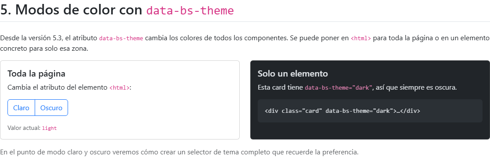

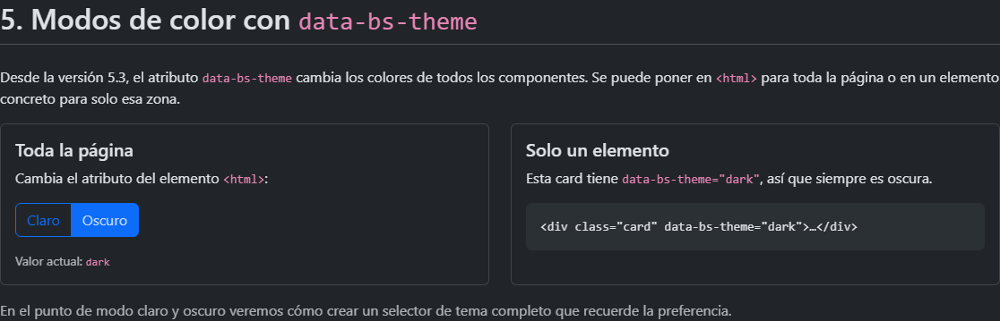

La card de la derecha tiene su propio `data-bs-theme="dark"`, por eso es oscura en los dos casos.

=== Práctica: la primera plantilla

. Crear una carpeta de proyecto y abrirla en VS Code.
. Crear un fichero `index.html` con la plantilla base.
. Abrirlo en el navegador y comprobar en F12 → Red que se cargan el CSS y el JS de Bootstrap.
. Añadir un párrafo con la clase `lead` y un botón con `class="btn btn-primary"`.
. Cambiar `data-bs-theme` a `dark` y observar qué cambia.
. _Opcional:_ instalar Bootstrap con npm y enlazar los ficheros de `node_modules` en lugar del CDN.

== Contenedores y breakpoints

Dónde empieza y acaba el contenido, en qué anchos cambia el diseño y por qué se piensa primero en el móvil.

=== ¿Qué es un contenedor?

El contenedor es el *elemento de maquetación más básico* de Bootstrap: una caja que envuelve el contenido, lo *centra* horizontalmente, le da un *ancho máximo* según el tamaño de pantalla y le añade un *relleno lateral* para que el texto no toque los bordes.

[source,html]
----
<body>
  

    <!-- todo el contenido aquí -->
  

</body>
----

Centrado:: `margin-left: auto; margin-right: auto`.
Ancho máximo:: `max-width` distinto en cada breakpoint.
Relleno lateral:: `0.75rem` por lado (la mitad del gutter de 1.5rem).
Imprescindible para la rejilla:: Las `.row` tienen márgenes negativos que el relleno del contenedor compensa.

NOTE: Los contenedores se pueden anidar, pero casi nunca hace falta.
Lo habitual es uno por sección (cabecera, contenido, pie) o uno solo para toda la página.

=== Los seis breakpoints

Un *breakpoint* (punto de ruptura) es un ancho de viewport a partir del cual el diseño puede cambiar.
Bootstrap 5 define seis, y cada uno tiene un *infijo* que aparece en el nombre de las clases (`col-**md**-6`, `d-**lg**-none`, `container-**xl**`…).

[cols="2h,1,1,2,2",options="header"]
|===
|Breakpoint |Infijo |Desde |Dispositivo típico |Ancho de `.container`

|Extra small |_ninguno_ |0 px |Móvil vertical |100 %
|Small |`sm` |576 px |Móvil horizontal |540 px
|Medium |`md` |768 px |Tablet |720 px
|Large |`lg` |992 px |Portátil |960 px
|Extra large |`xl` |1200 px |Escritorio |1140 px
|Extra extra large |`xxl` |1400 px |Pantalla grande |1320 px
|===

WARNING: *xs no tiene infijo.* No existe `col-xs-6` (sí existía en Bootstrap 3). Una clase sin infijo, como `col-6`, se aplica desde 0 px.

NOTE: *xxl es nuevo en Bootstrap 5.* Bootstrap 4 solo llegaba hasta xl (1200 px).

Los breakpoints se definen en Sass (mapa `$grid-breakpoints`), así que se pueden cambiar al compilar Bootstrap.
Desde la 5.3 también están expuestos como variables CSS (`--bs-breakpoint-md`, etc.), aunque solo como información: las variables CSS no funcionan dentro de una media query.

=== Tipos de contenedor

`.container`:: Ancho fijo que salta en cada breakpoint. Al 100 % solo en móvil (xs). El más habitual.
`.container-fluid`:: Siempre al 100 % del ancho. Para paneles, dashboards o bandas a ancho completo.
`.container-{breakpoint}`:: Al 100 % *hasta* ese breakpoint; a partir de él se comporta como `.container`.

.Ancho de cada contenedor según el breakpoint (px)
[cols="2m,1,1,1,1,1,1",options="header"]
|===
|Clase |xs (< 576) |sm (≥ 576) |md (≥ 768) |lg (≥ 992) |xl (≥ 1200) |xxl (≥ 1400)

|.container |*100 %* |540 |720 |960 |1140 |1320
|.container-sm |*100 %* |540 |720 |960 |1140 |1320
|.container-md |*100 %* |*100 %* |720 |960 |1140 |1320
|.container-lg |*100 %* |*100 %* |*100 %* |960 |1140 |1320
|.container-xl |*100 %* |*100 %* |*100 %* |*100 %* |1140 |1320
|.container-xxl |*100 %* |*100 %* |*100 %* |*100 %* |*100 %* |1320
|.container-fluid |*100 %* |*100 %* |*100 %* |*100 %* |*100 %* |*100 %*
|===

Los anchos fijos son `max-width` en píxeles. `.container` y `.container-sm` se comportan igual.

=== Los contenedores en cada breakpoint

En las capturas, cada banda punteada ocupa todo el ancho de la ventana y la zona coloreada es el contenedor.
Se ve en qué breakpoint deja cada uno de estar al 100 %.

.xs: ventana de 400 px
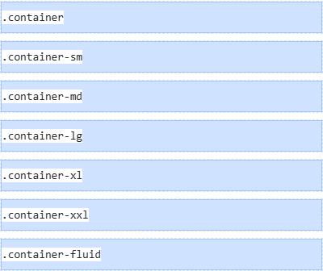

.sm: ventana de 600 px
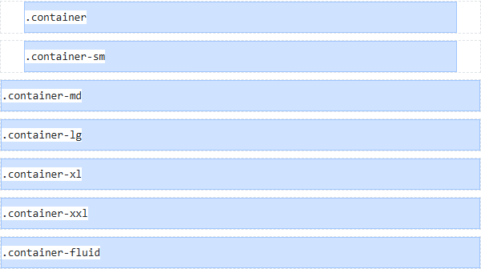

.md: ventana de 800 px
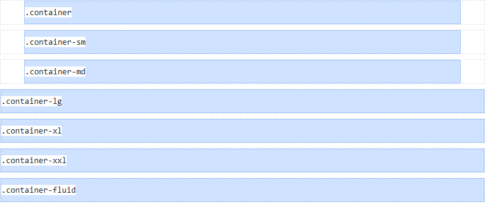

.lg: ventana de 1000 px
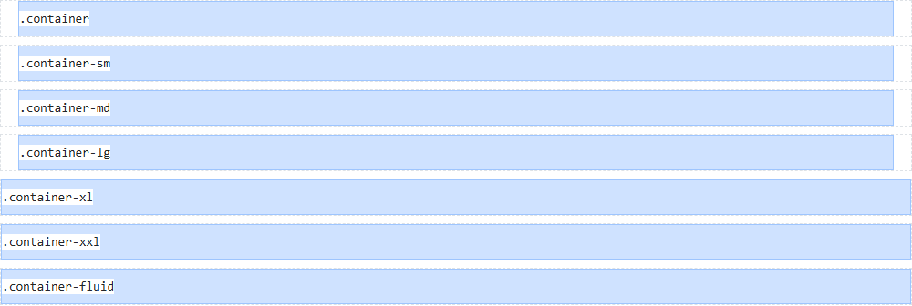

.xl: ventana de 1250 px
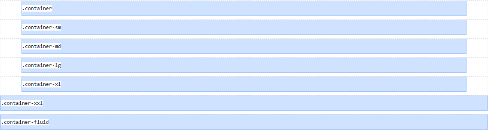

.xxl: ventana de 1450 px
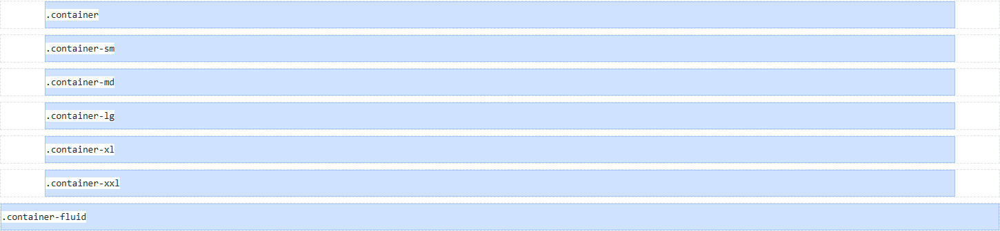

=== El enfoque mobile-first

Bootstrap se diseña *primero para el móvil* y luego se va ampliando para pantallas mayores.
Técnicamente significa que sus media queries usan `min-width`: una clase con infijo se aplica *desde ese breakpoint hacia arriba*, nunca hacia abajo.

Lo que hace Bootstrap por dentro (simplificado):

[source,css]
----
/* Sin infijo: desde 0 px (móvil) */
.text-center { text-align: center; }

/* md: desde 768 px hacia arriba */
@media (min-width: 768px) {
  .text-md-start { text-align: left; }
}
----

Cómo se usa en el HTML:

[source,html]
----

  Centrado en móvil, a la izquierda desde tablet

  Ancho completo → mitad → tercio

----

==== Cómo se lee una lista de clases responsive

. La clase *sin infijo* es el estilo base: el del móvil.
. Cada clase con infijo *sobrescribe* la anterior a partir de su breakpoint.
. Si un breakpoint no tiene clase, *hereda* la del breakpoint inferior más cercano.

El mismo párrafo con `text-center text-md-start text-xl-end` en tres anchos de ventana:

.xs (400 px): centrado
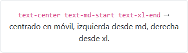

.md (800 px): a la izquierda
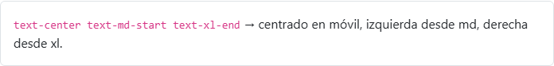

.xl (1250 px): a la derecha
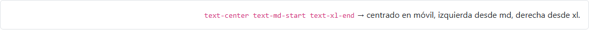

TIP: *Por qué mobile-first:* el móvil es la pantalla más limitada y hoy la más usada.
Partir de lo sencillo y añadir complejidad es más fácil que recortar un diseño de escritorio.

NOTE: *¿Y hacia abajo?* En Sass existe `media-breakpoint-down(md)`, que genera `max-width: 767.98px`.
Los `.98` evitan que dos media queries coincidan en el mismo píxel.

=== Práctica: contenedores y breakpoints

. Crear una página con tres bloques: cabecera con `.container-fluid`, contenido con `.container` y pie con `.container-lg`, cada uno con un color de fondo distinto.
. Redimensionar la ventana y anotar en qué anchos cambia cada bloque.
. Añadir un título con `text-center text-lg-start` y comprobar en qué breakpoint cambia la alineación.
. Mostrar un mensaje solo en móvil con `d-md-none` y otro solo desde tablet con `d-none d-md-block`.

== Flexbox y utilidades

Las utilidades son clases de Bootstrap que aplican *una sola propiedad CSS*.
Este capítulo cubre las de espaciado, que separan unos elementos de otros, y las de flexbox, que los colocan, reparten el espacio y los alinean.

=== Cómo se forma el nombre

El nombre tiene tres partes, siempre en este orden: *qué*, *dónde* y *cuánto*.

----
{qué}{dónde}-{cuánto}        p  y  - 2   →   py-2
----

[cols="1m,3",options="header"]
|===
|Qué |Significado
|p |`padding`: relleno, espacio por *dentro* del borde
|m |`margin`: margen, espacio por *fuera* del borde
|===

[cols="1m,2,2,3m",options="header"]
|===
|Dónde |Viene de |Significa |CSS equivalente (con `p`)
|t |**t**op |arriba |padding-top
|b |**b**ottom |abajo |padding-bottom
|s |**s**tart |donde empieza el texto (izquierda en español) |padding-left
|e |**e**nd |donde acaba el texto (derecha en español) |padding-right
|x |eje X |izquierda y derecha |padding-left + padding-right
|y |eje Y |arriba y abajo |padding-top + padding-bottom
|_(nada)_ | |los cuatro lados |padding
|===

`x` e `y` son los ejes de una gráfica: `x` el horizontal, `y` el vertical.

[cols="1m,2m,1",options="header"]
|===
|Cuánto |Valor |Con base de 16 px
|0 |0 |0
|1 |0.25rem |4 px
|2 |0.5rem |8 px
|3 |1rem |16 px
|4 |1.5rem |24 px
|5 |3rem |48 px
|auto |auto |solo para `margin`
|===

Todos los valores van en `rem`: si cambia el tamaño de letra base del navegador, el espaciado crece en proporción al texto.

Algunos ejemplos y su CSS equivalente:

[cols="1m,3m",options="header"]
|===
|Bootstrap |CSS normal
|p-3 |padding: 1rem;
|py-2 |padding-top: 0.5rem; padding-bottom: 0.5rem;
|px-5 |padding-left: 3rem; padding-right: 3rem;
|mt-5 |margin-top: 3rem;
|mb-3 |margin-bottom: 1rem;
|mx-auto |margin-left: auto; margin-right: auto;
|ms-auto |margin-left: auto;
|===

NOTE: Bootstrap declara estas utilidades con `!important`, para que ganen siempre a cualquier otra regla.
Los equivalentes de la tabla lo omiten.

WARNING: En Bootstrap 4 los lados eran `l` (_left_) y `r` (_right_): `pl-3`, `ml-auto`, `mr-2`.
En Bootstrap 5 ya no existen; ahora son `ps-3`, `ms-auto`, `me-2`.
Los ejemplos de Internet con `ml-auto` o `pr-3` son de Bootstrap 4.

En las capturas siguientes, la caja exterior es gris y el gris que asoma alrededor es el espaciado.
La caja de contenido va en verde si el espaciado lo pone una clase de Bootstrap y en azul si lo pone CSS normal.

=== La escala

Del 0 al 5. No es lineal: los saltos crecen (4, 8, 16, 24 y 48 px).

.De `p-0` a `p-5`
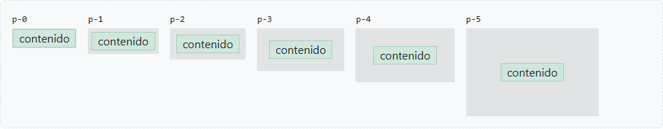

=== Los lados

La letra del medio dice dónde se aplica. `x` e `y` ahorran escribir dos propiedades.

.`py-2`, `px-5`, `pt-4` y `ps-5`, cada una con su equivalente en CSS
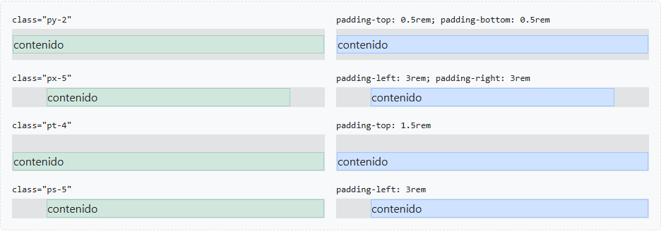

=== Margin

El margen es espacio por *fuera* del borde.
Para verlo, la caja de contenido va dentro de una caja gris: el gris que asoma alrededor es el margen.

.`m-3` y `mx-5`
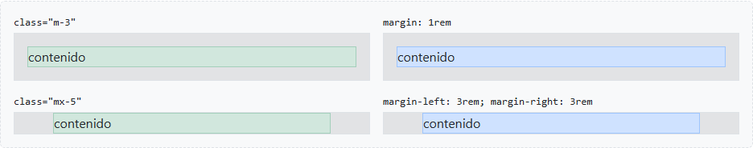

=== Margin auto

Con un ancho fijo, el margen automático reparte el espacio sobrante:

* `mx-auto`: el mismo margen a los dos lados, así que la caja queda *centrada*.
* `ms-auto`: todo el margen a la izquierda, así que la caja se va a la *derecha*.

Es la forma clásica de centrar un bloque.
Sin ancho no hace nada visible: un `div` ya ocupa todo el ancho y no sobra espacio que repartir.

.`mx-auto` y `ms-auto` en una caja de 150 px
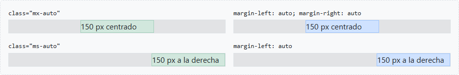

=== Start y end: por qué no se llaman left y right

`s` y `e` no significan izquierda y derecha, sino *donde empieza* y *donde acaba* el texto.
En español empieza a la izquierda, pero en árabe, hebreo, persa o urdu se escribe de derecha a izquierda y empieza a la derecha.

==== El atributo `dir`

El sentido de escritura se indica en el HTML con el atributo `dir`, normalmente una sola vez en `<html>`:

[source,html]
----
<html lang="ar" dir="rtl">
----

El navegador ordena por sí solo las letras árabes o hebreas dentro de una palabra, pero sin `dir="rtl"` la maquetación sigue siendo de izquierda a derecha:

* el texto queda alineado a la izquierda;
* los elementos de una línea se colocan de izquierda a derecha;
* `start` y `end` siguen significando izquierda y derecha.

`dir` se hereda, así que también puede ponerse en un único elemento.
Con `dir="auto"` el navegador decide según el primer carácter del texto, lo que resulta útil para contenido que escribe el usuario.

==== Propiedades lógicas de CSS

CSS tiene propiedades *lógicas* que dicen «al principio» o «al final» en lugar de «a la izquierda» o «a la derecha».
El navegador las traduce a un lado concreto según el `dir` del elemento:

[cols="2m,2m,2m",options="header"]
|===
|Propiedad lógica |Con `dir="ltr"` |Con `dir="rtl"`
|margin-inline-start |margin-left |margin-right
|margin-inline-end |margin-right |margin-left
|padding-inline-start |padding-left |padding-right
|padding-inline-end |padding-right |padding-left
|===

==== Ejemplo: un botón con una lupa

Un botón con una lupa delante del texto. Queremos separación *entre* la lupa y el texto, así que le ponemos a la lupa un margen al final.
En árabe la lupa aparece siempre a la derecha, porque ahí empieza el texto.
Lo que hay que mirar es el *hueco*: si queda entre la lupa y el texto, está bien; si la lupa se pega al texto, el margen se ha ido al lado de fuera.

[source,html]
----
<button dir="rtl">🔍بحث</button>
----

(بحث significa «buscar» en árabe.)

.La misma lupa en español y en árabe con `margin-inline-end`, `margin-right` y `me-3`
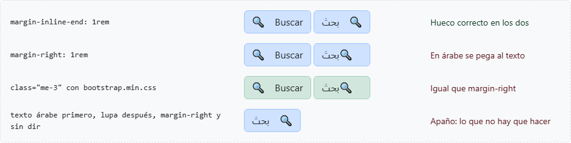

* `margin-inline-end`: hueco correcto en los dos idiomas.
* `margin-right`: en árabe la lupa se pega al texto.
* `me-3`: con `bootstrap.min.css` se comporta igual que `margin-right`.

==== Las dos hojas de estilos de Bootstrap

`me-3` no se adapta sola porque Bootstrap no usa propiedades lógicas en sus utilidades. Trae *dos hojas de estilos*:

[cols="2m,3m",options="header"]
|===
|Fichero |Regla
|bootstrap.min.css |.me-3 { margin-right: 1rem !important; }
|bootstrap.rtl.min.css |.me-3 { margin-left: 1rem !important; }
|===

Los nombres de las clases son los mismos en las dos.
Para una web en árabe se carga la versión rtl y se pone `<html dir="rtl">`: el HTML no cambia, solo la hoja de estilos.
Por eso las clases se llaman _start_ y _end_ y no _left_ y _right_.

IMPORTANT: Una web de derecha a izquierda con Bootstrap necesita las dos cosas:
`dir="rtl"` en `<html>`, para que el navegador coloque el texto y los elementos, y `bootstrap.rtl.min.css`, para que las clases de espaciado vayan al lado correcto.

=== Espaciado responsive

Igual que en los contenedores, se puede añadir un breakpoint en medio del nombre:

----
{qué}{dónde}-{breakpoint}-{cuánto}     p-md-5
----

Es mobile-first: `p-2 p-md-5` aplica `p-2` en móvil y, a partir de md (768 px), `p-5`.
En CSS normal no basta con un `style=""`: hace falta una media query.

[source,css]
----
.relleno-responsive {
  padding: 0.5rem;
}

@media (min-width: 768px) {
  .relleno-responsive {
    padding: 3rem;
  }
}
----

.xs: `p-2`
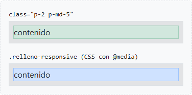

.md: `p-5`
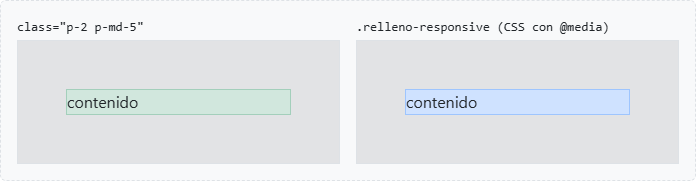

=== Flexbox: contenedor, ejes y dirección

Flexbox es CSS puro: coloca elementos en fila o en columna, reparte el espacio entre ellos y los alinea.
Bootstrap solo le pone clases.
La propia rejilla está hecha con flexbox: `.row` es un contenedor flex.

Siempre hay *dos niveles*:

* *Contenedor flex*: el elemento con `d-flex` (`display: flex`).
* *Elementos flex*: sus hijos directos, que pasan a colocarse en fila.

Y *dos ejes*:

* *Eje principal*: la dirección en la que se colocan los elementos (en fila, el horizontal). Lo controla `justify-content`.
* *Eje cruzado*: el perpendicular (en fila, el vertical). Lo controla `align-items`.

Si la dirección cambia a columna, los ejes se intercambian.

[cols="2m,2m,3",options="header"]
|===
|Bootstrap |CSS |Efecto
|d-flex |display: flex |Los hijos se colocan uno al lado del otro
|d-inline-flex |display: inline-flex |Igual, pero el contenedor solo ocupa lo que su contenido
|flex-row |flex-direction: row |En fila (por defecto)
|flex-column |flex-direction: column |En columna: los ejes se intercambian
|flex-row-reverse |flex-direction: row-reverse |Fila con el orden visual invertido
|flex-column-reverse |flex-direction: column-reverse |Columna con el orden visual invertido
|===

.Sin `d-flex`, con `d-flex` y con `flex-row-reverse`
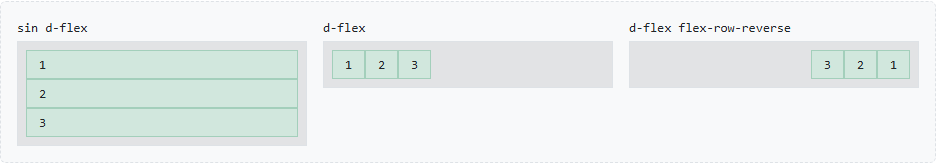

=== Reparto en el eje principal: `justify-content-*`

Decide qué se hace con el espacio que sobra en la fila.

[cols="2m,2m,3",options="header"]
|===
|Bootstrap |CSS |Efecto
|justify-content-start |justify-content: flex-start |Todo al principio (por defecto)
|justify-content-end |justify-content: flex-end |Todo al final
|justify-content-center |justify-content: center |Todo en el centro
|justify-content-between |justify-content: space-between |Primero y último pegados a los bordes, el resto repartido
|justify-content-around |justify-content: space-around |El mismo espacio alrededor de cada uno (en los bordes, la mitad)
|justify-content-evenly |justify-content: space-evenly |Todos los huecos iguales, también los de los bordes
|===

.Los seis valores de `justify-content`
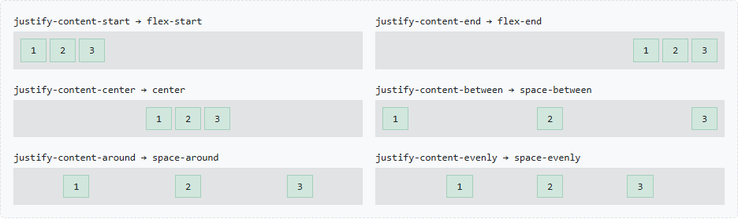

=== Alineación en el eje cruzado: `align-items-*`

En fila, el eje cruzado es el vertical: para que se note, el contenedor necesita más altura que sus elementos.

[cols="2m,2m,3",options="header"]
|===
|Bootstrap |CSS |Efecto
|align-items-stretch |align-items: stretch |Estirados a toda la altura (por defecto)
|align-items-start |align-items: flex-start |Arriba
|align-items-center |align-items: center |Centrados en vertical
|align-items-end |align-items: flex-end |Abajo
|align-items-baseline |align-items: baseline |Alineados por la línea base del texto
|===

.Los valores de `align-items` y el centrado en las dos direcciones
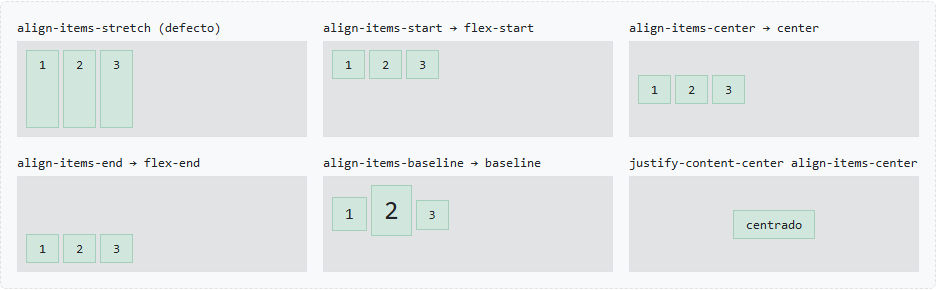

TIP: `justify-content-center align-items-center` centra un elemento en las dos direcciones.
Es la forma más sencilla de centrar algo en CSS.

=== Hueco y salto de línea: `gap-*` y `flex-wrap`

`gap-*` separa los elementos entre sí, pero no de los bordes del contenedor.
Usa la escala del espaciado (`gap-3` = `gap: 1rem`) y es mejor que poner margen a cada elemento: no deja hueco sobrante al final.
También existen `row-gap-*` y `column-gap-*` para separar en una sola dirección.

Por defecto (`flex-nowrap`) todos los elementos se quedan en la misma línea aunque no quepan: se encogen o se salen del contenedor.
Con `flex-wrap` (`flex-wrap: wrap`) los que no caben bajan a la línea siguiente.
`.row` lleva `flex-wrap`: por eso las columnas que no caben bajan de línea.

.`gap-3` y `flex-wrap`
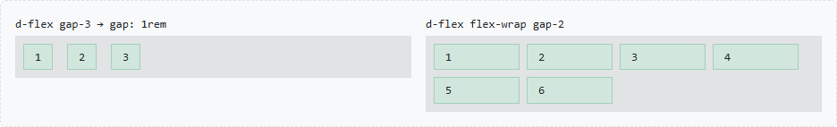

=== Clases para un elemento

Las clases anteriores van en el contenedor; estas van en un elemento concreto.

[cols="2m,2m,3",options="header"]
|===
|Bootstrap |CSS |Efecto
|flex-grow-1 |flex-grow: 1 |El elemento se queda con el espacio sobrante
|flex-shrink-0 |flex-shrink: 0 |El elemento no se encoge aunque falte sitio
|ms-auto |margin-left: auto |Empuja el elemento y los siguientes hasta el final
|align-self-* |align-self |Alinea solo ese elemento en el eje cruzado
|order-* |order |Cambia su posición visual
|===

.`flex-grow-1`, `ms-auto` y `align-self-end`
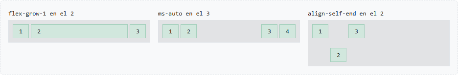

NOTE: `ms-auto` dentro de un contenedor flex es el truco típico de las barras de navegación: logo a la izquierda y enlaces a la derecha, sin `justify-content`.

=== Flexbox responsive

Casi todas las clases admiten breakpoint: `d-md-flex`, `flex-md-row`, `justify-content-lg-between`…
Caso típico: en columna en móvil y en fila a partir de md.

[source,html]
----

…

----

[source,css]
----
.fila-responsive {
  display: flex;
  flex-direction: column;
}

@media (min-width: 768px) {
  .fila-responsive {
    flex-direction: row;
  }
}
----

.xs: en columna
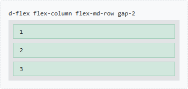

.md: en fila
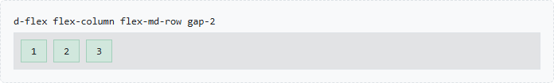

=== Práctica: flexbox y utilidades

. Crear una caja con un título y un párrafo, y darle relleno con `p-*` hasta que el texto respire.
. Separar varias cajas seguidas con `mb-*` en lugar de ` `.
. Centrar una caja de 300 px de ancho con `mx-auto`.
. Hacer que el relleno sea pequeño en móvil y grande desde lg.
. Maquetar una barra con un logo a la izquierda y tres enlaces a la derecha usando `d-flex` y `ms-auto`.
. Rehacerla con `justify-content-between` y comparar.
. Centrar un texto en una caja de 300 px de alto en las dos direcciones.
. Hacer que la barra pase a columna en móvil con `flex-column flex-md-row`.
. Escribir el CSS normal equivalente de cada clase usada.

== Sistema de rejilla

Filas y columnas sobre flexbox: doce columnas que se reparten, se recolocan y se adaptan a cada breakpoint.

En las capturas de este capítulo, las cajas de color son el contenido de cada columna, y el hueco entre ellas es el _gutter_.

=== Filas y columnas

La rejilla de Bootstrap divide el ancho disponible en *12 columnas* y está construida con *flexbox*.
Siempre tiene la misma estructura de tres niveles:

[source,html]
----

      <!-- 1. contenedor -->
  
          <!-- 2. fila -->
    
…
 <!-- 3. columnas -->
    
…

  

----

`.row`:: Contenedor flex (`display: flex; flex-wrap: wrap`). Agrupa columnas en horizontal.
`.col-*`:: Hijos directos de la fila. Solo ellos pueden ser hijos de `.row`.
El contenido:: Va siempre _dentro_ de las columnas, nunca directamente en la fila.

==== Cómo se forma el hueco entre columnas

Cada columna tiene un relleno lateral de la mitad del gutter: 0.75rem por lado, 1.5rem entre dos columnas.
La fila tiene un margen negativo del mismo tamaño para que la primera y la última columna queden alineadas con el borde del contenedor.

.Tres columnas `.col` con el gutter por defecto
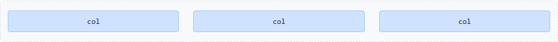

IMPORTANT: Una `.row` debe ir dentro de un contenedor (o de otra columna): si no, su margen negativo provoca scroll horizontal.

=== Columnas automáticas

`.col` sin número:: Todas las columnas se reparten el espacio *a partes iguales*, sean cuantas sean.
`.col-auto`:: La columna mide *lo que mida su contenido*. Las `.col` restantes se reparten lo que sobra.

.Dos y cinco columnas `.col`
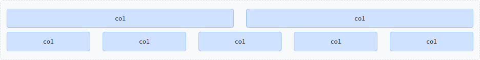

[source,html]
----

  
…
  <!-- ancho del contenido -->
  
…
       <!-- el resto del espacio -->
  
…

----

.`.col-auto` a los lados y `.col` en el centro
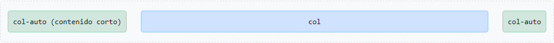

=== Columnas de ancho fijo

`.col-{n}` ocupa *n de las 12 columnas*. El ancho es un porcentaje: `col-4` = 4/12 = 33,33 %.
Se pueden mezclar con `.col`, que se reparten lo que quede.

.`col-4 + col-8`, `col-3 + col-6 + col-3` y `col-6 + col + col`
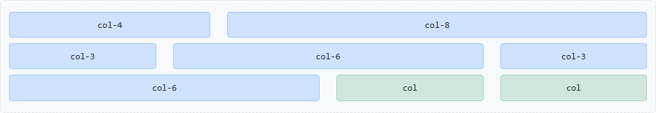

*Si la suma pasa de 12*, las columnas que no caben bajan a una nueva línea (`flex-wrap: wrap`):

.`col-9 + col-4`: 13 columnas, la segunda baja
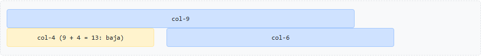

TIP: Para forzar un salto de línea sin cerrar la fila: `

` entre dos columnas.

=== Clases responsive

`.col-{breakpoint}-{n}` aplica el ancho *desde ese breakpoint hacia arriba* (mobile-first).
Por debajo, si no hay otra clase, la columna ocupa el 100 % y las columnas se *apilan*.

[source,html]
----

  
…

  
…

  
…

  
…

----

[cols="2m,1,1,1",options="header"]
|===
|Clases |xs / sm |md / lg |xl / xxl
|col-12 col-md-6 col-xl-3 |1 por fila |2 por fila |4 por fila
|===

.xs (400 px): apiladas
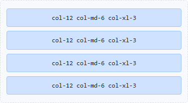

.md (800 px): dos por fila
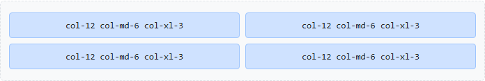

.xl (1250 px): cuatro por fila
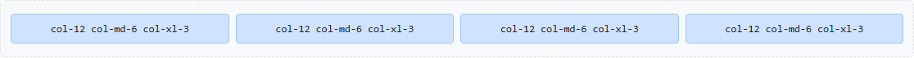

`.col-{breakpoint}` sin número: columnas iguales desde ese breakpoint y apiladas por debajo.

.`.col-md` en xs (apiladas) y en md (en fila)
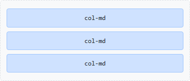

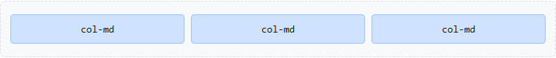

WARNING: *Error típico:* pensar que `col-md-6` es «media columna solo en tablet».
Es media columna *desde* tablet: también en portátil y escritorio.

=== Offset: desplazar columnas

`.offset-{n}` y `.offset-{breakpoint}-{n}` añaden un margen izquierdo de *n columnas*.
Útil para centrar o dejar huecos sin columnas vacías.

.`col-4 offset-4`, `col-6 offset-3` (centrada) y `col-md-6 offset-md-3`
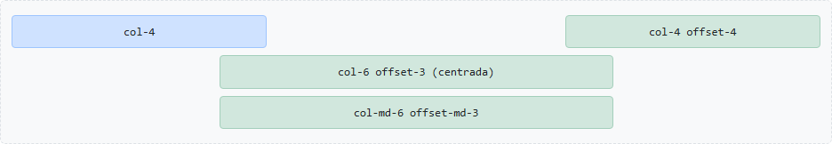

Alternativa con márgenes automáticos de flexbox: `ms-auto` empuja la columna hacia la derecha.

.`col-3` y `col-3 ms-auto`
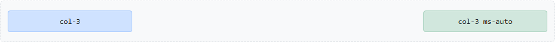

=== Order: cambiar el orden visual

Las columnas se muestran en el orden del HTML.
Con `.order-{0..5}`, `.order-first` y `.order-last` (y sus versiones responsive) cambiamos el orden *visual* sin tocar el HTML.

[source,html]
----

  
1º en el HTML

  
2º en el HTML

  
3º en el HTML

----

.xs: la segunda columna sube la primera
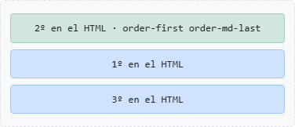

.md: la segunda columna pasa a ser la última
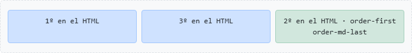

Caso típico: en móvil, el contenido principal antes que la barra lateral.

CAUTION: *Accesibilidad:* `order` solo cambia lo que se ve.
Lectores de pantalla y navegación con tabulador siguen el orden del HTML, así que el HTML debe tener ya un orden lógico.

=== Gutters: el espacio entre columnas

El gutter por defecto es de *1.5rem* (24 px) en horizontal y 0 en vertical.
Se cambia *en la fila* con una escala de 0 a 5:

[cols="1m,2",options="header"]
|===
|Clase |Afecta a
|g-{n} |Horizontal y vertical
|gx-{n} |Solo horizontal (entre columnas)
|gy-{n} |Solo vertical (entre líneas)
|g-md-{n}… |Versiones responsive
|===

[cols="1,2",options="header"]
|===
|n |Valor
|0 |0
|1 / 2 / 3 |0.25rem / 0.5rem / 1rem
|4 |1.5rem (el de por defecto en horizontal)
|5 |3rem
|===

.`g-0`: sin hueco
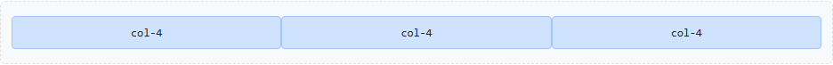

.`g-5`: hueco grande en las dos direcciones
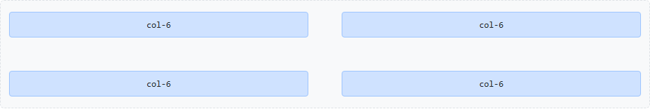

.`gx-1 gy-4`: poco hueco horizontal, mucho vertical
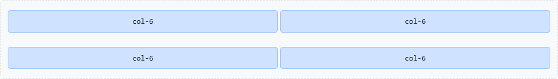

NOTE: Sin `gy-*`, al apilarse en móvil las columnas quedan pegadas una encima de otra.
`g-*` o `gy-*` es la forma correcta de separarlas, mejor que añadir márgenes a cada columna.

=== `row-cols-*`: columnas por fila

En lugar de dar ancho a cada columna, `.row-cols-{n}` en la *fila* indica *cuántas columnas caben por línea*.
Las columnas solo llevan `.col`. Ideal para listas de elementos iguales: cards, productos, galerías.

[source,html]
----

  
…
  <!-- 1 por fila en xs, 2 desde sm, 4 desde lg -->
  …

----

.xs: una por fila
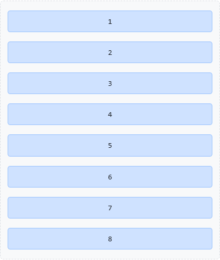

.sm: dos por fila
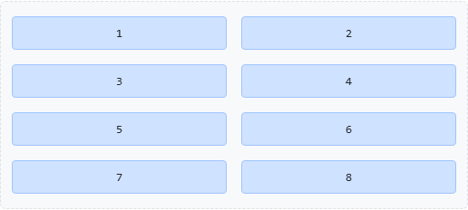

.lg: cuatro por fila
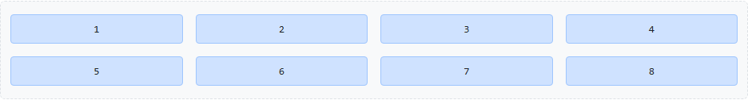

Admite de `row-cols-1` a `row-cols-6` y `row-cols-auto` (cada columna con el ancho de su contenido).

=== Anidado

Dentro de una columna podemos poner una *nueva `.row`*, que vuelve a tener 12 columnas *relativas al ancho de esa columna*, no al de la página.
No hace falta otro contenedor.

[source,html]
----

  

    
            <!-- nueva fila: 12 columnas dentro de las 8 -->
      
…

      
…

    

  

  
…

----

.Dos `col-6` anidadas dentro de una `col-md-8`
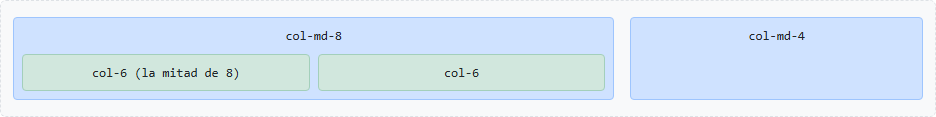

=== Práctica: tres layouts

==== Layout 1: blog con contenido y barra lateral

Contenido de 8 columnas y lateral de 4 desde lg; apilados en móvil con el contenido primero.

[source,html]
----

  
Cabecera

  
Artículo

  
Lateral

  
Pie

----

.Layout de blog en xs y en lg
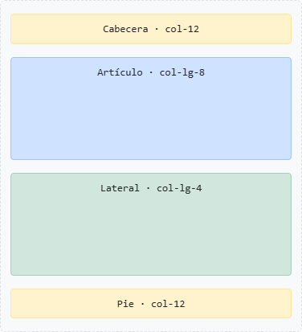

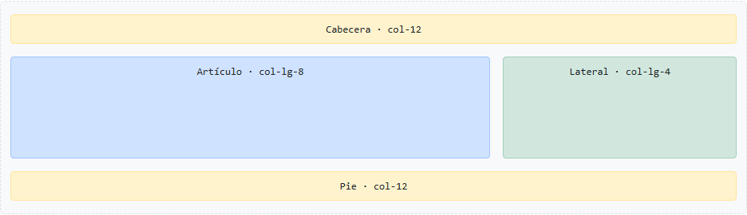

==== Layout 2: catálogo de productos

Un producto por fila en móvil, 2 desde sm, 3 desde md y 4 desde xl, con `row-cols-*` y `g-*`.

[source,html]
----

  
Producto 1

  …

----

.Catálogo en sm y en xl
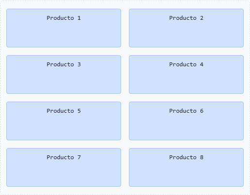

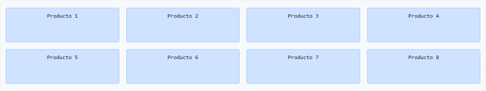

==== Layout 3: panel con menú, contenido y avisos

Tres columnas desde lg (2 + 7 + 3). En móvil el contenido va primero con `order`; el contenido tiene una rejilla anidada con tarjetas de datos.

[source,html]
----

  
Menú

  

    Contenido
    

      
Dato 1

      
Dato 2

      
Dato 3

    

  

  
Avisos

----

.Panel en xs y en lg

==== Ejercicio

. Maquetar los tres layouts en páginas separadas, con cajas de color en lugar de contenido real.
. Comprobar cada uno en xs, md y xl con el modo dispositivo de F12.
. En el layout 1, hacer que el lateral pase a la izquierda desde lg sin cambiar el HTML.
. En el layout 2, quitar `g-3` y observar qué ocurre al apilarse en móvil.
. En el layout 3, centrar el bloque de datos en una columna de 6 con `offset` en lugar de tres datos.

== Referencias

* https://getbootstrap.com/docs/5.3/getting-started/introduction/[Documentación oficial de Bootstrap 5.3]
* https://getbootstrap.com/docs/5.3/layout/containers/[Containers]
* https://getbootstrap.com/docs/5.3/layout/breakpoints/[Breakpoints]
* https://getbootstrap.com/docs/5.3/customize/color-modes/[Color modes]
* https://getbootstrap.com/docs/5.3/layout/grid/[Grid system]
* https://getbootstrap.com/docs/5.3/layout/columns/[Columns]
* https://getbootstrap.com/docs/5.3/layout/gutters/[Gutters]
* https://getbootstrap.com/docs/5.3/utilities/spacing/[Spacing]
* https://getbootstrap.com/docs/5.3/getting-started/rtl/[RTL]
* https://getbootstrap.com/docs/5.3/utilities/flex/[Flex]
